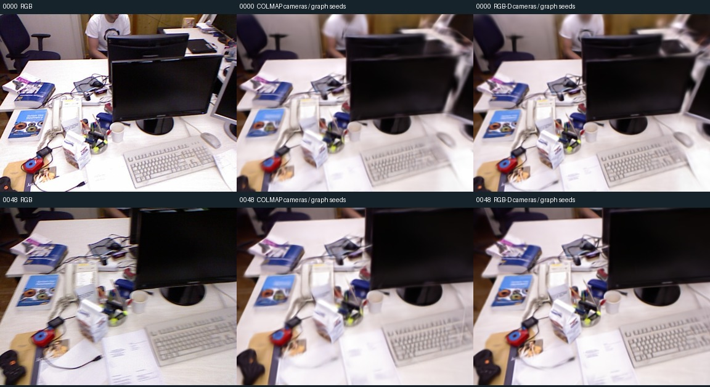

# 同一相机模型下分开验证外参与深度初始点

TUM freiburg1_xyz 上，整个 COLMAP 流程比 RGB-D 精化高 1.32 dB。两者同时改变了内参、图像去畸变、外参和初始点来源。这里保留深度相机的原始照片、默认针孔内参和训练深度像素，分别替换训练相机的外参和生成初始点的外参。四组对照中，替换成 COLMAP 外参均降低了留出画质。直接移植外参的方案未采用。[完整流程基线](RGBD-XYZ.md) · [逐图评分与模型配置](benchmarks/rgbd-extrinsics.json)

## 实拍结果

96 张 RGB 和对应配准深度全部进入两种求姿流程，失败 0 张。冻结既有轨迹，COLMAP 单目的尺度和世界坐标系只用 84 张训练相机的中心对齐到 RGB-D。随后将全部 96 个外参转换到同一坐标系。12 张留出照片参与上游求姿，未参与坐标系拟合、高斯训练或深度初始点生成。四组统一 640×480、焦距 525、主点 (319.5, 239.5)，原图固定深度像素 12,604 个。使用同一 Brush 0.3.0 Metal、种子 42、1000 步、512 长边、15 万高斯上限。逐张在完整 512×384 原图上评分，再取均值。[COLMAP 位姿格式](https://colmap.github.io/format.html) · [TUM 数据与标定](https://cvg.cit.tum.de/data/datasets/rgbd-dataset/file_formats)

| 训练相机 | 生成深度初始点的位姿 | PSNR / SSIM | 实际高斯 | SH3 PLY 字节 | 训练导出（秒） |
| --- | --- | ---: | ---: | ---: | ---: |
| COLMAP | COLMAP | 20.617 / 0.72814 | 19,825 | 4,680,250 | 9.70 |
| RGB-D 精化 | COLMAP | 21.563 / 0.77545 | 20,180 | 4,764,030 | 9.46 |
| COLMAP | RGB-D 精化 | 20.538 / 0.72716 | 19,779 | 4,669,394 | 9.50 |
| RGB-D 精化 | RGB-D 精化 | 21.630 / 0.77941 | 20,513 | 4,842,618 | 9.45 |

在两份分别固定的初始几何上，RGB-D 训练相机分别高 0.95 和 1.09 dB，逐图分别有 9/12、10/12 张提高。固定训练相机时，改用 RGB-D 位姿生成深度点的均值变化为 −0.080 和 +0.068 dB。此结果只覆盖同一批深度像素的两套世界坐标，COLMAP 三角化稀疏点本身未参与这四组对照。



图中两列重建使用同一套初始点。第 0 帧的显示器外框和键盘在 RGB-D 外参下更清晰，两组都难以辨认书封小字。此次检查固定视角。训练及导出使用预热 GPU 串行运行，每组一次，准备深度点与场景文件各用 0.12–0.13 秒。求姿使用上轮缓存，耗时见基线；本轮没有独立端到端测速。初次写报告时比例值的 JSON 序列化失败，修正标量转换后在独立目录完成四组训练。

## 复现

先按基线文档生成 xyz 的 RGB-D 与全配对 COLMAP 结果，再运行下列命令。脚本核对归档导入照片与两套求姿输入的摘要、留出照片名和渲染尺寸。运动捕捉真值不参与拟合与训练。

```sh
.venv/bin/python -m scripts.benchmark_rgbd_extrinsics \
  --archive .samples/archives/tum-freiburg1-xyz.tgz --sequence freiburg1_xyz \
  --graph .data/benchmarks/xyz-reproduction/graph.json \
  --colmap .data/benchmarks/xyz-colmap --out .data/benchmarks/xyz-extrinsics
```

下一步检验相机成像模型和照片的像素对应关系。TUM 提醒配准深度已经过 OpenNI 处理，直接套用彩色相机去畸变需要单独验证。TUM RGB-D 原始数据和上图的衍生图像按 CC BY 4.0 使用。[数据作者与许可](../THIRD_PARTY_NOTICES.md) · [RGB-D 全局一致性研究](https://arxiv.org/abs/2506.00970)
