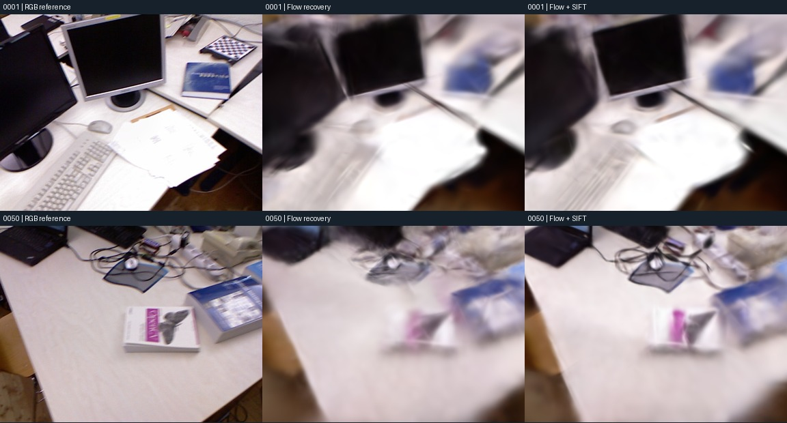

# RGB-D 光流失效时的图像重定位

TUM desk 的 96 张 RGB 照片中，单向光流在第 30 至 55 帧连续失去跟踪。允许从两侧已定位帧补算能注册 94 张，但在共同的 94 张上，与运动捕捉轨迹相比，位置均方根误差达到 12.40 厘米。光流内点少于 50 时增加 SIFT 匹配，保留内点更多的 PnP 解，96 张全部定位。相同 94 张的误差降至 3.79 厘米，姿态误差中位数由 7.44° 降到 2.16°。保留为有配准深度输入的离线实验。[逐帧关联、评分和训练记录](benchmarks/rgbd-odometry.json)

## 位姿

使用同一个任务冻结的 640×480 RGB 序列。按时间差最多 20 毫秒一对一匹配到 93 张深度图，传感器轴向深度单位为 1/5000 米。按 TUM 的预配准说明取针孔内参 fx=fy=525、cx=319.5、cy=239.5。每次最多跟踪 1000 个 Shi–Tomasi 角点，光流往返误差小于 1 像素，深度在 0.25 至 5 米之间。PnP 采用 2.5 像素的 RANSAC 阈值，至少 12 个内点后做 LM 精化。候选最多提取 1200 个 SIFT 特征，最近邻距离比阈值 0.75。两种补算均只搜索前后 5 个采样位置。[OpenCV 4.13 PnP](https://docs.opencv.org/4.13.0/d5/d1f/calib3d_solvePnP.html) · [TUM 标定和真值格式](https://cvg.cit.tum.de/data/datasets/rgbd-dataset/file_formats)

| 方法 | 注册 | 未定位帧（从 0 编号） | CPU 求姿（秒） | 位置 RMSE / P90（厘米） | 旋转中位数 / P90 |
| --- | ---: | --- | ---: | ---: | ---: |
| 单向光流 | 67/96 | 0–2、30–55 | 0.93 | 5.07 / 6.06 | 3.67° / 4.90° |
| 光流双向补算 | 94/96 | 0、30 | 1.61 | 12.40 / 23.29 | 7.44° / 24.23° |
| 光流加 SIFT | 96/96 | 无 | 1.00，复核 0.97 | 3.81 / 5.25 | 2.20° / 4.14° |
| 历史 RGB-only COLMAP | 96/96 | 无 | 40.46（完整 SfM） | 2.11 / 2.92 | 1.23° / 1.90° |

表内误差按各自注册集合计算。RGB-D 使用刚体轨迹对齐并保留米制尺度。单目 COLMAP 允许相似变换，含一个全局尺度因子。两者均在求姿完成后与 TUM 独立运动捕捉数据配对。候选的 95 条有效连接中有 6 条使用 SIFT。求姿计时包含灰度照片解码、特征、PnP 和补算，之前读取及解压深度图另耗 1.94–2.01 秒。历史 COLMAP 的 40.46 秒包含特征提取、匹配、建图和去畸变，两项耗时覆盖的工作及传感器输入不同。[历史 TUM 测试](TUM-DESK.md)

## 留出重建

两组只取共同的 94 张，以相同顺序每 8 张留一张。82 张训练、12 张留出，留出照片参与求姿。初始化只在训练视角取深度和颜色，两组使用完全相同的 11,937 个观测像素。相机模型、针孔内参、图名和原照片相同，每组使用各自估计的外参。Brush 0.3.0 在本机 Metal 串行训练，1000 步、种子 42、长边 512、上限 150,000 个高斯、完整 SH3。反序复测复用各自的位姿，重新训练模型。

| 顺序 / 方法 | 实际高斯 | PLY 字节 | 数据准备 / 训练导出（秒） | 原始照片域 PSNR / SSIM |
| --- | ---: | ---: | ---: | ---: |
| 首轮 / 光流补算 | 21,323 | 5,033,778 | 0.118 / 9.92 | 17.558 / 0.64282 |
| 首轮 / 加 SIFT | 21,231 | 5,012,066 | 0.118 / 9.85 | 18.561 / 0.67724 |
| 反序 / 加 SIFT | 21,228 | 5,011,358 | 0.117 / 9.75 | 18.532 / 0.67600 |
| 反序 / 光流补算 | 21,305 | 5,029,530 | 0.118 / 9.81 | 17.578 / 0.64304 |

评分将同名原照片用 Lanczos 缩至 512×384，逐图计算 RGB PSNR 和 11×11 高斯窗 SSIM 后取平均。两种训练顺序下的增益分别为 1.003 和 0.954 dB。首轮按深度解包、求姿、准备、训练导出四段求和，光流补算约 13.65 秒，候选约 12.91 秒。分段命令之间的等待、真值评分和文件导入未纳入计时，尚无产品端到端测速。



第 50 帧上，候选还原了鼠标线与底座的大致轮廓，白盒文字仍模糊。第 1 帧键盘按键在两组模型中都难以辨认。自由漫游下的漂浮物与空洞仍待检查。本轮仅覆盖一个带深度的桌面场景。ETH3D office 与 pipes 的纯照片结果沿用前次验证。下一步检验跨帧几何约束能否缩小和 COLMAP 之间的轨迹误差。[纯照片对照](RETRY-FEATURES.md) · [RGB-D 重定位相关研究](https://arxiv.org/abs/2506.00970)

## 复现

使用已准备的 TUM desk 重建任务，其输入目录须保留有序照片和原始时间戳。将下面的环境变量指向该任务、官方压缩包和新的输出目录。离线求姿需要 OpenCV 4.13（OpenCV 团队，Apache-2.0）。实验使用本机可选的 opencv-python-headless 环境。常规照片重建无需安装该依赖。

```sh
for mode in forward recover hybrid; do
  .venv/bin/python -m scripts.benchmark_rgbd_odometry --data "$data" --job "$job" \
    --archive "$archive" --mode "$mode" --out "$run/$mode"
done
.venv/bin/python -m scripts.benchmark_rgbd_training --data "$data" --job "$job" \
  --archive "$archive" --baseline "$run/recover/poses.json" \
  --candidate "$run/hybrid/poses.json" --out "$run/models"
```

交换两份位姿文件并选新输出目录即可反序复测。训练入口核对 RGB 文件 SHA-256、时间戳和相机矩阵。TUM desk 与本文衍生图片遵循 CC BY 4.0，原作者为 Jürgen Sturm、Nikolas Engelhard、Felix Endres、Wolfram Burgard 和 Daniel Cremers。[作者与许可](../THIRD_PARTY_NOTICES.md) · [OpenCV 源码与许可](https://github.com/opencv/opencv/tree/4.13.0)
