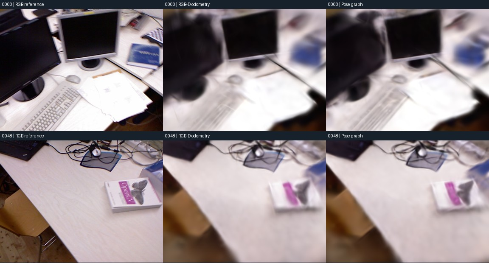

# 96 帧 RGB-D 实拍的跨帧位姿精化

TUM desk 上用粗位姿寻找回到相近位置、朝向相近的照片。69 对候选中有 33 对通过图像匹配和深度 PnP 验证。米制轨迹位置 RMSE 从 3.81 厘米降到 2.51 厘米，旋转中位误差从 2.20° 降到 1.25°。96 张全部定位。保留为离线 RGB-D 实验的 `--mode graph`。[逐对验证、轨迹评分及四份模型指标](benchmarks/rgbd-pose-graph.json)

## 输入与方法

沿用同一批 TUM desk 原照片、93 张有时间对应的深度图和固定针孔内参。源帧必须有深度，候选间隔至少 8 个采样位置，粗位姿距离小于 35 厘米、视轴夹角小于 35°。每个目标最多提名一对，去除反向重复。35 个以上 SIFT 匹配内点、与初值相差不超过 20 厘米和 12° 才加入图。原跟踪边与新边按内点数加权，上限 80。固定第一张有深度帧，用最小二乘拟合相机旋转并投影到 SO(3)，再拟合位置。运动捕捉真值仅在位姿文件落盘后用于评分。[RGB-D 基线与标定](RGBD-ODOMETRY.md) · [相关 RGB-D 全局一致性研究](https://arxiv.org/abs/2506.00970) · [OpenCV PnP](https://docs.opencv.org/4.13.0/d5/d1f/calib3d_solvePnP.html)

| 同一批 96 张 | RGB-D 粗位姿 | RGB-D 加跨帧约束 | 历史纯 RGB COLMAP |
| --- | ---: | ---: | ---: |
| 相机位置 RMSE / P90（厘米） | 3.81 / 5.25 | 2.51 / 3.66 | 2.11 / 2.92 |
| 旋转误差中位数 / P90 | 2.20° / 4.14° | 1.25° / 2.18° | 1.23° / 1.90° |

正式入口总求姿 2.60 秒，含跨帧精化 1.51 秒，深度解包另耗 1.95 秒。历史纯 RGB 的 40.46 秒覆盖完整稀疏重建和去畸变，其输入与处理范围不同。当前采用稠密最小二乘，仅测了短序列；长轨迹的时间、内存与错误闭环仍待验证。

## 实拍重建

以共同的 96 个相机训练，其中 84 张用于训练，12 张留出。两组使用相同的 12,068 个训练照片深度像素、相机内参、图像和评分范围。留出照片仅参与上游求姿。Brush 0.3.0 在 Metal 上串行执行，1000 步、长边 512、最多 150,000 个高斯、SH3，原图评分 512×384。这里的留出集合与 94 张交集实验不同。

| 顺序 / 方法 | 实际高斯 / PLY 字节 | 准备 / 训练导出（秒） | 同原照片域 PSNR / SSIM |
| --- | ---: | ---: | ---: |
| 首轮 / 粗位姿 | 21,447 / 5,063,042 | 0.21 / 10.36 | 17.470 / 0.65003 |
| 首轮 / 跨帧精化 | 21,640 / 5,108,590 | 0.12 / 10.97 | 18.986 / 0.70237 |
| 反序 / 跨帧精化 | 21,610 / 5,101,510 | 0.13 / 10.05 | 19.027 / 0.70155 |
| 反序 / 粗位姿 | 21,443 / 5,062,098 | 0.12 / 10.07 | 17.476 / 0.64984 |

首轮精化各段合计约 15.64 秒（含一次归档读取、求姿、准备和训练导出），尚未计入产品导入、下载和命令启动开销。四次模型均独立训练，第 0、48 帧的线缆轮廓尚可辨认，盒面文字仍模糊，单个视角的局部效果会波动。独立平移序列已使用相同参数复测。[xyz 结果](RGBD-XYZ.md)。[参考的纯照片固定基准](RETRY-FEATURES.md)

按[粗位姿实验](RGBD-ODOMETRY.md)的命令先运行 `hybrid`，再以 `--mode graph` 生成新的输出目录。把两份 `poses.json` 传给相同的训练对照入口，无需提供外部真值作为初值。TUM desk 数据及衍生图来自 Jürgen Sturm 等，CC BY 4.0。[署名与许可](../THIRD_PARTY_NOTICES.md) · [基线提交](https://github.com/sakorman/web-scan/commit/6edee2d)
