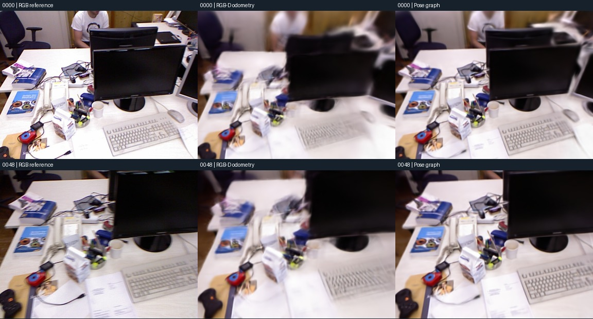

# 独立平移轨迹上的 RGB-D 位姿与留出画质

将 desk 上的参数原样用于 TUM freiburg1_xyz。96 张照片全部定位，有 95 个时间戳能在 20 毫秒内匹配独立运动捕捉参考（第 24 帧缺少对应真值）。加入跨帧约束后，位置均方根误差从 5.42 降到 1.91 厘米，12 张留出照片的平均 PSNR 从 17.57 升到 21.71 dB。相同照片上的纯 RGB COLMAP 仍有更低的位置误差与更高的留出画质。[逐帧数据、相机与训练记录](benchmarks/rgbd-xyz.json) · [desk 上固定的参数](RGBD-POSE-GRAPH.md)

## 数据与计时

从官方归档的时间有序照片中等间隔选 96 张，包含首尾。每张都有配准深度。xyz 序列以平移为主，转动较小。沿用固定针孔内参（640×480、焦距 525 像素、主点 319.5/239.5），在 72 对非相邻候选中接受 69 对。先保存全部位姿，再读运动捕捉真值做评估。RGB-D 只允许刚体对齐，单目使用相似变换对齐。[官方序列与轨迹说明](https://cvg.cit.tum.de/data/datasets/rgbd-dataset/download) · [TUM 文件格式](https://cvg.cit.tum.de/data/datasets/rgbd-dataset/file_formats)

| 方法 | 注册 | 位置 RMSE / P90（厘米） | 旋转中位数 / P90 | 求姿或完整稀疏重建（秒） | 训练导出（秒） |
| --- | ---: | ---: | ---: | ---: | ---: |
| RGB-D 粗位姿 | 96/96 | 5.42 / 7.60 | 4.55° / 7.08° | 0.82 | 9.76 |
| RGB-D 跨帧精化 | 96/96 | 1.91 / 3.10 | 1.79° / 2.71° | 2.55 | 9.58 |
| 纯 RGB COLMAP，全配对、共享内参 | 96/96 | 1.22 / 1.83 | 2.43° / 3.00° | 81.69 | 9.83 |

RGB-D 归档解码与图像准备另用 3.61 秒。按从同一批已准备传感器观测或照片到模型的各段求和，RGB-D 精化约 12.25 秒（2.55 求姿、0.12 初始点和格式准备、9.58 训练导出），纯 RGB 约 91.52 秒（含匹配、建图、去畸变和训练导出）。RGB-D 使用额外的实测深度，两个流程的输入与成果精度有差异。没有测量手机上传、现场采集或下载耗时。

## 同照片留出重建

全部训练使用同一 Brush 0.3.0 Metal 可执行文件、84 张训练 / 12 张留出、种子 42、1000 步、512 长边、15 万高斯上限。RGB-D 两组各用相同的 12,604 个训练深度像素初始化；COLMAP 用 9,834 个稀疏点。留出图参与上游求姿。测量时三份模型串行训练，一组独立序列每种方法一次。

| 方法 | 实际高斯 / SH3 PLY 字节 | 相同原图像素域 PSNR / SSIM |
| --- | ---: | ---: |
| RGB-D 粗位姿 | 19,827 / 4,680,722 | 17.566 / 0.64784 |
| RGB-D 跨帧精化 | 20,513 / 4,842,618 | 21.707 / 0.78080 |

比较不同相机模型时，将 COLMAP 和精化模型分别投回同一张原照片，限定在两侧都有效的 512×384 像素内，平均保留 98.71% 的画面。COLMAP 为 **23.036 dB / 0.82343**，RGB-D 精化为 **21.718 dB / 0.78133**，相差 1.32 dB。精化后显示器边框和键盘按键比粗位姿清楚，书封小字仍模糊。这里的截图展示固定留出视角。[同类 RGB-D 全局匹配研究](https://arxiv.org/abs/2506.00970)



## 复现和限制

新增直接从官方归档运行的入口，默认执行轨迹与成对重建。准备路径先按示例编码 JPEG 95，再按应用导入编码 JPEG 94。最初只编码一次时，同一 desk 轨迹的精化误差变为 4.40 厘米。对齐编码后，96 张照片 SHA-256 均与历史输入相同，并复现原来的 2.51 厘米结果。xyz 使用同一规则。归档 SHA-256 为 `a0236d97b8c30cd93b653656d2b6c293ff7c982a4130ef2a1a8beecdb124ef98`。

```sh
.venv/bin/python -m scripts.benchmark_rgbd_sequence \
  --sequence freiburg1_xyz --archive .samples/archives/tum-freiburg1-xyz.tgz \
  --out .data/benchmarks/xyz-reproduction
.venv/bin/python -m scripts.benchmark_sfm_matching \
  --images .data/benchmarks/xyz-reproduction/input --output .data/benchmarks/xyz-colmap \
  --camera-mode shared --matching-modes exhaustive --training-steps 1000 --resolution 512
```

求姿命令使用前述可选 OpenCV 4.13 环境。TUM RGB-D 数据与衍生截图来自 Jürgen Sturm、Nikolas Engelhard、Felix Endres、Wolfram Burgard 和 Daniel Cremers，按 CC BY 4.0 使用。下一步分开验证剩余的外参误差和初始几何对 1.32 dB 差距的影响。[作者与许可](../THIRD_PARTY_NOTICES.md) · [COLMAP 3.13](https://github.com/colmap/colmap/tree/3.13.0)
