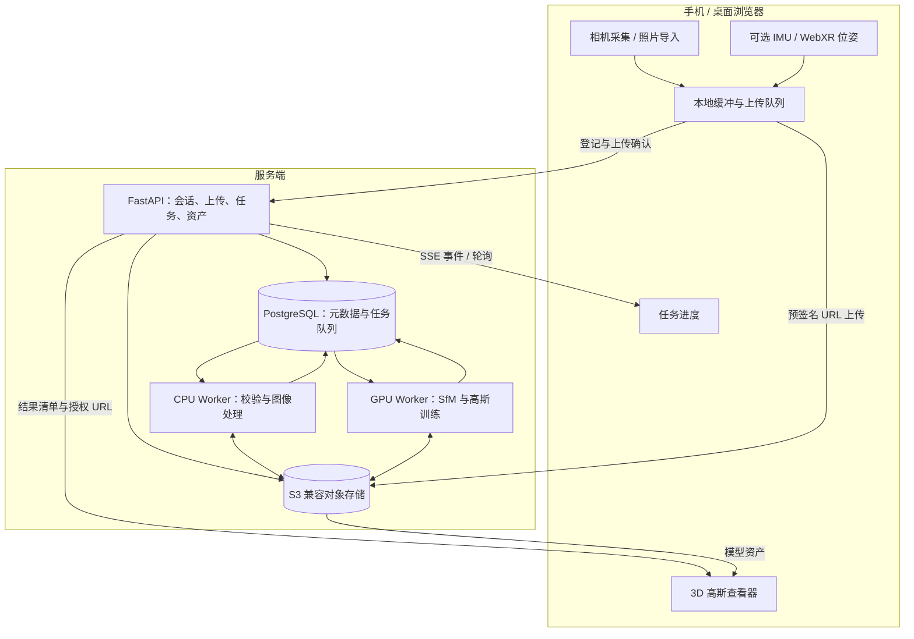
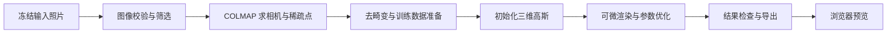

# Web Scan — 手机网页采集与 3D Gaussian Splatting 重建

通过手机浏览器采集真实场景，在服务端生成可交互浏览的 3D 高斯模型。用户完成「打开网页 → 拍摄 → 提交重建 → 查看结果」即可使用。

> **状态：技术架构方案，尚未实现。** 本目录当前只有 README；文中的目录、接口和部署结构均为设计。首版采用公开可用的 COLMAP + gsplat 路线，先验证真实重建闭环，再优化速度。“采集后几分钟出结果”是待验证的性能目标。

## 1. 产品范围

首版支持小型静态物体和局部室内空间：手机拍摄或上传照片、查看上传进度、提交重建、查看任务状态、浏览和下载结果。

功能边界：

- 手机负责采集、上传和结果浏览；服务端 GPU 负责重建。
- 基础路径只需要照片；运动传感器数据和 WebXR 位姿属于增强输入。
- 首版交付 Gaussian PLY 和浏览器预览资产。高斯模型不自动等于可编辑 Mesh、CAD 模型或精确测量成果。
- 不把语言大模型作为重建依赖。人物分割等视觉模型可作为后续预处理模块。
- 首版不承诺实时完整重建、未拍摄区域补全、大型户外场景或专业测绘精度。

## 2. 总体架构



### 技术选型

| 层级 | 拟采用技术 | 职责 |
| --- | --- | --- |
| Web 客户端 | TypeScript + React + Vite | 手机采集、任务交互、桌面管理 |
| 浏览器采集 | getUserMedia、视频帧回调、Canvas / Worker | 摄像头画面采样与图片编码 |
| 运动信息 | DeviceMotion / DeviceOrientation；可选 WebXR | 记录运动观测与设备位姿先验 |
| API 服务 | Python + FastAPI + Pydantic | 接口校验、鉴权、会话和资产管理 |
| 状态与任务 | PostgreSQL | 持久任务、原子领取、进度和失败恢复 |
| 文件存储 | S3 兼容对象存储；开发环境 MinIO | 原图、掩码、中间数据、最终资产 |
| 位姿求解 | COLMAP / pycolmap | 特征、匹配、相机位姿、稀疏几何 |
| 高斯训练 | PyTorch + gsplat + 自有训练适配层 | 场景初始化、可微渲染、优化、导出 |
| 浏览器预览 | gsplat.js 适配层 | 首版加载、旋转、缩放和展示 |
| 部署 | Docker Compose；GPU Worker 独立镜像 | 本地联调和单机 GPU 部署 |

gsplat 是训练与渲染基础库，gsplat.js 是浏览器查看库，两者是不同项目。训练服务还需实现数据加载、优化循环、检查点、产物导出和任务接口，不能只安装一个库就完成整个产品。

## 3. 手机采集与数据上传

### 3.1 基础采集路径

1. 用户创建采集会话，主动授权摄像头。
2. 优先使用后置摄像头，在预览画面中提示缓慢移动、保持视角重叠、补拍遗漏区域。
3. 按时间间隔采样视频帧，并结合清晰度、曝光和重复程度筛选候选图片。
4. 图片进入有界上传队列，同时在 IndexedDB 中暂存待确认的数据。
5. 服务端确认图片完整落盘后，客户端释放对应本地缓存。
6. 用户结束采集后，等待剩余上传完成；服务端核验并冻结输入清单，再创建重建任务。

初始实验可从每秒 1–2 张候选图、长边约 1600 像素开始，依据重建质量和上传带宽调整；这些是调试起点，不是已验证的默认参数。采样不能只追求数量，必须保留有视差和足够重叠的有效图像。

手机通过局域网 IP 访问普通 HTTP 页面通常不能使用摄像头，因此手机联调和正式访问都应提供受设备信任的 HTTPS。用户切换后台可能使采集暂停；页面需显示实际状态并支持恢复，不能假设后台持续拍摄。

### 3.2 传感器与位姿增强

| 路径 | 收集的数据 | 首版用途 |
| --- | --- | --- |
| 普通摄像头 | 图像、尺寸、帧时间戳、摄像头设置 | 完整的基础重建路径 |
| IMU 可用 | 加速度、角速度、设备朝向及观测时间 | 保存为辅助数据；不直接当作准确位置 |
| WebXR 可用 | 参考空间下的位姿、跟踪状态、重置事件 | 第二阶段验证位姿先验的收益 |

WebXR 跟踪能力和原始相机图像访问是不同能力。必须分别探测浏览器、设备和会话特性；不能假设所有安卓手机都支持，也不能假设 WebXR 可以与独立摄像头会话同时工作。

图像帧、IMU 和 XR 观测须保存各自的时钟域与时间戳。只有验证时间同步、坐标变换和图像对应关系后，才允许把位姿用于重建。`predictedDisplayTime` 不能直接当作相机曝光时间；跟踪丢失或参考空间重置后应分段记录。

首版先验证纯照片路径。记录传感器数据不代表已经利用这些数据加速求解；增强路径需要独立适配和对照测试。

### 3.3 上传一致性

- 每张图片以 `session_id + frame_id` 唯一标识，记录 SHA-256、字节数和解码尺寸。
- 相同图片重复确认保持幂等；同一帧 ID 对应不同内容时返回冲突。
- 上传 URL 只允许写入该会话指定的对象，设置有效期和大小限制；实际确认时复核内容。
- 输入清单冻结前必须核对所有必需帧；缺帧不能静默进入训练。
- 本地队列和存储空间设上限，积压时降低采样频率或暂停并提示用户。

## 4. 3DGS 重建流水线



### 4.1 图像预处理

检查图片解码、清晰度、曝光、尺寸、方向和重复情况。统一图像旋转后，必须同步调整相关相机参数；去畸变或缩放后也必须使用匹配的相机内参。

采集期间可以先执行逐图校验、质量评分和可选人物分割。匹配、全局位姿求解和训练等待输入清单冻结后执行，以保持首版实现清晰、可重复。

可选人物分割使用预训练视觉模型输出 keep mask，让位姿估计和训练排除人物像素。该模块需要验证数据加载和损失计算确实使用 mask；不能仅把文件写到目录中就认为过滤已生效。

### 4.2 相机位姿与稀疏几何

首版采用 COLMAP 的特征提取、匹配、增量重建与 Bundle Adjustment。连续采集优先评估顺序匹配；无序照片采用适合其规模的匹配策略，并检查场景是否形成连通模型。

该阶段输出相机内参、每张已注册图片的位姿、三维稀疏点和观测关系。进入训练前检查注册率、重投影误差、点的多视图支持和重建连通性。匹配失败或相机未正确注册时，应给出补拍建议。

标准 COLMAP 基线不直接消费浏览器 IMU / WebXR 记录。位姿先验加速由后续 `PoseEstimator` 适配器实现；未经校验的浏览器位姿不能直接替代视觉求解。

### 4.3 初始化与训练

基线从有效 SfM 稀疏点初始化高斯，不要求手机提供 LiDAR。每个高斯包含位置、尺度、旋转、不透明度和颜色 / 球谐系数。

训练循环按以下方式工作：

```text
抽取训练视图
  → 从该相机渲染当前高斯场景
  → 在有效像素上计算图像误差与正则项
  → 反向传播，更新高斯参数
  → 按策略增加、拆分或删除高斯
  → 记录进度，保存检查点
```

首版以 gsplat 官方 COLMAP 训练示例为基线，固定依赖提交和配置后再封装为独立训练任务。先验证图像损失、稠密化和导出链路；几何正则、曝光优化等增强逐项加入，并通过留出视图对照评估。

训练视图数、输入分辨率、高斯数量上限和步数必须可配置。OOM 时保留失败阶段和实际配置，让用户重新选择较小预算；不把降质重试伪装成原配置成功。

这是对单个场景进行参数优化。重建结果来自实际拍摄的多视角观测，未拍摄区域不具备可靠的恢复依据。

### 4.4 输出和查看

每次成功任务交付：

- `gaussians.ply`：保留球谐系数的原始高斯资产。
- `preview.splat`：供首版 gsplat.js 查看器使用的预览资产。
- `cameras.json`：相机信息和查看器初始视角。
- `report.json`：版本、配置、数据数量、耗时、质量指标和产物校验值。
- `thumbnail.jpg`：结果缩略图。

gsplat.js 的 `.splat` 格式不保留球谐系数，预览会损失视角相关颜色。因此原始 PLY 必须保留，预览质量与原始资产分开验收。高质量浏览后续可以接入经验证支持完整 SH 的查看器。

浏览器端控制模型大小和加载预算，分批显示进度，避免一次加载超大模型。对象坐标和相机坐标统一转换；无可靠尺度来源的纯照片重建只标注相对尺度。

## 5. 服务与任务模型

### 5.1 服务边界

| 模块 | 输入 | 输出 |
| --- | --- | --- |
| Session API | 用户与采集配置 | 会话、上传授权、冻结清单 |
| Preprocess Worker | 已确认的图像 | 图像质量信息、可选 mask |
| Reconstruction Worker | 输入快照与重建配置 | 位姿、初始化数据、高斯模型 |
| Exporter | 原始高斯与相机 | 预览资产、缩略图、结果清单 |
| Viewer | 授权资产 URL | 三维浏览与下载 |

API 处理短请求；GPU 任务由独立进程执行。可替换接口为 `PoseEstimator`、`GaussianTrainer` 和 `ArtifactExporter`，首版分别实现 COLMAP、gsplat 和 PLY / splat 导出。

### 5.2 状态与恢复

采集会话状态：`CAPTURING → FINALIZING → READY`；输入冻结后不再追加图片，需要补拍时创建新的输入版本。

重建任务状态：`QUEUED → RUNNING → SUCCEEDED / FAILED / CANCELLED`。执行阶段单独记录为 `PREPROCESS / SFM / TRAIN / EXPORT`，避免把任务状态与算法阶段混在一起。

API 在数据库事务中创建任务。Worker 使用 PostgreSQL 行锁原子领取任务，记录租约、心跳、尝试次数和执行令牌。重新领取会更新令牌，过期 Worker 不能发布成功结果。执行过程采用独立工作目录，最终资产校验完成后再原子发布清单。

默认每张 GPU 同时执行一个重建任务。取消请求终止对应进程组并更新状态；Worker 中断后，按阶段完成记录和兼容的检查点恢复。单阶段能否断点续跑取决于具体后端，不能统一假设支持。

### 5.3 核心数据

| 实体 | 关键字段 |
| --- | --- |
| CaptureSession | id、owner_id、status、capture_config、input_version |
| Frame | session_id、frame_id、object_key、sha256、dimensions、timestamp、clock_domain |
| SensorRecord | session_id、source、timestamp、clock_domain、segment、payload |
| ReconstructionJob | id、input_snapshot、config、status、stage、lease_token、heartbeat、attempt |
| JobEvent | job_id、sequence、stage、message、created_at |
| Artifact | job_id、type、object_key、sha256、bytes、metadata |

### 5.4 拟定 API

| 方法与路径 | 用途 |
| --- | --- |
| `POST /api/sessions` | 创建采集会话 |
| `POST /api/sessions/{id}/frames/upload-url` | 登记帧并获取上传 URL |
| `POST /api/sessions/{id}/frames/{frame_id}/commit` | 确认帧上传完成 |
| `POST /api/sessions/{id}/sensors` | 批量提交可选传感器记录 |
| `POST /api/sessions/{id}/finalize` | 核验并冻结输入清单 |
| `POST /api/jobs` | 根据输入快照创建重建任务 |
| `GET /api/jobs/{id}` | 查询状态、阶段和结果 |
| `GET /api/jobs/{id}/events` | SSE 推送阶段事件；支持断线后续传 |
| `POST /api/jobs/{id}/cancel` | 请求取消任务 |
| `GET /api/jobs/{id}/artifacts` | 获取资产清单和临时下载 URL |

所有会话和任务均校验用户归属。事件进度以真实完成量或明确阶段呈现；无法估算的阶段只显示正在处理，不制造精确百分比。

## 6. 拟定代码目录

```text
web-scan/
├── README.md
├── apps/web/                 # 手机采集、任务页面、结果查看器
├── services/api/             # FastAPI、鉴权、会话、任务、资产
├── services/worker/          # 任务领取、资源分配、阶段执行
├── reconstruction/
│   ├── preprocess/          # 图片校验、质量评分、可选分割
│   ├── pose/                # COLMAP 与后续位姿先验适配器
│   ├── trainer/             # gsplat 训练适配、检查点、进度
│   └── export/              # Gaussian PLY、splat、缩略图
├── contracts/               # API、清单、坐标与产物约定
├── infra/                   # HTTPS 网关、Compose、GPU 镜像
└── tests/                   # 上传一致性、任务恢复、真实重建验收
```

以上目录尚未创建，后续按实现阶段补齐。

## 7. 部署与性能

开发机可运行前端、API、PostgreSQL 和 MinIO；真实训练部署在具备兼容 NVIDIA GPU、CUDA 和驱动的 Linux Worker 上。API 与 Worker 通过数据库和对象存储协作，可以分机部署；Worker 本地 SSD 保存任务临时文件。

先固定 PyTorch、CUDA、gsplat 和 COLMAP 的兼容版本，记录容器镜像摘要与训练配置，再建立性能基线。Mac 可以承担采集和管理开发，本方案的 CUDA 重建路径需要对应 GPU 环境。

提速顺序：

1. 上传、逐图校验和可选分割与采集重叠，缩短采集结束后的剩余等待。
2. 选择高质量、有视差的关键帧，控制冗余图片。
3. 验证匹配策略、图像分辨率与训练预算的质量 / 耗时关系。
4. 对完成时间、显存峰值和画质做分阶段测量，再决定是否实现位姿先验求解或训练内核优化。

分别统计采集耗时、上传尾部耗时、队列等待、预处理、SfM、训练、导出和预览首次加载时间。至少同时报告「从开始拍摄到可浏览」与「结束拍摄到可浏览」两种时间，按场景规模和硬件记录中位数与 P95。

## 8. 实现阶段与验收

| 阶段 | 交付 | 验收重点 |
| --- | --- | --- |
| M1：照片到高斯 | 导入照片 → COLMAP → gsplat → PLY → 浏览器查看 | 固定小场景真实训练成功；新视角可浏览；模型非占位产物 |
| M2：手机采集闭环 | 摄像头采集、分批上传、任务状态、断线恢复 | 在实际手机 HTTPS 环境验证授权、后台切换和上传中断；冻结清单无缺帧 |
| M3：质量与运行稳定性 | 帧筛选、可选人物分割、取消重试、资源隔离 | 掩码实际生效；重复提交幂等；Worker 重启可恢复；失败原因可定位 |
| M4：加速 | 采集与预处理并行、可选位姿先验、训练优化 | 同数据、同硬件对照，报告质量和耗时；达标后再确定“几分钟”口径 |

重建质量同时检查图像注册情况、独立留出视角指标和新视角人工浏览。纯图像管线须披露留出视图是否参与上游位姿求解；严格的端到端评估另设独立拍摄视图。不能只用训练照片上的相似度判断成功。

测试集至少包含纹理丰富物体、弱纹理墙面、反光表面、运动人物和覆盖不足等情况，以识别适用范围和失败原因。

## 9. 参考资料

- [3D Gaussian Splatting 原始方法](https://repo-sam.inria.fr/fungraph/3d-gaussian-splatting/)
- [COLMAP 命令行与重建流程](https://colmap.github.io/cli.html)
- [gsplat：Fit a COLMAP Capture](https://docs.gsplat.studio/main/examples/colmap.html)
- [gsplat 可微光栅化](https://docs.gsplat.studio/main/apis/rasterization.html)
- [gsplat.js 浏览器查看器与格式说明](https://github.com/dylanebert/gsplat.js)
- [getUserMedia 与安全上下文要求](https://developer.mozilla.org/en-US/docs/Web/API/MediaDevices/getUserMedia)
- [WebXR Device API](https://www.w3.org/TR/webxr/)
- [WebXR Raw Camera Access](https://immersive-web.github.io/raw-camera-access/)

本文为自建工具的设计方案，不是对已有 web-scan 私有代码的完整复刻；其未公开的快速求位姿与训练内核不属于首版实现依赖。
