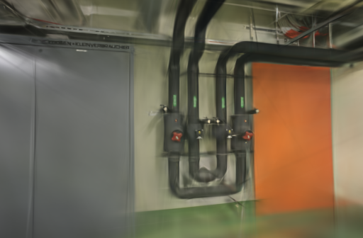
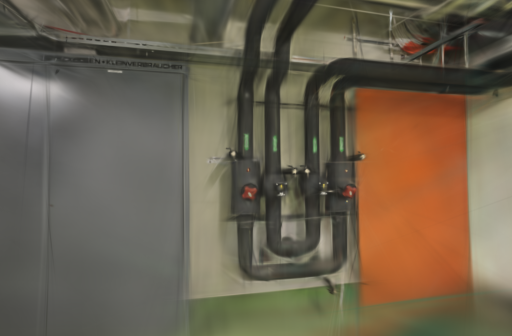
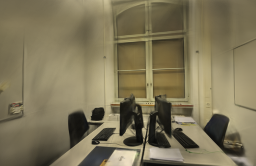
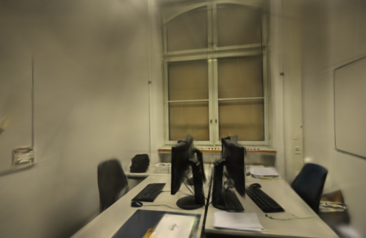

# 单独调整旋转的 Adam 稳定项

2026-10-23。只把旋转参数的 epsilon 从 `1e-15` 提高到 `1e-8`，其它参数组继续使用 `1e-15`。八次同相机训练中，早期旋转差异缩小，但 pipes 和 office 的平均 PSNR、SSIM 均下降，因此不采用为默认值。

## 改动与验证

上一轮[全参数组实验](ADAM-EPSILON.md)减少了首轮旋转漂移，却没有通过画质要求。本轮在独立 Brush 构建的优化器状态中增加可选 epsilon，仅给旋转组设置覆盖值。覆盖值随参数状态保留，经过增点、裁剪和记录恢复后继续生效。位置、尺度、透明度与颜色的优化器设置不变；这些参数后续的训练轨迹仍会受到旋转变化影响。

新增实际 GPU 测试 `epsilon_override_stays_with_parameter_state`，检查连续两次更新、未设置覆盖值的参数回退、记录转换和设备迁移。该测试通过，release 构建通过。四次候选训练逐一检查初始化及29次增点 / 裁剪后的状态，共120条记录都保留 `1e-8`；默认优化器始终为 `1e-15`。

八次运行的首轮旋转更新与实际梯度代入 Adam 公式的结果一致，最大绝对误差小于 `3.24e-8`。每场景四次运行的初始完整 PLY 逐字节相同。下表比较同设置的两次运行，数值是导出归一化四元数的最大分量差，不是角度或渲染误差：

| 场景 | 完成更新次数 | 全部 `1e-15` | 仅旋转 `1e-8` |
| --- | ---: | ---: | ---: |
| pipes | 1 | 0.00231832 | 0.00019881 |
| pipes | 100 | 0.02770504 | 0.00045353 |
| office | 1 | 0.00267389 | 0.00057435 |
| office | 100 | 0.04253839 | 0.00068432 |

早期变化确实变小，但各组最终模型仍不确定。相同初始状态、相同种子和相同照片顺序不足以固定完整训练结果，也不能把较小的参数差异直接解释为更好的画质。

## 固定条件

Apple M5 / 32 GiB、Metal、Rust / Cargo 1.99.0。两组使用同一个 `0.3.0-rotation-adam-study` 二进制，源码锁定 Brush `3edecbb2fe79d3e2c87eeab85b15e0b1dd10d486` 及原 `Cargo.lock`。

- pipes 输入 / 定位 14 / 14，训练 / 评估 12 / 2；office 为 26 / 26、22 / 4，无失败定位视角。
- 复用 10 月 12 日同镜头模式几何，逐项核对照片、稀疏文件、相机、评估集合和参考图摘要。
- 3000 步、512 像素长边、15 万高斯预算、SH3，每 100 步增点，80% 步数后停止增长，每 500 步导出，每 8 张留出一张。
- 固定图像消费顺序和真实点编号排序，CLI、CPU 加权采样、GPU 随机种子均为42。两场景每设置各两次，共八次，pipes 顺序为基线、候选、候选、基线，office 相反。
- GPU 串行运行，训练期间浏览器停在项目列表，未清空系统与驱动缓存。两组启用同样的首轮梯度读回及第0、1、10、100次更新状态快照。

本轮没有重新计算 SfM，未测 API 端到端耗时或峰值内存。下面计时包含训练、评估、追踪和导出，不含编译与输入复制。GPU读回会同步执行并可能改变调度，不能将这组带观测的耗时直接当作生产速度。

## 同相机成绩

`compare_quality.py` 在相同相机、画幅与参考图下统一到长边512，计算 RGB PSNR 和11×11 Gaussian-window SSIM，按视角等权平均。评估照片参与过 SfM，属于固定几何下的渲染留出对照。

| 场景 | 重复 | 旋转 epsilon | 训练与导出 | 实际高斯 | PLY 字节 | PSNR / SSIM |
| --- | ---: | --- | ---: | ---: | ---: | --- |
| pipes | 1 | `1e-15` | 23.3117 s | 11,402 | 2,692,422 | 18.7854 / 0.74050 |
| pipes | 1 | `1e-8` | 23.2591 s | 11,920 | 2,814,670 | 18.1194 / 0.74487 |
| pipes | 2 | `1e-15` | 23.2753 s | 11,721 | 2,767,706 | 19.2402 / 0.74807 |
| pipes | 2 | `1e-8` | 23.2908 s | 11,255 | 2,657,730 | 18.1888 / 0.74273 |
| office | 1 | `1e-15` | 23.2899 s | 14,241 | 3,362,426 | 21.8529 / 0.86542 |
| office | 1 | `1e-8` | 23.3017 s | 14,428 | 3,406,558 | 21.1460 / 0.86267 |
| office | 2 | `1e-15` | 23.3026 s | 14,412 | 3,402,782 | 21.2755 / 0.86072 |
| office | 2 | `1e-8` | 23.2885 s | 14,406 | 3,401,366 | 20.4765 / 0.84893 |

平均 PSNR：pipes 19.0128 → 18.1541，office 21.5642 → 20.8113；平均 SSIM 分别为0.74429 → 0.74380、0.86307 → 0.85580。四次配对的候选 PSNR 均下降。这里只与本轮同时测量的基线比较，不与上一轮不同运行的均值拼成收益结论。

两次重复仍不足以估计普遍退化幅度，但已不满足当前采用要求。毫秒级耗时差小于进程轮询粒度，实际高斯数量也不同，不作为提速证据。

下图固定展示首次重复的第一个留出视角，左右相机、画幅一致，原生 PNG 未修改：

| 场景 | 全部 `1e-15` | 仅旋转 `1e-8` |
| --- | --- | --- |
| pipes |  |  |
| office |  |  |

八个模型通过完整 SH3 和评估校验。浏览器加载两场景基线 / 候选并拖动候选漫游，控制台无错误或警告；细管、线缆、窗框仍有模糊与拉丝，覆盖外有缺失和漂浮片段，未确认漫游改善。

## 决定与复现

不启用旋转组 `1e-8`，保留实验开关和记录，正式引擎、原照片和历史模型不变。暂停沿着提高 epsilon 的方向继续调整。现有追踪显示，各设置的两次重复中，首轮增点的索引集合相同，遍历顺序仍不同；下一步可单独固定这个顺序，再验证它对训练波动的影响。

项目基线 [ed2cf5c](https://github.com/sakorman/web-scan/commit/ed2cf5c)。[rotation-adam.patch](benchmarks/rotation-adam.patch)是相对干净 Brush `v0.3.0` 的累计补丁，包含此前实验，不能叠加旧补丁。按[源码构建方法](LOADER-ORDER.md#决定与复现)换用本补丁。实际 GPU 状态测试：

```bash
cargo test --manifest-path .tools/brush-order-study/Cargo.toml \
  --locked --release -p brush-train epsilon_override_stays_with_parameter_state
```

两组均设置 `WEBSCAN_STABLE_ADAM=0`，并将 `WEBSCAN_SINGLE_LOADER`、`WEBSCAN_TRACE_LOADER`、`WEBSCAN_TRACE_SAMPLING`、`WEBSCAN_SEEDED_SAMPLING`、`WEBSCAN_STABLE_INIT`、`WEBSCAN_TRACE_STATE`、`WEBSCAN_SEED_GPU`、`WEBSCAN_TRACE_GRADIENT` 设为 `1`。只切换 `WEBSCAN_ROTATION_ADAM=0` / `1`。CLI 使用上一轮[固定参数](ADAM-EPSILON.md#取舍与复现)，每次另设独立输入和输出目录。

本机资料在 `.data/benchmarks/rotation-adam-20261023/`，保留二进制、测试与构建日志、适配器、模型、状态和梯度分析脚本。[公开记录](benchmarks/rotation-adam.json)包含逐次 / 逐视角成绩、梯度统计、状态检查与文件摘要。应用源码未变，不重复其本地测试；提交后由标准 CI 检查后端、前端、类型和构建。

补丁遵循 [Brush Apache-2.0 许可](../THIRD_PARTY_NOTICES.md#brush-loading-experiment)，照片及渲染遵循 [ETH3D 署名与许可](../THIRD_PARTY_NOTICES.md#test-dataset)。
