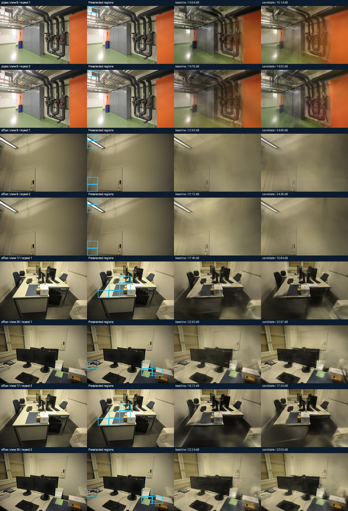
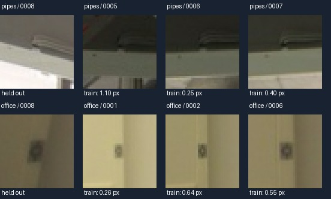
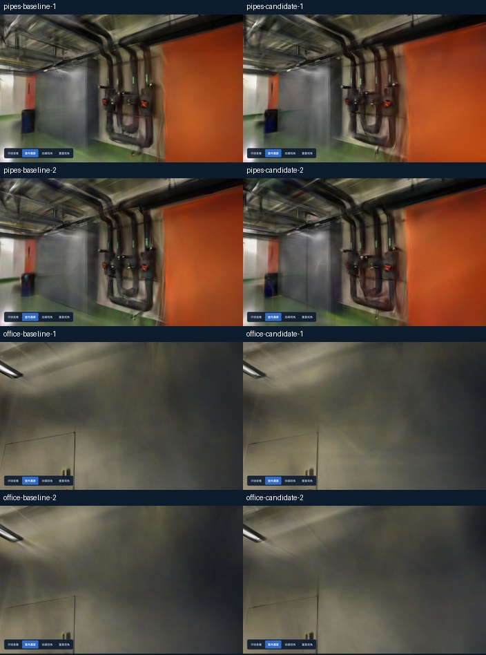

# 降低旋转学习率对高误差区域的影响

2026-11-26。ETH3D pipes 和 office 各做两组配对重建。将 Brush 的旋转学习率从 0.001 减半后，四组留出视图的整图平均 PSNR 都上升。office 第一组预选区域的 RGB 均方误差却从 0.02707 增至 0.03538（+30.7%），第二组降至 0.02507。实验未达到预定的局部改善条件，默认训练继续使用 0.001。[逐视角分数、分区、相机及模型摘要](benchmarks/rotation-rate.json)

## 选区与对照

上轮实测发现，单凭稀疏轨迹的空白很难预测哪一块会渲染失真。此次先在历史模型上固定目标区域。将每张留出图分成 8×8 格，取各模型误差最高的八格，按同一视角求交集。误差并列时取行优先编号较小的一格。pipes 四份历史模型的两个视角分别留下 3、1 格，office 三份模型的四个视角分别留下 7、4、5、4 格。新模型按这些固定区域内的像素数汇总 MSE。选区和评分共用同一批留出照片，此处衡量的是已知问题区域再次训练后的表现。[上轮实测](SUPPORT-ERROR.md) · [基线提交](https://github.com/sakorman/web-scan/commit/268b4c6)

此前本机曾测到近各向同性高斯的首步旋转更新接近整个学习率。Brush 为旋转单独设置优化步长，因此这次只调旋转组。Chenhao Zhang、Fengze Zhang 和 Fengqing Zhu 的 GC-GS v1（2026-11-18）研究了损失冲突下的位置梯度更新。旋转学习率减半是本项目根据本机观测提出的假设。使用 Arthur Brussee 与 Brush 贡献者发布的 Apache-2.0 版 v0.3.0。[本机首步梯度记录](ADAM-EPSILON.md) · [GC-GS v1](https://arxiv.org/abs/2611.28111v1) · [论文分发许可](https://arxiv.org/licenses/nonexclusive-distrib/1.0/) · [Brush v0.3.0 优化器](https://github.com/ArthurBrussee/brush/blob/v0.3.0/crates/brush-train/src/train.rs) · [近期训练实现 64b8533](https://github.com/ArthurBrussee/brush/blob/64b8533863338907cba2485c1c95325b82e5765d/crates/brush-train/src/train.rs)

ETH3D 纯照片求姿。pipes 定位 14/14 张，12 张训练、2 张留出。office 定位 26/26 张，22 张训练、4 张留出。定位失败均为 0。1600×1067 输入共用 RADIAL 内参，两场景焦距分别为 906.09、906.44 px。复用同一去畸变针孔相机、初始点和照片，每八张留出一张，留出照片参与过上游 SfM。八次均在 Apple M5 / Metal 上串行运行，每次启动独立 Brush 进程，浏览器在训练后打开。固定种子 42、3,000 步、训练长边 512、每 100 步细化、第 2,400 步停止增长、上限 150,000 高斯、完整 SH3。按参考文件和相机核验同视角，统一在 512×341 的完整画幅评分。数值只覆盖此本机纯照片流程。

实验预先要求各配对整图 PSNR 差值至少 −0.2 dB、SSIM 差值至少 −0.005，两场景各自两次平均 PSNR 提升至少 0.2 dB，且各场景两次的预选区域 MSE 均下降。第一轮先训练两个基线，再训练候选。第二轮倒序。固定种子仍有训练波动。

## 八次重建

整图 PSNR、SSIM 先对每个留出视角评分，再对视角取算术平均。分区 MSE 以归一化 RGB 计算，越低越好。PLY 大小以十进制 MB 计。八次都复用 SfM，新增求姿耗时为 0 秒。末列从复制缓存开始，包含训练、留出渲染、导出和 SH3 读回。系统与 Metal 磁盘缓存未清空，冷启动成本未测。

| 场景 / 配对 | 旋转学习率 | 高斯数 | PLY (MB) | PSNR (dB) | SSIM | 分区 MSE | 训练至导出 (s) | 复用总计 (s) |
| --- | ---: | ---: | ---: | ---: | ---: | ---: | ---: | ---: |
| pipes / 1 | 0.001 | 11,648 | 2.750 | 18.166 | 0.75373 | 0.04643 | 22.96 | 23.01 |
| pipes / 1 | 0.0005 | 11,495 | 2.714 | 19.262 | 0.75747 | 0.03120 | 22.69 | 22.72 |
| pipes / 2 | 0.001 | 11,583 | 2.735 | 18.158 | 0.74774 | 0.04379 | 22.75 | 22.78 |
| pipes / 2 | 0.0005 | 11,478 | 2.710 | 18.508 | 0.75737 | 0.03477 | 22.57 | 22.60 |
| office / 1 | 0.001 | 14,573 | 3.441 | 21.070 | 0.87325 | 0.02707 | 23.42 | 23.47 |
| office / 1 | 0.0005 | 14,319 | 3.381 | 21.595 | 0.87201 | 0.03538 | 23.34 | 23.39 |
| office / 2 | 0.001 | 14,473 | 3.417 | 20.480 | 0.87003 | 0.03163 | 23.99 | 24.04 |
| office / 2 | 0.0005 | 14,521 | 3.429 | 22.194 | 0.87638 | 0.02507 | 23.23 | 23.27 |

pipes 两次预选区域的整体误差均下降，但每次仍有一个视角的局部误差上升。office 第一组中，第 17 张局部误差增幅最大（+0.02889）。第 25 张四格合计的像素加权 MSE 两次都上升（+0.00060、+0.00123）。下一步按这四格回查训练源图的遮挡、边界和细节，确定反复出错的像素位置。每场景仅两次配对，实测耗时和点数不能单独支持提速或压缩结论。



## 训练源图与漫游

在预选格内，按留出视角分别统计可回投到训练照片的稀疏点。同一点出现在多个留出视角时分别计数。用已核验的双向对应、去重的训练照片及原图 2 px 重投影误差上限筛选后，pipes 合计 22 次点观测、对应 67 个训练照片观测，残差中位数 0.32 px。office 分别为 109 和 414，中位数 0.43 px。下图取各场景第 9 张预选格中训练照片支持数最多的点，依次展示留出照片及最多三张训练照片的原生 41×41 裁剪。pipes 能看到同一段边缘，office 能看到同一处暗色构件，源图亮度有差异。这些稀疏样本仅覆盖选区的一部分。[轨迹筛选方法](TRACK-OBSERVATIONS.md)



八份完整 SH3 PLY 均能加载，从同一拍摄视角拖动漫游后，pipes 顶部细管仍有软边和重影，office 墙面暗区与顶边条纹仍可见。本次短路径未辨认出新增的独立漂浮物或空洞，遮挡背面尚待检查。照片及含实拍内容的对照图源于 Thomas Schöps 等人的 ETH3D，沿用 CC BY-NC-SA 4.0。[ETH3D 数据](https://www.eth3d.net/) · [作者与许可](../THIRD_PARTY_NOTICES.md)



## 复现

在仓库根目录使用已有 Brush v0.3.0 和结果 JSON 中列出的本地历史 SfM、相机及照片缓存。命令将实验适配器、八份重建和评分写入独立目录。两组输入采用相同哈希，Metal 的重复训练允许有数值波动。[驱动补丁](benchmarks/rotation-rate.patch) · [评分脚本](benchmarks/rotation-rate-score.py)

```sh
trial_dir=$(mktemp -d .data/benchmarks/rotation-repro-XXXXXX)
git show 268b4c6:docs/benchmarks/sh-slow-learning.py > "$trial_dir/driver.py"
patch -s "$trial_dir/driver.py" < docs/benchmarks/rotation-rate.patch
.venv/bin/python -c 'import json; print(json.dumps(json.load(open("docs/benchmarks/rotation-rate.json"))["regions"]))' > "$trial_dir/regions.json"
PYTHONPATH=. .venv/bin/python "$trial_dir/driver.py" --root "$trial_dir/run"
PYTHONPATH=. .venv/bin/python docs/benchmarks/rotation-rate-score.py --run "$trial_dir/run" --regions "$trial_dir/regions.json" --output "$trial_dir/scores.json"
```
