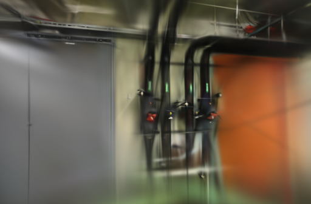

# 示例准备提速

2026-10-15。准备 ETH3D 示例时，旧脚本为每张照片分别启动一次 `tar`，固实压缩块会被反复解码。现在按归档顺序读取一次，再逐张处理照片。两组实测节省了约 90%–94% 的准备时间，输出文件逐字节一致。

## 归档准备实测

Apple M5、32 GiB 内存、Python 3.12、Pillow 12.3.0、macOS 自带 bsdtar 3.5.3 / libarchive 3.7.4。使用同一份官方 7z，长边 1600 像素、JPEG quality 95，保留有效等效焦距。

| 场景 | 照片 | 旧版 | 单次读取 | 减少 | tar 进程数 |
| --- | ---: | ---: | ---: | ---: | ---: |
| pipes | 14 | 54.87 s | 5.54 s | 89.9% | 15 → 1 |
| office | 26 | 183.94 s | 11.25 s | 93.9% | 27 → 1 |

时间包含读取归档、解码缩图、JPEG 保存、焦距信息、SHA-256 和发布清单；不含网络下载、网页导入、SfM 或高斯训练。输出目录全新，没有复用准备结果；未清理操作系统文件缓存，因此不能称为冷磁盘测速。顺序为旧版 pipes、旧版 office、新版 pipes、新版 office，每版每场景各测一次，均串行执行。数字反映本机这两份归档，不是通用速度承诺。

[测量与输入摘要](benchmarks/sample-preparation.json)包含归档大小和 SHA-256、脚本摘要、顺序、完整照片清单。计时后的代码整理只调整了 import 顺序与空行。

## 读取与完整性

7z 通过 libarchive 的 `tar -cf - @归档` 转成内存管道里的 tar 流，Python 顺序消费。这个用法由 [bsdtar 手册的归档转换说明](https://man.freebsd.org/cgi/man.cgi?query=bsdtar&sektion=1&format=html)支持。普通 tar / tar.gz 使用 Python 标准库直接流式读取，回归测试不依赖 macOS 的 tar 实现。

只接收目标照片目录里的普通 JPEG 文件，单张原始压缩文件不超过 64 MiB；拒绝链接、路径嵌套、重名、错误数量和损坏图片。所有图片处理完、解压进程正常退出后，才按文件名排序并发布完成清单。归档错误、解压程序失败或读取中断时，临时结果会清理，旧示例文件保留；读取中断也会终止并回收解压进程。

两版生成的 **40 张 JPEG 和两份 source.json 全部逐字节相同**，也与本机已有示例一致。40 张照片的 20 mm 等效焦距完整保留。没有改变像素、照片顺序、许可、相机参数或训练配置，已有采集、模型和历史任务无需迁移。

## 真实重建回归

用新版准备结果，从示例导入接口建立独立测试采集，再运行完整 Worker。每组重新计算位姿，未命中 SfM 缓存；Metal GPU 串行训练，浏览器返回项目列表以停止模型渲染。固定 Brush 0.3.0、自动镜头模式、1000 步、512 像素长边、5 万高斯预算、每 8 张留出一张。

| 场景 | 输入 / 定位 | 训练 / 留出 | SfM | 训练与导出 | Worker 总耗时 | 实际高斯 | PLY | PSNR / SSIM |
| --- | --- | --- | ---: | ---: | ---: | ---: | ---: | --- |
| pipes | 14 / 14 | 12 / 2 | 6.02 s | 8.08 s | 14.16 s | 2,972 | 702,941 B | 16.772 / 0.6940 |
| office | 26 / 26 | 22 / 4 | 8.60 s | 8.07 s | 16.73 s | 4,128 | 975,757 B | 19.676 / 0.8074 |

两组都没有失败视角。从导入开始到校验下载结束分别为 14.31 和 16.95 秒，不含此前的归档准备与网络下载。两组 PLY 完整可读并包含 SH3，四种下载产物与磁盘文件逐字节一致。[完整配置与结果](benchmarks/sample-reconstruction.json)

PSNR / SSIM 来自 Brush 的 512 像素留出评测，评估照片参与过上游 SfM。1000 步仅检查流程：墙面、管道和桌椅可辨认，但细线、物体边界仍模糊。这些成绩不用于比较新旧画质，也不代表精细重建质量；此次收益只在示例准备阶段。




照片及其衍生渲染遵循 [ETH3D 数据许可与署名](../THIRD_PARTY_NOTICES.md#test-dataset)。

## 复现准备计时

先按 README 下载官方归档。以下命令分别测量旧版和当前版，结果写到新的 `.qa/sample-preparation`，不覆盖已有 `.samples`：

```bash
mkdir -p .qa
# 旧脚本仍能使用当前版本的焦距与数据来源模块。
git show d0592cc:scripts/prepare_indoor.py > .qa/prepare-before.py
.venv/bin/python - <<'PY'
import importlib.util
import time
from pathlib import Path

root = Path('.qa/sample-preparation')
root.mkdir(exist_ok=False)
for version, source in [('before', '.qa/prepare-before.py'),
                        ('after', 'scripts/prepare_indoor.py')]:
    spec = importlib.util.spec_from_file_location(version, source)
    module = importlib.util.module_from_spec(spec)
    spec.loader.exec_module(module)
    for scene in ['pipes', 'office']:
        start = time.perf_counter()
        folder = module.prepare(Path(f'/tmp/{scene}_dslr_jpg.7z'), scene,
                                root / version)
        print(version, scene, round(time.perf_counter() - start, 3))
        if version == 'after':
            baseline = root / 'before' / folder.name
            assert {p.name: p.read_bytes() for p in folder.iterdir()} == {
                p.name: p.read_bytes() for p in baseline.iterdir()}
PY
```

后端 86 项、前端 18 项回归通过，TypeScript 与生产构建通过。新增测试覆盖流顺序一致性、异常归档保留旧数据、解压失败后拒绝发布和读取中断时回收进程。下一步仍优先检查真实采集覆盖与训练收敛；本轮没有调整重建参数。
