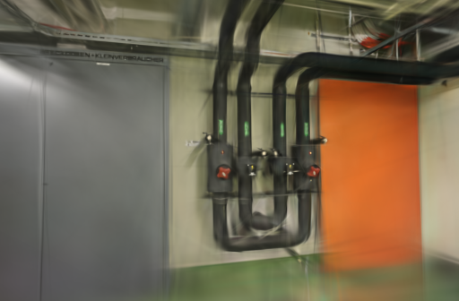
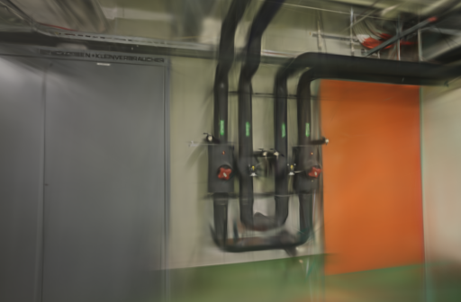
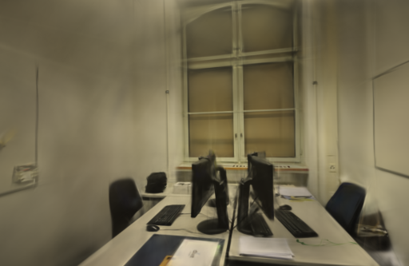
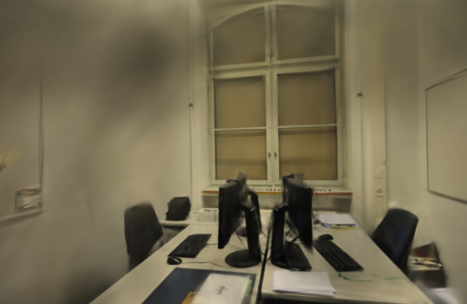

# 加权采样与初始化顺序

2026-10-21。给 Brush 的高斯加权采样增加独立、持续保存的随机数状态后，相同权重和种子的单元测试可以重复得到同一序列。但真实照片训练仍不确定。追踪还发现：**相同稀疏点文件进入初始化容器后，点编号的遍历顺序会变化，第一次采样收到的权重也已不同。** 正式训练器保持原样。

## 本轮改动

在上一轮的独立 Brush 构建中保留单个图像生产任务，本轮只切换高斯加权采样的随机源：基线沿用 `rand::rng()`；候选从 CLI 种子创建 `StdRng`，存入训练器，在多次替换和增点采样之间持续使用，避免每次调用重新播种。

两个设置使用同一个 `0.3.0-sampling-study` 二进制，原有学习率、损失、增长策略及 GPU 内核不变。追踪代码同时记录照片消费序列、初始化点编号、第一次采样的权重位模式、选中索引和传入 refinement 的索引顺序。追踪在两组中都开启，没有排序或修改这些数组。

先运行上游的三个采样测试，再加入“相同种子跨多次调用重现、状态继续推进、改变种子改变测试样例结果”两项测试。**5 项采样测试通过**，原有 NaN 权重与零权重处理仍通过。测试只证明同一构建中给定相同权重流时的采样行为，不证明端到端模型确定性。

## 真实照片配置

Apple M5 / 32 GiB，Metal，Rust / Cargo 1.99.0，锁定上游依赖。源码基于 Brush `3edecbb2fe79d3e2c87eeab85b15e0b1dd10d486`，未覆盖已安装的官方二进制。

- pipes 输入 / 定位 14 / 14，训练 / 评估 12 / 2；office 为 26 / 26、22 / 4。没有失败定位视角。
- 两组均复用 10 月 12 日的同镜头几何；相机、稀疏文件、照片字节与评估参考图摘要相同。没有重新运行 SfM。
- 3000 步、512 像素长边、15 万高斯预算、SH3、CLI 种子 42；每 100 步增点，80% 步数后停止增长，每 500 步导出，每 8 张留出一张。
- 两场景、两设置、各两次，共八次正式训练；另有两次 500 步验收，不计入均值。GPU 串行运行，执行顺序交错，计时期间浏览器停在项目列表。系统与驱动缓存未清空。

## 追踪结果

正式训练共校验 24,000 条实际消费照片记录。下表每行覆盖同场景的四次运行：

| 场景 | 照片序列数 | 初始点数量 | 点编号集合数 | 点编号遍历序列数 | 首次采样权重数组数 | 最终模型数 |
| --- | ---: | ---: | ---: | ---: | ---: | ---: |
| pipes | 1 | 1,873 | 1 | 4 | 4 | 4 |
| office | 1 | 2,456 | 1 | 4 | 4 | 4 |

两种采样设置各自两次运行的模型也都不同。完整摘要与原始计数见[数据记录](benchmarks/sampling-seed.json)。

[COLMAP 读取代码](https://github.com/ArthurBrussee/brush/blob/3edecbb2fe79d3e2c87eeab85b15e0b1dd10d486/crates/colmap-reader/src/lib.rs)使用 `std::collections::HashMap` 保存点；[初始化代码](https://github.com/ArthurBrussee/brush/blob/3edecbb2fe79d3e2c87eeab85b15e0b1dd10d486/crates/brush-dataset/src/formats/colmap.rs)再遍历 `values()` 组装坐标和颜色。[Rust 文档](https://doc.rust-lang.org/std/collections/struct.HashMap.html)说明默认哈希状态随机初始化，遍历顺序不固定。

本轮记录的是该容器的点编号遍历序列，没有改动初始化方式，也没有测出它对最终误差的贡献。第一次加权采样之前，权重数组已经不同，因此真实训练不满足单元测试的“相同权重流”条件。不能把模型波动全部归因于采样器，也不能把两组分数差异全部归因于固定种子。

## 画质与成本

以下使用 `compare_quality.py` 在相同相机、画幅、留出照片和长边 512 下重新评分，采用 RGB PSNR 和 11×11 Gaussian-window SSIM，按视角等权平均。评估照片参与过 SfM，不是完全独立的端到端留出成绩。

| 场景 | 重复 | 加权采样 | 训练与导出 | 实际高斯 | PLY 字节 | PSNR / SSIM |
| --- | ---: | --- | ---: | ---: | ---: | --- |
| pipes | 1 | 线程随机源 | 24.21 s | 11,622 | 2,744,342 | 18.7987 / 0.74002 |
| pipes | 1 | 种子 42 | 23.20 s | 11,626 | 2,745,286 | 17.3490 / 0.73002 |
| pipes | 2 | 线程随机源 | 23.20 s | 11,847 | 2,797,442 | 17.0702 / 0.73577 |
| pipes | 2 | 种子 42 | 23.20 s | 11,594 | 2,737,734 | 16.2856 / 0.71264 |
| office | 1 | 线程随机源 | 24.22 s | 14,503 | 3,424,258 | 21.5287 / 0.86635 |
| office | 1 | 种子 42 | 24.23 s | 14,545 | 3,434,170 | 20.6447 / 0.85781 |
| office | 2 | 线程随机源 | 24.22 s | 14,466 | 3,415,526 | 21.1632 / 0.86199 |
| office | 2 | 种子 42 | 24.22 s | 14,403 | 3,400,658 | 21.4252 / 0.86362 |

平均 PSNR：pipes 17.9345 → 16.8173，office 21.3460 → 21.0349；平均 SSIM 分别为 0.73789 → 0.72133、0.86417 → 0.86072。只有两次重复，且初始化和首轮权重尚未固定，不据此认定固定采样种子本身降低画质。当前结果没有支持替换正式引擎。

平均训练与导出时间为 pipes 23.71 → 23.20 秒、office 24.22 → 24.23 秒。一秒进程轮询粒度、追踪日志和模型数量变化限制了速度判断，没有建立提速收益。时间不含源码编译、SfM 或输入复制；本轮没有新的 API 端到端耗时或峰值内存测量。

下面是首次重复的第一个评估视角，左右相机及画幅一致，PNG 原样保存。所有评估视角与摘要保留在数据记录中。

| 场景 | 线程随机源 | 种子 42 |
| --- | --- | --- |
| pipes |  |  |
| office |  |  |

十个训练输出均通过完整 SH3 与评估校验。浏览器加载两场景基线和候选，分别拖动候选进行漫游，控制台无错误或警告；细管、线缆和未充分覆盖区域仍有模糊、拉丝及缺失。

## 取舍与复现

保留持久采样状态和追踪补丁作为实验基础，不修改应用默认设置或官方训练器。下一步先按稳定点编号构造初始化数组，再检查相同权重下的采样及 refinement 索引顺序；当前不扩展到更长训练，也不据此承诺确定性。

项目基线：[1676da3](https://github.com/sakorman/web-scan/commit/1676da3)。[sampling-seed.patch](benchmarks/sampling-seed.patch)是相对干净 Brush `v0.3.0` 的累计实验补丁，已包含上一轮读图追踪，不能再叠加 `loader-order.patch`。沿用[源码构建方法](LOADER-ORDER.md#决定与复现)，换用本补丁，构建后版本应为 `0.3.0-sampling-study`。

两组都设置 `WEBSCAN_SINGLE_LOADER=1`、`WEBSCAN_TRACE_LOADER=1`、`WEBSCAN_TRACE_SAMPLING=1`；只将 `WEBSCAN_SEEDED_SAMPLING` 在 `0` 和 `1` 之间切换。候选从实际 CLI 种子初始化一次采样器状态，不在每次采样时重置。

本机原始资料在 `.data/benchmarks/sampling-seed-20261021/`，包含源码修改前快照、三个基线测试与五个新版测试的记录、编译日志、适配器、八次正式运行、两次验收及逐次 `sampling-trace.json`。`benchmark.py` 仅将现有基准脚本的二进制路径指向独立构建；`analyze.py` 核对完整照片序列、点编号集合与顺序、首轮权重，再做同相机评分。应用源码未改动，不重复其本地单测与构建；CI 随记录提交执行标准回归。

实验修改继续遵循 [Brush Apache-2.0 许可](../THIRD_PARTY_NOTICES.md#brush-loading-experiment)，照片与衍生渲染遵循 [ETH3D 署名及许可](../THIRD_PARTY_NOTICES.md#test-dataset)。
