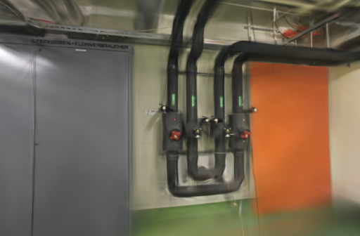
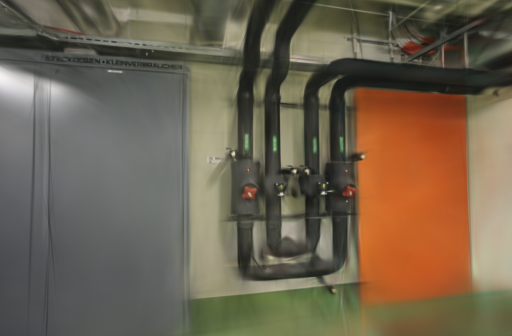
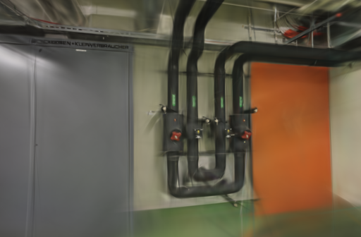
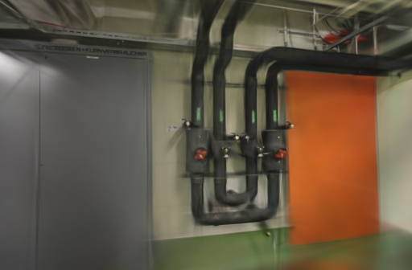
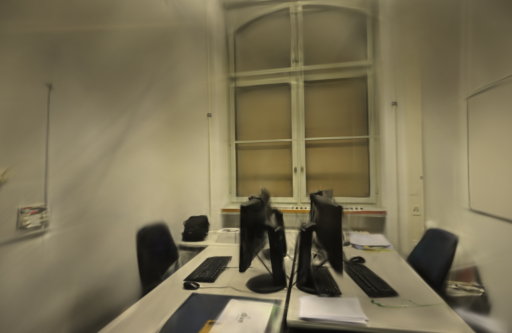
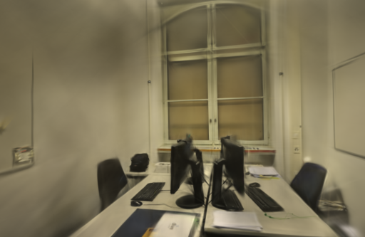

# 尺度约束对照

2026-10-20。在固定相机的两组 ETH3D 照片上，将 Brush 的尺度损失权重从 `1e-8` 提到 `1e-6`，各重复两次。office 的平均留出成绩提高，pipes 则一升一降，未得到稳定的整体改善。**不修改默认训练参数。**

## 为什么测试这个参数

当前模型在管线、细线和未充分覆盖的方向仍有拉丝。较强的尺度约束可能限制较大的高斯，但也可能损失细结构，因此需要实测，不能只看点数或某一张图。

[Brush 0.3.0 实现](https://github.com/ArthurBrussee/brush/blob/v0.3.0/crates/brush-train/src/train.rs#L171-L185)对可见性加权后的高斯尺度求和，再按场景尺度归一化，并随辅助损失调度衰减；[默认配置](https://github.com/ArthurBrussee/brush/blob/v0.3.0/crates/brush-train/src/config.rs)的权重为 `1e-8`。本次只增加这个权重，未调整透明度、学习率、增点或训练步数。

[3DGS-MCMC 论文](https://arxiv.org/abs/2404.09591)提供了正则化与高斯采样的研究背景，但并不证明这一参数能直接改善当前 Brush / Metal 流程。`1e-6` 是实验开始前选定的较强约束，不是论文推荐值；没有根据成绩反复调参。

## 固定条件

- Apple M5 / 32 GiB，原有 Brush 0.3.0 / Metal 二进制，SHA-256 见[完整记录](benchmarks/scale-loss.json)。未测试 CUDA。
- pipes 14 张输入、14 张定位，训练 / 评估为 12 / 2；office 为 26 / 26，训练 / 评估为 22 / 4。没有未定位照片。
- 复用 10 月 12 日同镜头模式的相机、稀疏几何和去畸变照片，两种设置都从同一份初始几何开始重新训练。这是固定历史几何的训练实验，不代表最新 SfM 的定位效果。每场景的输入摘要、相机 JSON 和评估参考图摘要一致。
- 3000 步、512 像素长边、15 万高斯上限、SH3、种子 42；每 100 步增点，80% 步数后停止增长，每 500 步导出，每 8 张照片留出一张。
- 两场景、两设置、各两次，共八次真实 GPU 训练。pipes 顺序为基线 / 候选 / 候选 / 基线，office 相反。GPU 串行执行，浏览器停在项目列表，完成计时后才查看模型。

本轮测量训练、评估和导出，**不含 SfM、输入复制和下载，也没有重新测端到端耗时**。旧任务中的 SfM 时间仅作为来源记录，不计入本轮成绩。操作系统及驱动缓存未清空，不能将这些结果称为完全冷启动。固定种子仍存在训练波动，两个重复不足以建立普遍结论。

## 结果

使用现有 `compare_quality.py` 的计算方法：同相机、同画幅、同评估照片，参考图与渲染图统一到长边 512，以 RGB PSNR 和 11×11 Gaussian-window SSIM 按视角等权平均。表中是重新评分结果，与 Brush 日志采用的指标实现略有差别。评估照片参与过 SfM，不是完全独立的端到端留出测试。

| 场景 | 重复 | 权重 | 训练及导出 | 实际高斯 | PLY 字节 | PSNR | SSIM |
| --- | ---: | --- | ---: | ---: | ---: | ---: | ---: |
| pipes | 1 | `1e-8` | 24.11 s | 11,381 | 2,687,466 | 18.0059 | 0.72675 |
| pipes | 1 | `1e-6` | 24.12 s | 11,591 | 2,737,026 | 18.6535 | 0.74692 |
| pipes | 2 | `1e-8` | 24.14 s | 11,705 | 2,763,930 | 17.5714 | 0.73866 |
| pipes | 2 | `1e-6` | 23.10 s | 11,323 | 2,673,778 | 16.5301 | 0.71791 |
| office | 1 | `1e-8` | 24.14 s | 14,267 | 3,368,562 | 20.5390 | 0.85656 |
| office | 1 | `1e-6` | 24.14 s | 14,168 | 3,345,198 | 20.9284 | 0.85908 |
| office | 2 | `1e-8` | 25.14 s | 14,403 | 3,400,658 | 20.7290 | 0.85362 |
| office | 2 | `1e-6` | 24.14 s | 14,027 | 3,311,922 | 21.5043 | 0.86487 |

两次平均：pipes PSNR **17.7886 → 17.5918**，SSIM **0.73270 → 0.73241**；office PSNR **20.6340 → 21.2163**，SSIM **0.85509 → 0.86197**。office 也不是每个视角都改善，第一张评估照片在首次重复中的 PSNR / SSIM 均下降。

平均耗时分别为 pipes 24.12 → 23.61 秒、office 24.64 → 24.14 秒。适配器以一秒间隔等待进程结束，这种约半秒的均值差不足以支持提速结论。实际点数和模型大小略有变化；未测峰值内存，不能据此宣称显存节省。

另外记录了归一化模型中最长轴尺度的 95% 分位数：pipes 平均 0.2794 → 0.2551，office 0.1621 → 0.1695，并没有一致缩小。轴长比例本身也可能反映正常薄表面，**这些统计不能直接当作漂浮物数量或几何精度**。

## 同视角输出与漫游

以下均为训练器原样保存的 PNG，未修图。每行左右使用相同相机和画幅；固定展示第一张评估照片，同时保留 pipes 两次结果，避免只展示首次上涨的运行。全部视角的成绩与摘要在[数据记录](benchmarks/scale-loss.json)中。

| 场景 / 重复 | 基线 `1e-8` | 候选 `1e-6` |
| --- | --- | --- |
| pipes / 1 |  |  |
| pipes / 2 |  |  |
| office / 1 |  |  |

浏览器加载两场景的基线与候选，核对拍摄视角，并分别拖动候选进入漫游；控制台没有错误或警告。阀门边缘、桌面线缆仍不清楚，转到未充分覆盖的方向仍能看到拉丝和缺失细节，没有验证出稳定的漫游收益。没有进行带几何真值的误差评估。

## 取舍与复现

八个模型均通过完整 SH3 和评估输出校验，但候选没有通过两场景一致改善的条件，因此停止扩展到 6000 步 / 1024 像素，不修改生产适配器。这个结论只是否定本次参数作为通用默认值，不能推断所有尺度正则方案都无效。后续应先检查训练采样与增点顺序的波动，再评估小幅参数收益。

基线为 [2a9cdba](https://github.com/sakorman/web-scan/commit/2a9cdba)，候选只应用[尺度权重补丁](benchmarks/scale-loss.patch)。可以用已有、完整定位的 pipes / office 任务复现：

```bash
mkdir -p .data/benchmarks/scale-loss-repeat
git show 2a9cdba:webscan/brush.py > .data/benchmarks/scale-loss-repeat/baseline.py
cp .data/benchmarks/scale-loss-repeat/baseline.py .data/benchmarks/scale-loss-repeat/candidate.py
patch .data/benchmarks/scale-loss-repeat/candidate.py < docs/benchmarks/scale-loss.patch
.venv/bin/python scripts/benchmark_exports.py --repo . \
  --baseline .data/benchmarks/scale-loss-repeat/baseline.py \
  --candidate .data/benchmarks/scale-loss-repeat/candidate.py \
  --output .data/benchmarks/scale-loss-repeat/runs \
  --jobs PIPES_JOB OFFICE_JOB --steps 3000 --resolution 512 --repeats 2
```

本机原始运行在 `.data/benchmarks/scale-loss-20261020/`，包含参数计划、源码快照、八个模型、日志、全部 PNG、重评分脚本及摘要。查看器源码未变，本轮不重复本地前后端单测与构建；提交后由 CI 执行标准回归。保留原照片、历史模型和缓存。

照片及衍生渲染遵循 [ETH3D 署名和 CC BY-NC-SA 4.0 许可](../THIRD_PARTY_NOTICES.md#test-dataset)。
