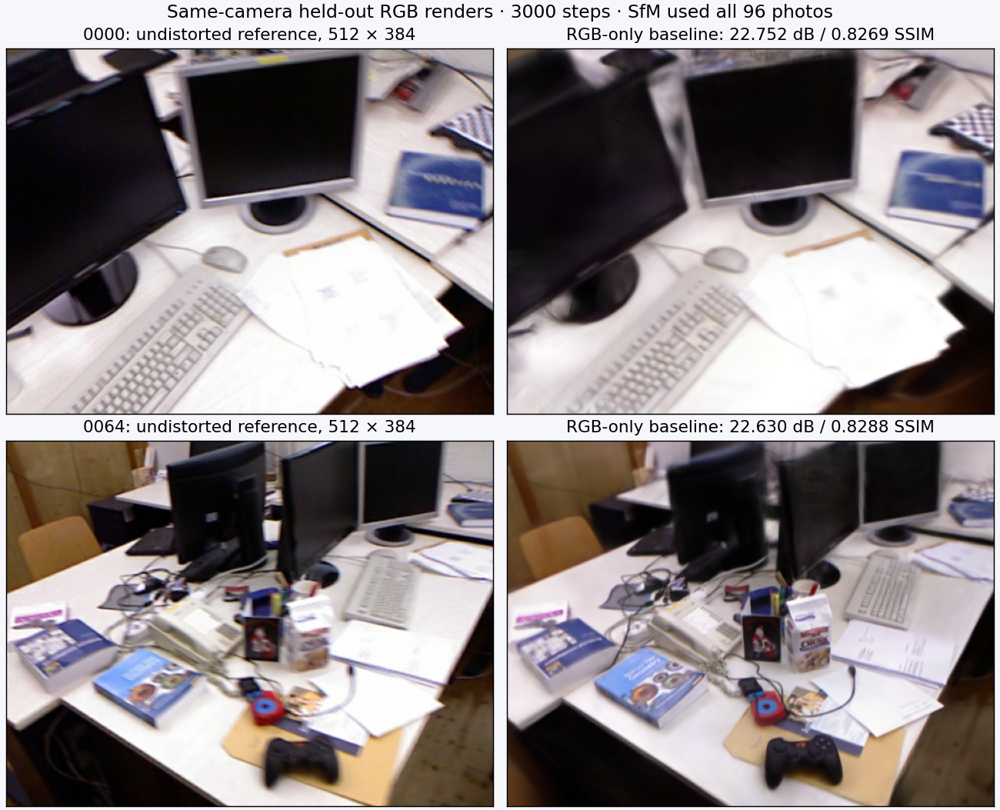
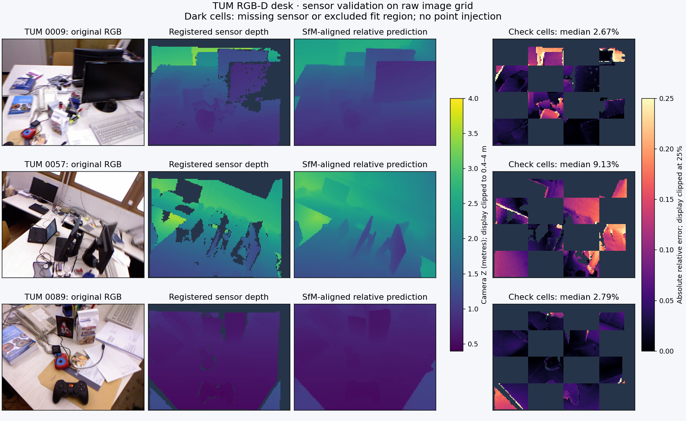

# 用传感器深度核验单目先验

2026-11-01，Apple M5 / 32 GiB，基点 [b3e9251](https://github.com/sakorman/web-scan/commit/b3e9251)。

新增离线传感器深度核验。在 TUM desk 预选的 12 张训练照片中，11 张具有时间足够接近的深度测量；这些照片全部通过原有稀疏筛查，也通过空间检查区域的传感器筛查。有效位置的逐视图平均绝对相对误差为 **5.66%**，常量深度对照为 **22.84%**。这说明该场景的相对预测包含有用的深度变化，但不能证明缺测区域、跨视图融合或 ETH3D 场景同样可靠；本轮采用核验工具，仍不补点。

## 数据和研究依据

复用已下载的 [TUM RGB-D freiburg1_desk](https://cvg.cit.tum.de/data/datasets/rgbd-dataset)，作者 Jürgen Sturm、Nikolas Engelhard、Felix Endres、Wolfram Burgard、Daniel Cremers，IROS 2012，CC BY 4.0。归档内有 595 张深度图。根据[官方格式](https://cvg.cit.tum.de/data/datasets/rgbd-dataset/file_formats)，深度已配准到 RGB 像素，16 位值除以 5000 得到相机轴向米制深度，零值为缺测；官方已经应用深度尺度修正，不再乘 1.035。未使用官方相机内参或轨迹。

沿用 [Depth Anything V2 Small](https://github.com/DepthAnything/Depth-Anything-V2/tree/a561b849ebae10a6f5ef49e26c83cbbcd36c71bf) 的固定代码和 Apache-2.0 权重，[来源与许可](../THIRD_PARTY_NOTICES.md)。近期 [DOC-GS](https://arxiv.org/abs/2604.06739) 将几何可靠性和跨视图证据用于抑制不可靠高斯，提示不能仅凭平滑的深度图判断几何质量。本轮只研究这一问题，没有复现其 dropout、暗通道或裁剪方法。

重建仍是 **纯 RGB → SfM → Brush**；传感器测量只在训练结束后进入离线评分。MPS 用于深度推理，Brush 用 Metal，核验用 NumPy CPU；没有运行 CUDA 方法，也没有把传感器辅助评测算作纯照片模型自身的米制精度。

## 基线和冻结配置

新任务 `depth-sensor-20261101/jobs/tum-baseline`，从原 96 张 640×480 JPEG 建立新 SfM 数据库。相机使用共享 RADIAL：`f=545.393335, cx=320, cy=240, k1=0.140152, k2=-0.237818`，去畸变照片为 626×469。普通 SIFT / 穷举匹配；Brush 0.3.0、seed 42，不保证确定性。

| 项目 | 新 TUM 基线 |
|---|---:|
| 输入 / 定位照片 | 96 / 96，无失败视角 |
| 有效稀疏点 / 重投影误差 | 16,410 / 1.098718 px |
| 训练 / 留出照片 | 84 / 12 |
| 步数 / 长边 / 高斯预算 | 3000 / 512 / 150,000 |
| 实际高斯数 / 完整 SH3 PLY | 71,756 / 16,935,966 字节 |
| SfM / 训练评估导出 / 本地完整任务 | 41.6448 / 39.2639 / 81.0669 秒 |
| 留出 RGB PSNR / SSIM | 22.885935 dB / 0.839308 |

留出索引为 `0000,0008,…,0088`。这些照片参与 SfM，不参与 Brush 训练或深度诊断，因此不是完全独立的端到端评估。RGB 评分采用同相机去畸变参考和渲染、512×384 网格及现有 Lanczos / SSIM 定义；用 `compare_quality.py` 自比较复核，两个字段对应同一模型，不是候选提升。



显示器边缘、文字、键盘和线缆仍模糊。界面与查看器未变，未新增浏览器漫游检查或漫游质量结论。

ETH3D office / pipes 继续作为固定基准，复用[上一轮完整任务](DEPTH-CONSISTENCY.md)，重新核对源图摘要、已归档结果和完整 SH3 数量，未重复训练或改写历史分数。两组仍为 26/26、14/14 定位；其训练配置、相机、逐图评分和耗时随本轮 JSON 一同保留。TUM 与 ETH3D 的数据和覆盖不同，不能横比数字后声称优化。

## 空间划分与单位

1. 在训练前冻结诊断索引 `0001,0009,…,0089`。RGB / 深度按时间差从小到大一对一匹配，上限固定 20 ms；`0001` 最近也相差 382.465 ms，明确排除，不换照片或放宽上限。其余 11 张最大差 16.417 ms。
2. 在原 RGB 上运行深度预测，保留 640×480 输出；不使用 SfM 去畸变图重采样传感器深度。网络输入为 518×686、MPS Float32。原始 SfM 观测按同一 4×4 棋盘格分为拟合格与检查格；每图只在拟合格拟合相对预测到逆 SfM 相机 Z 的尺度与偏移，沿用既有稀疏检查门槛。
3. 仅用拟合格中 5,898 个有效传感器 / SfM 对应观测的比值中位数，得到**全场景唯一**尺度 `0.231912917 m / SfM unit`。没有按照片重新对齐传感器，也没有用检查格拟合。观测按条目等权，相关轨迹并非独立统计样本。
4. 在原始像素中心 `(2.5+4i, 2.5+4j)` 采样。仅评分检查格，每图 9,600 个位置；传感器取最近原生像素，不跨零值或深度边缘双线性混合。相对预测经过 SfM 对齐和场景尺度转换后，与传感器相机 Z 对比。
5. 常量对照取该图拟合格 SfM 深度的中位数，使用同一场景尺度、检查位置及传感器有效掩码。无效预测计入失败分母，传感器缺测另行计数。诊断门槛固定为中位绝对相对误差 ≤10%、p90 ≤25%，且无无效预测；不是经过校准的质量保证。

传感器信息只用于全局尺度和评分，这仍属于带测量参考的离线核验。相邻像素相关，深度存在量化、配准、时间差和遮挡误差；不能把检查格称为独立场景或无噪声真值。

## 结果与限制

| 相同检查位置上的指标 | SfM 对齐预测 | 常量深度对照 |
|---|---:|---:|
| 通过传感器筛查的视图 | 11 / 11 | 0 / 11 |
| 有效传感器位置 | 77,120 | 77,120 |
| 缺测位置 | 28,480（26.97%） | 同左 |
| 无效预测 | 0 | 0 |
| 逐视图平均 AbsRel | 5.6623% | 22.8375% |
| 逐视图平均中位 AbsRel | 3.6744% | 20.6784% |
| 逐视图平均 p90 AbsRel | 11.3547% | 45.2570% |
| 逐视图平均 RMSE | 0.14648 m | 0.45158 m |
| 相对误差 ≤10% 的比例，逐视图平均 | 84.7537% | 26.0398% |
| δ < 1.25，逐视图平均 | 96.7990% | 56.6350% |

这里先计算每张图的统计量再等权平均，平均 p90 不是全部像素合并后的 p90。额外复查 5,161 个传感器有效的检查格 SfM 锚点，其逐视图平均 AbsRel 为 3.1960%，另有 853 个锚点缺测；稀疏锚点和密集网格位置不同，不能直接当作同位置算法对照。



图中展示首个成功匹配视角 `0009`、中位误差最高的 `0057` 和最后一个 `0089`；`0057` 中位误差为 9.13%，局部物体边缘和背景仍有明显误差。深度显示范围裁至 0.4–4 m，误差图裁至 25%，**数值评分没有这样裁剪**；暗色为缺测或排除的拟合区域。

本轮给出了可继续验证的候选：相对深度在 TUM 的有测量区域明显优于常量深度。但 26.97% 缺测区域尚无证据，也未验证跨视图点融合；不能覆盖上一轮 ETH3D 的支撑不足和冲突结论。采用核验工具，暂不采用补点。下一步可在该已配准场景核验跨视图支持掩码的保留率与传感器误差，再决定是否值得做固定预算补点对照。

## 成本、回归与复现

推理加载至 11 张结果保存耗时 1.703 秒；CPU 核验含摘要校验、读取和压缩采样图保存两次为 0.106 / 0.120 秒。训练与推理先后串行，未打开本任务的浏览器渲染；没有测峰值内存、完全冷启动或整个系统的 GPU 占用，数字只记录成本。权重沿用缓存；图示另用隔离目录中的 Matplotlib 3.10.7，应用依赖不变。

新增 10 项回归，覆盖时间匹配、缺测与单位、原生坐标、不使用检查区拟合、唯一场景尺度、无效预测分母、已知米制深度和摘要篡改。221 项后端、18 项前端、类型检查和构建通过，完整 SH3 和输入摘要通过；两张图均人工检查。保留已有 FastAPI 弃用与查看器体积提示。

首次准备因一张照片没有近邻深度而停止，改为显式记录未匹配后继续，其原目录保留。首次评分输出被 NumPy 布尔值的 JSON 序列化阻断，已转为原生布尔值并通过整流程回归；只重跑 CPU 核验，未重复 SfM、训练或深度推理。生产路径未受影响。

配置：[depth-sensor-config.json](benchmarks/depth-sensor-config.json)；逐图结果、数据摘要、相机、全部基线数据：[depth-sensor.json](benchmarks/depth-sensor.json)。使用新目录，先运行[冻结 RGB 基线驱动](benchmarks/depth-sensor-run.py)，再按顺序执行：

```sh
run=.data/benchmarks/depth-sensor-20261101
PYTHONPATH=. .venv/bin/python scripts/benchmark_sensor_depth.py prepare \
  --work "$run/jobs/tum-baseline" --archive .samples/archives/tum-freiburg1-desk.tgz \
  --config "$run/config.json" --output "$run/sensor-v2"
PYTORCH_ENABLE_MPS_FALLBACK=0 PYTHONPATH=.:.tools/depth-prior-deps .venv/bin/python scripts/benchmark_depth_prior.py infer \
  --anchors "$run/sensor-v2/anchors.json" --repository .tools/depth-anything-v2 \
  --weights .tools/depth-anything-v2/depth_anything_v2_vits.pth \
  --device mps --input-size 518 --output "$run/predictions-v2"
PYTHONPATH=. .venv/bin/python scripts/benchmark_depth_prior.py analyze \
  --anchors "$run/sensor-v2/anchors.json" --predictions "$run/predictions-v2" --output "$run/analysis.json"
PYTHONPATH=. .venv/bin/python scripts/benchmark_sensor_depth.py evaluate \
  --anchors "$run/sensor-v2/anchors.json" --manifest "$run/sensor-v2/sensor.json" \
  --predictions "$run/predictions-v2" --analysis "$run/analysis.json" \
  --config "$run/config.json" --output "$run/evaluation-v3"
```

PyCOLMAP 准备与 PyTorch 推理分进程运行；不修改 OpenMP 或系统权限来规避冲突。最终增加单场景及权重身份检查后，仅重复 CPU 核验，全部统计和采样图数组保持一致。原始 RGB、传感器图、权重和完整模型留在 `.samples` / `.data` / `.tools`，不提交到仓库。原历史任务全部保留。
