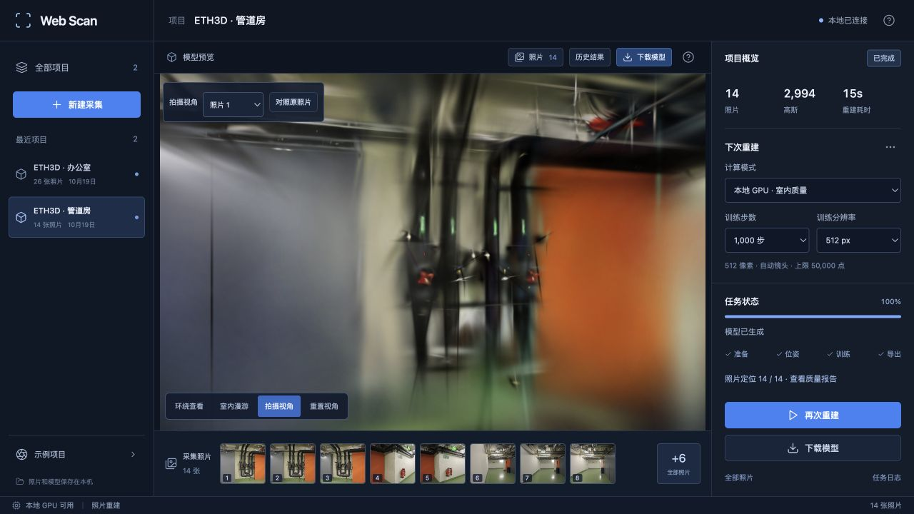
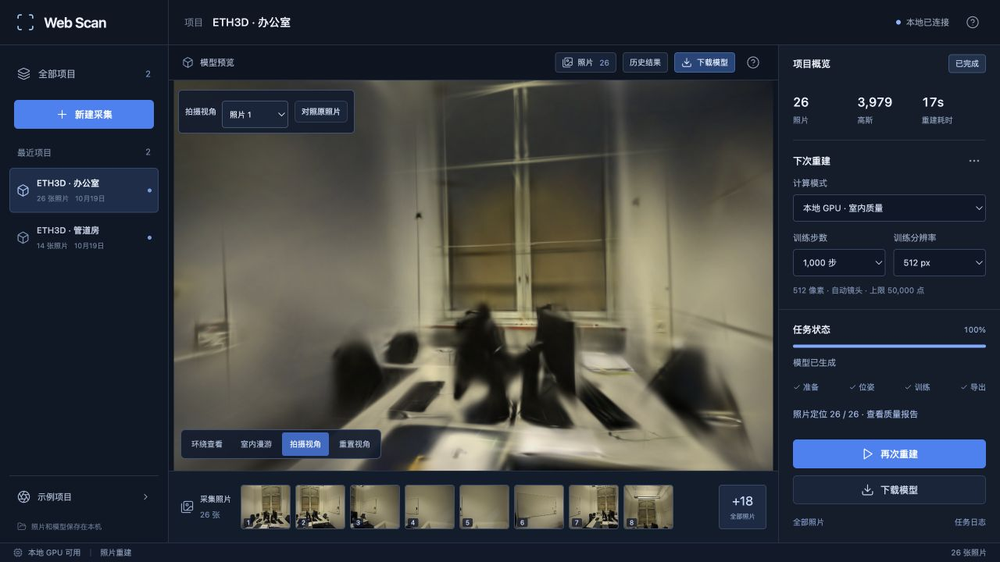

# 位姿求解的图像顺序

2026-10-19。修复并行特征提取让图像 ID 随完成先后变化的问题：先按采集文件名登记照片和相机，再并行提取 SIFT。它固定了进入匹配流程的图像顺序，但没有消除几何求解和训练的全部随机波动。

## 发现

沿用上轮 pipes 的相同输入：一次定位 11/14，另一次 14/14。两份数据库按照片名逐张对齐后，关键点和描述子的摘要完全一致；图像 ID 却不同。例如同一张 `0000-…jpg` 在两次数据库中分别为 ID 4 和 ID 3。

[COLMAP 3.13.0 的特征写入线程](https://github.com/colmap/colmap/blob/3.13.0/src/colmap/controllers/feature_extraction.cc)会在结果返回时给尚未登记的图片分配 ID。多线程完成顺序不同，即使特征相同，也会改变后续匹配任务使用的编号。它是已验证的不确定性来源，尚不能证明之前丢失三张视角只由这一点导致。

## 改动

先建立空数据库，通过 [PyCOLMAP 图像导入接口](https://github.com/colmap/colmap/blob/3.13.0/src/pycolmap/pipeline/images.cc)按排序后的输入名写入图像、相机和帧记录，再以同一清单执行 4 线程 SIFT。输入名由 Worker 的采集顺序前缀生成；不改照片像素、焦距先验、自动/同镜头选项、特征预算、匹配阈值或训练参数。

已有成功模型与原照片保留。由于 SfM 实现摘要变化，旧缓存不会被当作新版求解结果；下一次重建会生成新的位姿缓存，此后仍可复用。没有批量删除旧缓存或历史模型。

## 十二次真实 SfM 对照

Apple M5 / 32 GiB、PyCOLMAP 3.13.0，ETH3D pipes 14 张、office 26 张，自动相机模式。使用上轮任务的同一输入目录，每场景原版与新版各运行三次，顺序交错，每次使用新数据库。没有清理系统文件缓存；时间包含特征、匹配、映射和去畸变，不含 GPU 训练。

| 场景 | 版本 | 三次定位数 | 三次 ID 排列数量 | SfM 均值 | 时间范围 |
| --- | --- | --- | ---: | ---: | --- |
| pipes | 原版 | 14 / 14 / 14 | 3 | 5.95 s | 5.87–6.04 s |
| pipes | 固定顺序 | 14 / 14 / 14 | 1 | 6.03 s | 5.88–6.16 s |
| office | 原版 | 26 / 26 / 26 | 3 | 8.91 s | 8.78–9.02 s |
| office | 固定顺序 | 26 / 26 / 26 | 1 | 9.57 s | 8.88–10.74 s |

十二次都完整定位，没有失败视角；本轮对照未复现 11/14，不能宣称注册率已提高。按照片名对齐后的 SIFT 关键点和描述子，在同场景六次运行中完全一致。新版编号始终按文件名排列，保留了并行计算。

额外登记需要读取图像信息，本机均值约增加 0.08 / 0.66 秒，其中 office 一次耗时较高。仅三次重复，不能将全部差值视为稳定开销或声称提速。[逐次编号、特征摘要、匹配摘要和时间](benchmarks/sfm-order.json)

**仍未解决的部分：**新版每个场景的三次两视图几何摘要仍各不相同，稀疏点数和重投影误差也有变化。修复图像顺序不等于完全确定性的 SfM。后续继续检查随机采样与几何验证参数，不用一次完整定位掩盖已有波动。

## GPU 与缓存回归

新的独立采集中，各完成一次完整 SfM 与 1000 步 Metal 训练；pipes 再用相同配置复用缓存训练一次。均为 512 像素、5 万高斯预算、自动相机、每 8 张留出一张，GPU 串行使用，网页暂停模型渲染。

| 场景 | 输入 / 定位 | 训练 / 留出 | 位姿阶段 | SfM / 恢复 | 训练与导出 | 总计 | 实际高斯 | PLY 字节 | PSNR / SSIM |
| --- | --- | --- | --- | ---: | ---: | ---: | ---: | ---: | --- |
| pipes | 14 / 14 | 12 / 2 | 新计算 | 6.35 s | 8.08 s | 14.50 s | 2,994 | 708,133 | 18.405 / 0.7100 |
| pipes | 14 / 14 | 12 / 2 | 缓存复用 | 0.027 s | 8.07 s | 8.13 s | 2,988 | 706,717 | 16.468 / 0.6972 |
| office | 26 / 26 | 22 / 4 | 新计算 | 9.34 s | 8.07 s | 17.49 s | 3,979 | 940,593 | 19.595 / 0.8106 |

总计是 Worker 耗时，不含下载、准备和导入；从提交到下载校验分别为 14.55、8.19、17.53 秒。三次无未定位视角，完整 SH3 和下载字节校验通过。pipes 两次相机 JSON 摘要相同，缓存复用正确。[完整报告](benchmarks/sfm-order-reconstruction.json)

即使相机完全相同，pipes 两次训练的分数仍不同，这是仍需研究的训练波动；不能将本次顺序修复称为画质提升。表中是 Brush 的 512 像素留出评分，评估照片参与过 SfM，没有混入全照片训练成绩。

网页检查了新模型加载、原照片对照、项目切换和管道房拖动漫游，控制台无错误。1000 步模型的细小结构仍模糊，轨迹外仍有拉丝和缺失区域。





## 验证与复现

107 项后端、18 项前端测试及类型检查、构建通过。新增回归在独立进程中调用真实 PyCOLMAP，打乱文件创建顺序、改变图像尺寸与特征工作量，重复检查图像 ID、独立/共享相机以及焦距先验。没有把仅检查调用参数的模拟测试当作真实顺序验证。

```bash
.venv/bin/python -m pytest tests/test_sfm_order.py tests/test_quality.py tests/test_sfm_cache.py -q
```

重复 SfM 时使用相同的已归一化照片目录，原版可由 `git show 577874d:webscan/reconstruction.py` 保存到独立文件。每次在新的 Python 进程中加载对应模块并调用 `estimate_scene(images, work, callback, camera_mode="auto")`，输出目录必须不同，避免复用数据库；不要与 Torch 共用进程。此次完整输入、源码快照和日志在 `.data/benchmarks/sfm-order-20261019/`。

原照片、模型和截图遵循 [ETH3D 数据许可与署名](../THIRD_PARTY_NOTICES.md#test-dataset)。
