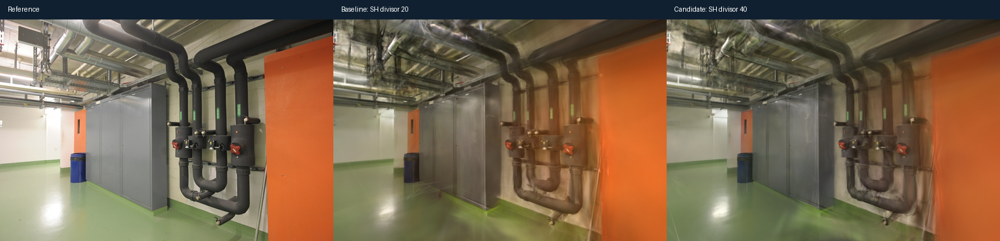
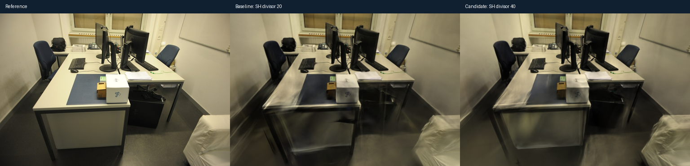
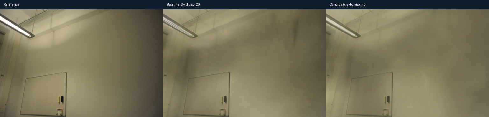
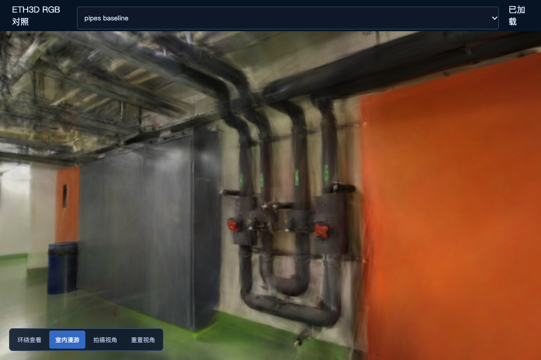
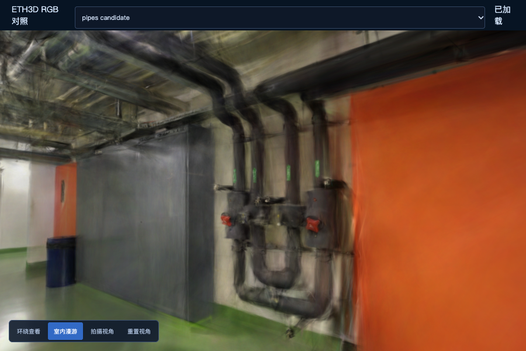
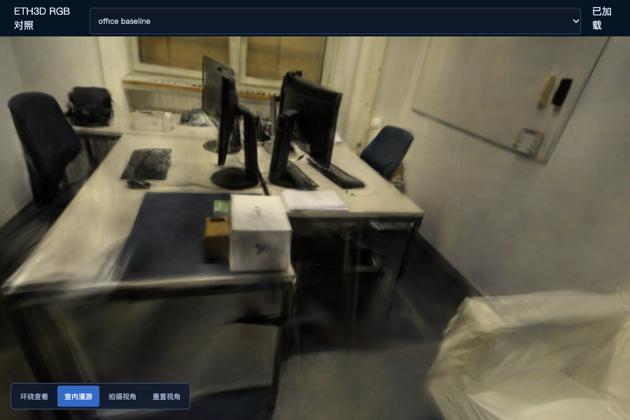
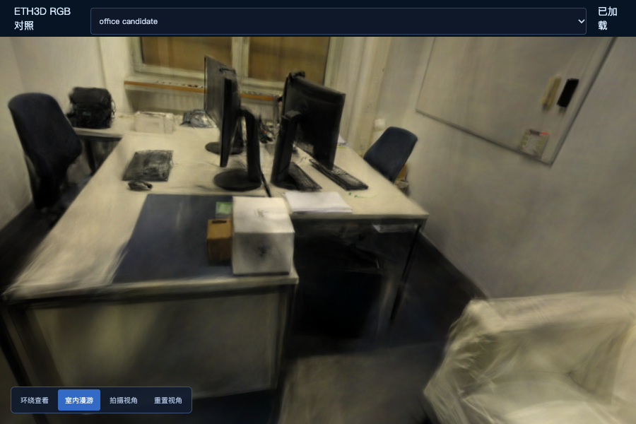

# 高阶 SH 慢学习率的长训练核验

2026-11-17。接续 [3000 步对照](SH-SLOW-LEARNING.md)，将两组同时设为 10000 步，检验高阶 SH 学习率减半的收益是否持续。代码基线为 [efbca68](https://github.com/sakorman/web-scan/commit/efbca68)。只扩展离线实验的 `--steps` 参数；默认仍是 3000，应用训练参数没有改变。

## 依据与边界

[DropAnSH-GS，Shuangkang Fang、I-Chao Shen 等，CVPR 2026](https://arxiv.org/abs/2602.20933v1) 提出针对邻域和高阶 SH 的 dropout，启发了上轮降低 SH 更新速度的假设。2026-11-17 核对[作者仓库 a7b1639](https://github.com/Fangkang515/DropAnSH-GS/tree/a7b1639a86c34ddaa8899a66c74e992f52e75e5e)，仍只有 README，没有训练实现或顶层许可证。本实验不是该论文方法的复现。

近期 [UGOD，Zhihao Guo、Peng Wang 等，2026-09-30 v1](https://arxiv.org/abs/2609.39089v1) 从弱约束高斯的不确定性与透明度贡献研究稀疏视角过拟合。它提醒我们不能把局部像素误差降低直接归因为 SH：几何、透明度和增点都可能共同变化。本轮没有实现不确定性网络或 dropout。

本轮还核对了 Brush 最新主分支 [1388f74（2026-10-03）](https://github.com/ArthurBrussee/brush/tree/1388f74c6fe0236f68ee4915564bf00e9d2e3747) 及其[渲染与训练优化 #556](https://github.com/ArthurBrussee/brush/pull/556)。该更新涉及上传、前向计算和优化器，没有可用于本机公平对照的公开测速数据，因此没有同时升级引擎。实际仍使用 Arthur Brussee 的 Brush 0.3.0 / Apache-2.0；[高阶 SH 梯度尺度](https://github.com/ArthurBrussee/brush/blob/v0.3.0/crates/brush-train/src/train.rs#L244-L250)确认除数 20 → 40 对应学习率 0.0001 → 0.00005，DC 为 0.002，完整 SH3 保留。

## 条件

Apple M5 / 32 GiB / Metal，原始照片计算出的共享 RADIAL 相机和稀疏点全部冻结。无雷达、深度或外部位姿输入，也未移植 CUDA 实现。

| 项目 | pipes | office |
| --- | --- | --- |
| 输入 / 定位 / 失败 | 14 / 14 / 0 | 26 / 26 / 0 |
| 训练 / 留出 | 12 / 2 | 22 / 4 |
| 留出索引（从 0 起） | 0、8 | 0、8、16、24 |
| 原图 / 去畸变尺寸 | 1600×1067 / 1600×1066 | 1600×1067 / 1600×1066 |
| 训练长边 / 评分网格 | 512 / 512×341 | 512 / 512×341 |
| 步数 / 高斯预算 / 种子 | 10000 / 150000 / 42 | 10000 / 150000 / 42 |

每场景两次基线、两次候选，共八次串行 GPU 训练；先做两场景第一轮基线，之后才生成候选适配器，第二轮反向排序。种子不保证 Metal 逐位复现。每次从同一稀疏初始化重新训练，没有从 3000 步检查点续训。应用的增点停止点也随总步数从 2400 变成 8000；只对比本轮相同 10000 步的两种参数，不把跨日程的分数增加当作参数收益。

SfM 缓存复用，计算耗时为 0；“复用全过程”从复制 SfM 开始到 SH3 模型读回结束，不包含照片上传和原始 SfM。进程独立启动但未清空 Metal 磁盘缓存，不是受控冷启动测速。训练时未启动验证浏览器。完整命令、引擎摘要、源任务、相机和参考图摘要见[公开数据](benchmarks/sh-long-learning.json)。原始照片和历史模型均保留。

评分复用 `scripts/compare_quality.py`，逐项核对相机、参考照片和尺寸，Lanczos 缩放后计算 RGB PSNR 和 11×11 Gaussian-window SSIM，所有留出视角等权平均。固定区域延续上轮：pipes 索引 8、第 12 块 `[0,255,128,341)`；office 索引 16、第 5 块 `[128,85,256,170)`。MSE 用 RGB [0,1]。

筛查沿用场景平均 PSNR 不下降超过 0.2 dB、SSIM 不下降超过 0.005，并要求 pipes 目标块在两次配对中都改善。这只是工程筛查，不是显著性检验。留出图参与过上游 SfM，且参数选择已参考这些固定留出图，因此不能将结果称为独立端到端评测或未见场景的泛化证据。

## 结果

两次重复的均值如下。分数只比较本轮同为 10000 步的基线与候选。

| 场景 | PSNR：20 → 40 | SSIM：20 → 40 | 固定区域 MSE：20 → 40 | 训练、评估和导出秒：20 → 40 |
| --- | --- | --- | --- | --- |
| pipes | 19.3891 → 19.6310 | 0.799977 → 0.800482 | 0.077844 → 0.064471 | 136.909 → 135.046 |
| office | 21.1885 → 20.9643 | 0.895881 → 0.894673 | 0.033452 → 0.032987 | 132.811 → 132.779 |

| 场景 / 重复 | PSNR 差值 (dB) | SSIM 差值 | 固定区域 MSE 变化 |
| --- | ---: | ---: | ---: |
| pipes / 1 | -0.4141 | -0.010088 | -14.52% |
| pipes / 2 | +0.8977 | +0.011099 | -19.17% |
| office / 1 | -0.4017 | -0.000878 | -25.70% |
| office / 2 | -0.0466 | -0.001539 | +46.18% |

区域 MSE 负值为改善。

| 任务 | 实际高斯 | PLY 字节 | 训练导出 (s) | 复用全过程 (s) |
| --- | ---: | ---: | ---: | ---: |
| pipes-baseline-1 | 150000 | 35401551 | 138.300 | 138.347 |
| pipes-candidate-1 | 150000 | 35401551 | 134.496 | 134.532 |
| pipes-baseline-2 | 150000 | 35401551 | 135.518 | 135.552 |
| pipes-candidate-2 | 150000 | 35401551 | 135.596 | 135.633 |
| office-baseline-1 | 150000 | 35401551 | 133.237 | 133.291 |
| office-candidate-1 | 150000 | 35401551 | 133.324 | 133.373 |
| office-baseline-2 | 150000 | 35401551 | 132.386 | 132.437 |
| office-candidate-2 | 150000 | 35401551 | 132.234 | 132.284 |

pipes 平均高斯数变化 +0.0，PLY 变化 +0 字节，训练导出耗时变化 -1.863 秒。两次重复不足以作提速结论。

office 平均高斯数变化 +0.0，PLY 变化 +0 字节，训练导出耗时变化 -0.032 秒。两次重复不足以作提速结论。

**候选未通过长训练筛查，不采用为通用默认值，除数继续保持 20。** office 平均 PSNR 下降 0.2242 dB，超过预设 0.2 dB 容差，且两次 PSNR / SSIM 均下降。pipes 的整图指标一降一升，第一轮两项降幅也超过容差；固定反光块虽两次改善，不能替代整图质量判断。office 同一固定区域第二轮反而增加 46.18% MSE。

八个模型均为 150000 个高斯、35401551 字节，结果不依赖最终点数和文件大小差异；训练轨迹和高斯的空间分布仍可能不同。3000 步的正向结果不足以支持跨日程默认修改，现有证据也不能证明所有慢学习率或 SH 正则方法无效。停止将这组参数作为直接默认替换候选；下一步先复查 office 索引 8 的稳定退化与训练采样波动，再决定是否引入新的约束，不继续盲扫学习率。

## 同视角与漫游

以下为第一次重复，顺序是同一去畸变参考、基线、候选，图像原生评分尺寸均为 512×341，标题不参与评分。pipes 反光区的颜色有所变化，但仍有墙面串色、管线重影与天花板细结构破碎；office 桌面、屏幕和椅子可辨认，前景与右下仍有拉丝和错误表面。





逐视角统计发现 office 索引 8 两次 PSNR 都下降（-2.1823 / -1.2180 dB），是更明确的复查对象。第一轮同视角可见候选的大面积墙面较参考更亮，白板线条仍模糊；以下保留该退化视角。



GPU 训练结束后，浏览器加载两场景第一轮四个完整 SH3 模型，从相同拍摄视角执行相同拖动进入室内漫游。四模型均加载成功，没有页面或资源错误；管线边缘漂浮与桌前拉丝仍明显，未看到足以推翻指标结论的细节提升。这条有限路径不能排除其它区域的空洞。

| 场景 | 基线 | 候选 |
| --- | --- | --- |
| pipes |  |  |
| office |  |  |

## 复现和验证

```bash
PYTHONPATH=. .venv/bin/python docs/benchmarks/sh-slow-learning.py \
  --steps 10000 --root .data/benchmarks/sh-long-learning-reproduction
.venv/bin/python -m scripts.compare_quality \
  --data .data/benchmarks/sh-long-learning-reproduction \
  --quick pipes-baseline-1 --detail pipes-candidate-1 \
  --size 512 --error-grid 4 \
  --output .data/benchmarks/sh-long-learning-reproduction/pipes-1-quality.json
```

其它三组配对替换场景和重复编号。训练脚本的默认 3000 步配置保持兼容，参数拒绝越界和非 500 倍数；实际新任务存于 `.data/benchmarks/sh-long-learning-20261117`。照片和衍生截图来自 Thomas Schöps 等提供的 [ETH3D](https://www.eth3d.net/datasets)，遵循 [CC BY-NC-SA 4.0](https://creativecommons.org/licenses/by-nc-sa/4.0/)。没有重新分发研究实现、模型或内部资料。

本轮启动检查发现旧服务健康接口返回 503、历史列表返回 500，数据库读取报 `unable to open database file`，后台队列停止；新进程可读取同一数据库。确认无活动任务后正常重启，健康与历史接口恢复 200，19 个项目、57 成功 / 1 失败 / 2 取消的历史任务数量一致。没有更改系统权限、替换数据库或删除文件；长期运行后的访问失效根因仍待定位。

305 项后端、18 项前端、类型检查和构建通过；保留既有 FastAPI TestClient 弃用提示和包体积提示。实验脚本的四个非法步数输入均在创建目录前被拒绝，八次真实训练完成且完整 SH3 读回通过。服务恢复后 50 次健康与历史列表检查均为 200。质量筛查未通过的是参数候选，软件回归没有失败。
