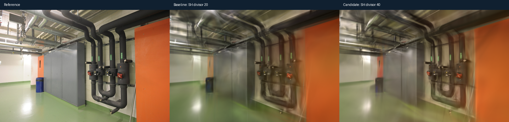
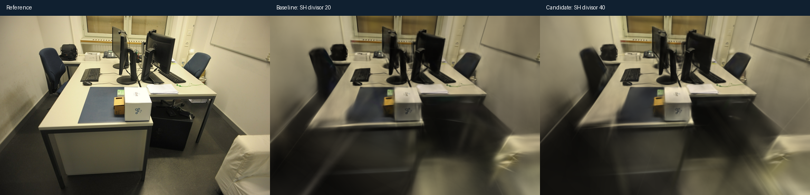
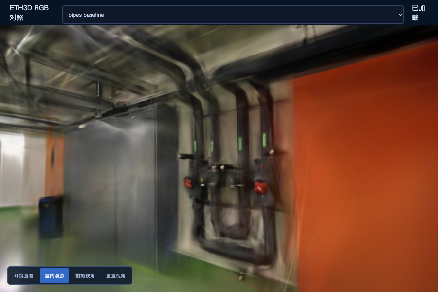
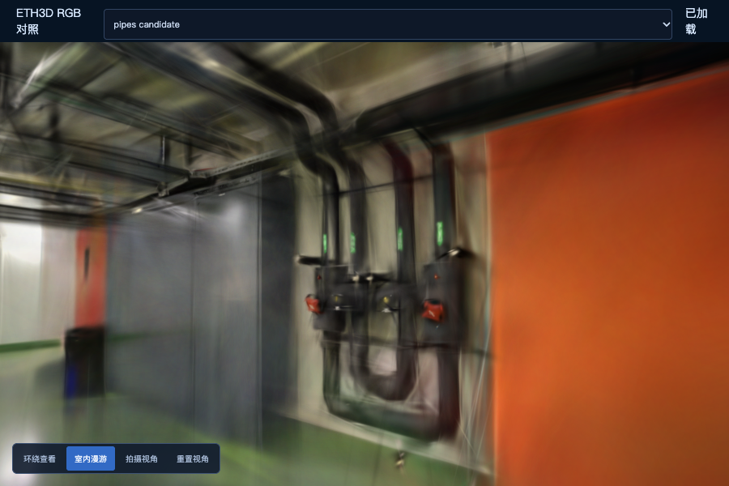
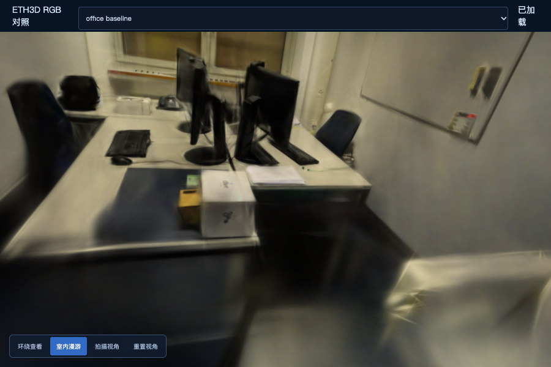
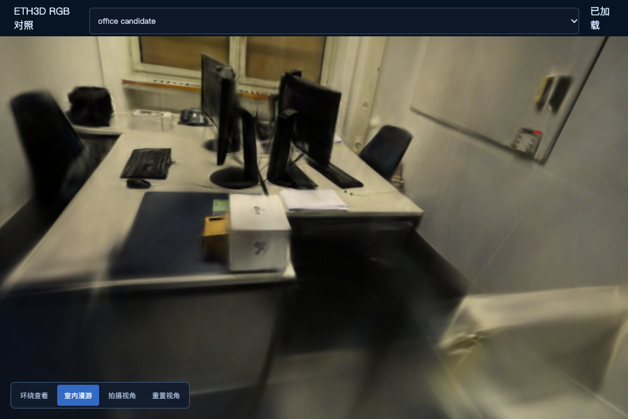

# 降低高阶 SH 学习率的重复对照

2026-11-16。针对 [局部轨迹核验](HOLDOUT-SUPPORT.md) 发现的 pipes 反光地面高误差，测试更慢的高阶球谐颜色更新。应用基线为 [967ec39](https://github.com/sakorman/web-scan/commit/967ec39)，实验只在独立适配器中追加 `--lr-coeffs-sh-scale 40`，其余参数与默认除数 20 相同。完整 SH3 保留，不截断球谐系数。

## 研究与假设

Shuangkang Fang、I-Chao Shen 等人的 [DropAnSH-GS（CVPR 2026，v1）](https://arxiv.org/abs/2602.20933v1) 将高阶 SH 过拟合作为稀疏视角问题的一部分，提出邻域与 SH dropout。[作者仓库 a7b1639](https://github.com/Fangkang515/DropAnSH-GS/tree/a7b1639a86c34ddaa8899a66c74e992f52e75e5e) 最后更新于 2026-03-12，本次核对仍只有 README，训练代码未发布，也无顶层许可证。这里据此提出可本地检验的弱假设：在有限训练步数内减缓高阶系数更新，可能缓解视角相关颜色过拟合。学习率减半不是 dropout，也不能验证论文方法本身。

更近的 [RGS（Xiaobiao Du、Yida Wang 等，2026-09-16 v1）](https://arxiv.org/abs/2609.19421v1) 使用几何先验与反射感知增点处理反光表面。[实现 c9ca8eb](https://github.com/xiaobiaodu/RGS/tree/c9ca8eb21b4d780f6d0902996c76858cb71228ca) 的渲染器显式依赖 CUDA 与 surfel 扩展，仓库无顶层许可证。本轮只参考其问题分析，没有移植代码或模型。这提示反光区也可能受几何与表示能力限制，不能先验认定为 SH 过拟合。

本地引擎为 Arthur Brussee 的 Brush 0.3.0（Apache-2.0），[配置](https://github.com/ArthurBrussee/brush/blob/v0.3.0/crates/brush-train/src/config.rs)和[训练实现](https://github.com/ArthurBrussee/brush/blob/v0.3.0/crates/brush-train/src/train.rs#L244-L250)确认高阶系数乘以除数的倒数。因此除数 20 → 40 使其学习率从 0.0001 降至 0.00005，DC 学习率保持 0.002。此配置适用于本机 Metal；未引入雷达、深度先验或新的位姿估计。

## 固定条件

Apple M5 / 32 GiB，串行启动八个 Brush 进程。每场景每种参数两次，先完成两场景第一次基线，再创建候选适配器；第二次按相反顺序运行。种子 42 不保证 Metal 训练逐位确定性。

| 项目 | pipes | office |
| --- | --- | --- |
| 输入 / 定位 / 失败 | 14 / 14 / 0 | 26 / 26 / 0 |
| 训练 / 留出 | 12 / 2 | 22 / 4 |
| 留出索引（从 0 起） | 0、8 | 0、8、16、24 |
| 来源任务 | `9b99bf8268944f1bba8ede3c2cd4b240` | `9b61678793164e06b9c37a617bfd46dd` |
| 相机 | 共享 RADIAL | 共享 RADIAL |
| 原始 / 去畸变照片 | 1600×1067 / 1600×1066 | 1600×1067 / 1600×1066 |
| 训练 / 评分 | 长边 512 / 512×341 | 长边 512 / 512×341 |
| 步数 / 高斯上限 / SH | 3000 / 150000 / SH3 | 3000 / 150000 / SH3 |

沿用已完成的照片 SfM，复制到独立实验任务；本轮 SfM 计算为 0 秒，复制和导出另计。所有照片参与过上游 SfM，因此这是固定几何的留出渲染评测，不是独立端到端重建评测。每个进程重新加载模型，未清空 Metal 磁盘编译缓存；不是受控冷启动测速。训练期间没有启动浏览器验证，全部训练后再进行评分和漫游。

评分复用 `scripts/compare_quality.py`，逐项核验输入、相机、参考图摘要与实际渲染尺寸。PSNR 和 SSIM 在同一 Lanczos 缩放参考网格计算，视角等权平均，不混用 Brush 日志中的 SSIM。预先选择 pipes 索引 8 的第 12 块 `[0,255,128,341)`，office 索引 16 的第 5 块 `[128,85,256,170)`；区域 MSE 基于 RGB [0,1]。工程筛查要求两场景平均 PSNR 不下降超过 0.2 dB、SSIM 不下降超过 0.005，并要求 pipes 目标块在两次配对中都改善。它不是统计显著性检验。

## 实测

两次重复的均值如下，表中为基线 → 候选。

| 场景 | PSNR (dB) | SSIM | 固定区域 MSE | 训练、评估及导出 (s) |
| --- | --- | --- | --- | --- |
| pipes | 18.7439 → 19.6831 | 0.759110 → 0.771580 | 0.069880 → 0.039266 | 22.997 → 22.981 |
| office | 20.9285 → 21.0437 | 0.866335 → 0.867654 | 0.049421 → 0.037697 | 23.532 → 23.650 |

pipes 两次配对 PSNR 分别增加 0.4840 / 1.3945 dB，固定区域 MSE 分别下降 41.97% / 45.62%，均通过预设筛查。office 两次 PSNR 增加 0.1091 / 0.1211 dB，SSIM 分别 -0.000980 / +0.003618，区域 MSE 下降 19.04% / 28.54%。office 的平均改善较小，不能认定结构细节稳定提高。

| 场景 / 参数 / 重复 | 实际高斯 | PLY 字节 | 训练导出 (s) | 缓存复用全过程 (s) |
| --- | ---: | ---: | ---: | ---: |
| pipes-baseline-1 | 11271 | 2661506 | 23.118 | 23.170 |
| pipes-candidate-1 | 11599 | 2738914 | 23.014 | 23.046 |
| pipes-baseline-2 | 11548 | 2726878 | 22.877 | 22.907 |
| pipes-candidate-2 | 11499 | 2715314 | 22.949 | 22.981 |
| office-baseline-1 | 14430 | 3407030 | 23.649 | 23.695 |
| office-candidate-1 | 14540 | 3432990 | 23.599 | 23.645 |
| office-baseline-2 | 14505 | 3424730 | 23.415 | 23.462 |
| office-candidate-2 | 14104 | 3330094 | 23.700 | 23.747 |

全过程从复制已完成的 SfM 开始，到模型读回结束；没有测量新的照片上传与冷 SfM。pipes 平均多 139.5 个高斯（1.22%）、PLY 多 32,922 字节；office 平均少 145.5 个高斯、PLY 少 34,338 字节。预算不变，但学习率可间接影响增点，现有实验不能拆分颜色更新与实际点数变化的贡献。耗时变化为 -0.016 / +0.118 秒，不作提速结论。

**保留为待扩展验证的参数候选，默认除数仍为 20。** 这轮证据支持在当前 3000 步、512 像素、固定几何留出条件继续验证除数 40；仅两次重复，不足以推广到全照片训练、10000 步或更高分辨率。下一轮先检验更长训练日程下收益是否保留，避免把有限步数内的暂态变化当成泛化提升。

## 同视角与漫游

第一次重复的同视角图依次为去畸变参考、基线和候选；评分不包含标题条。pipes 目标区域整体更接近参考，但左侧仍出现错误的橙色区域，管线和天花板有重影，不能宣称反光几何已修复。office 的屏幕边缘和桌前细节仍模糊，前景拉丝未消失。





浏览器实际加载两场景第一轮的四个 SH3 模型，并从相同拍摄视角做同样的室内漫游拖动。两组均有局部漂浮、前景拉伸及细结构不完整，有限路径检查不能排除其它空洞。下面保存基线 / 候选漫游对照。

| 场景 | 基线 | 候选 |
| --- | --- | --- |
| pipes |  |  |
| office |  |  |

首次浏览器检查发现临时验证页缺少 favicon 返回 404；给验证页设置空图标后重新检查。模型资源、四个拍摄视角切换与拖动漫游均成功，不涉及应用界面改动。

## 复现与记录

[训练脚本](benchmarks/sh-slow-learning.py)保留顺序、适配器差异、输入与相机摘要、逐次耗时、模型大小和完整 SH3 校验。[公开结果](benchmarks/sh-slow-learning.json)记录逐视角评分、两个固定区域与原始相机参数。独立目录为 `.data/benchmarks/sh-slow-learning-20261116`，原始照片与历史模型保留。

```bash
PYTHONPATH=. .venv/bin/python docs/benchmarks/sh-slow-learning.py \
  --root .data/benchmarks/sh-slow-learning-reproduction
.venv/bin/python -m scripts.compare_quality \
  --data .data/benchmarks/sh-slow-learning-reproduction \
  --quick pipes-baseline-1 --detail pipes-candidate-1 \
  --size 512 --error-grid 4 --output .data/benchmarks/sh-slow-learning-reproduction/pipes-1-quality.json
```

对 office 与第二次重复使用相应任务名。基线 / 候选适配器的差异只有一行 CLI 参数，实际执行过程通过完整 SH3 读取与评测集合校验。照片与衍生截图来自 [ETH3D](https://www.eth3d.net/datasets)，由 Thomas Schöps 等提供，遵循 [CC BY-NC-SA 4.0](https://creativecommons.org/licenses/by-nc-sa/4.0/)。研究仓库和权重没有重新分发。

验证：305 项后端、18 项前端、TypeScript 检查和构建通过；训练脚本编译检查通过，八个模型均成功读回完整 SH3。现有 FastAPI TestClient 弃用提示与构建包体积提示仍在，本轮没有新增应用依赖或源码。
