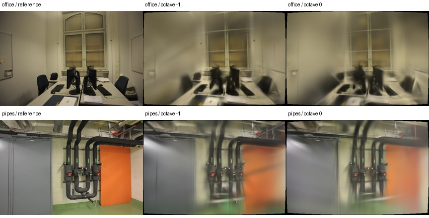

# 首层 SIFT 放大对定位覆盖的影响

在 ETH3D 的 office 和 pipes 上，将 CPU SIFT 的起始倍频程从 −1 改为 0，分别用四线程从新数据库重建。−1 从放大一倍的图像开始，0 从原尺寸开始。两种配置均使用相同 JPEG、1600 像素长边上限、8192 个特征上限及穷举引导匹配。默认与候选的输入照片分别逐场景相同。[COLMAP 3.13.0](https://github.com/colmap/colmap/tree/3.13.0) · [数据与署名](../THIRD_PARTY_NOTICES.md)

| 场景 / 起始倍频程 | 定位 / 输入 | 训练 / 留出 | 提取 / 完整 SfM / 训练导出 / 合计（秒） | 稀疏点 / 高斯 | SH3 PLY 字节 |
| --- | ---: | ---: | --- | ---: | ---: |
| office / −1 | 26/26 | 22/4 | 6.30 / 10.99 / 7.24 / 18.23 | 2,492 / 4,027 | 951,921 |
| office / 0 | 21/26 | 18/3 | 1.55 / 3.55 / 7.02 / 10.57 | 1,119 / 1,817 | 430,361 |
| pipes / −1 | 14/14 | 12/2 | 3.73 / 5.88 / 7.17 / 13.04 | 1,877 / 2,953 | 698,457 |
| pipes / 0 | 8/14 | 7/1 | 0.97 / 2.31 / 6.99 / 9.30 | 799 / 1,349 | 319,913 |

视角从 0 编号。起始倍频程为 0 时，office 丢失 11–15，pipes 丢失 3、5、6、7、12、13。两场景均触发共享内参重试，最终沿用自动内参模型。四个任务使用独立新数据库，操作系统文件缓存已热。训练串行使用本地 Brush 0.3 Metal、1000 步、长边 512、上限 15 万高斯。每组仅运行一次。候选配置分别少定位 5 张和 6 张照片，较短的整体耗时包含更少的训练视角与更小的模型。[逐任务配置、失败视角与评分](benchmarks/sift-octave.json)

## 共有的留出视角

留出名单随定位结果改变。office 原配置留出 0、8、16、24，新配置留出 0、8、21。pipes 原配置留出 0、8，新配置只留出 0。以下只比较双方都留出训练的照片。按各自相机将渲染重投影至相同的 512×341 原始照片坐标，使用共同有效像素。所有照片均参与上游 SfM。

| 场景 / 视角 | 共同像素 | −1 PSNR / SSIM | 0 PSNR / SSIM |
| --- | ---: | ---: | ---: |
| office / 0 | 170,058 | 21.858 / 0.81498 | 19.777 / 0.77539 |
| office / 8 | 171,514 | 22.472 / 0.91914 | 21.362 / 0.91627 |
| pipes / 0 | 170,002 | 20.337 / 0.73195 | 19.235 / 0.71508 |

保留 −1。下一步从缺失图像与已定位图像之间的几何验证内点数入手，检查是否能在粗尺度提取后有选择地补算细尺度特征。该实验只检验两组静态室内照片，未测自由漫游。[SIFT 线程基准](SIFT-THREADS.md)

图中使用 Thomas Schöps 等人的 ETH3D 照片与衍生渲染，沿用 CC BY-NC-SA 4.0。[数据集](https://www.eth3d.net/datasets)
