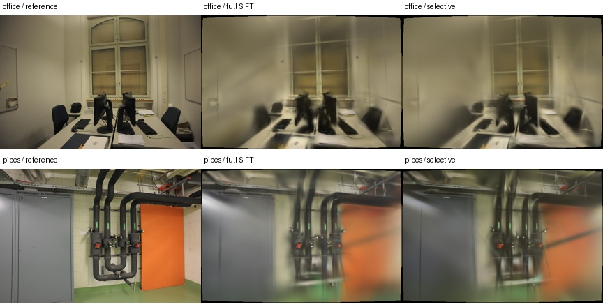
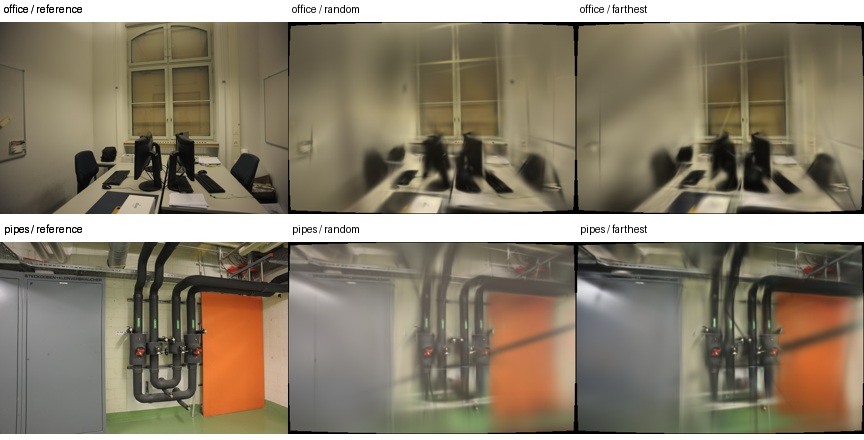

# 首层 SIFT 放大对定位覆盖的影响

在 ETH3D 的 office 和 pipes 上，将 CPU SIFT 的起始倍频程从 −1 改为 0，分别用四线程从新数据库重建。−1 从放大一倍的图像开始，0 从原尺寸开始。两种配置均使用相同 JPEG、1600 像素长边上限、8192 个特征上限及穷举引导匹配。默认与候选的输入照片分别逐场景相同。[COLMAP 3.13.0](https://github.com/colmap/colmap/tree/3.13.0) · [数据与署名](../THIRD_PARTY_NOTICES.md)

| 场景 / 起始倍频程 | 定位 / 输入 | 训练 / 留出 | 提取 / 完整 SfM / 训练导出 / 合计（秒） | 稀疏点 / 高斯 | SH3 PLY 字节 |
| --- | ---: | ---: | --- | ---: | ---: |
| office / −1 | 26/26 | 22/4 | 6.30 / 10.99 / 7.24 / 18.23 | 2,492 / 4,027 | 951,921 |
| office / 0 | 21/26 | 18/3 | 1.55 / 3.55 / 7.02 / 10.57 | 1,119 / 1,817 | 430,361 |
| pipes / −1 | 14/14 | 12/2 | 3.73 / 5.88 / 7.17 / 13.04 | 1,877 / 2,953 | 698,457 |
| pipes / 0 | 8/14 | 7/1 | 0.97 / 2.31 / 6.99 / 9.30 | 799 / 1,349 | 319,913 |

视角从 0 编号。起始倍频程为 0 时，office 丢失 11–15，pipes 丢失 3、5、6、7、12、13。两场景均触发共享内参重试，最终沿用自动内参模型。四个任务使用独立新数据库，操作系统文件缓存已热。训练串行使用本地 Brush 0.3 Metal、1000 步、长边 512、上限 15 万高斯。每组仅运行一次。候选配置分别少定位 5 张和 6 张照片，较短的整体耗时包含更少的训练视角与更小的模型。[逐任务配置、失败视角与评分](benchmarks/sift-octave.json)

## 共有的留出视角

留出名单随定位结果改变。office 原配置留出 0、8、16、24，新配置留出 0、8、21。pipes 原配置留出 0、8，新配置只留出 0。以下只比较双方都留出训练的照片。按各自相机将渲染重投影至相同的 512×341 原始照片坐标，使用共同有效像素。所有照片均参与上游 SfM。

| 场景 / 视角 | 共同像素 | −1 PSNR / SSIM | 0 PSNR / SSIM |
| --- | ---: | ---: | ---: |
| office / 0 | 170,058 | 21.858 / 0.81498 | 19.777 / 0.77539 |
| office / 8 | 171,514 | 22.472 / 0.91914 | 21.362 / 0.91627 |
| pipes / 0 | 170,002 | 20.337 / 0.73195 | 19.235 / 0.71508 |

保留 −1。下一步从缺失图像与已定位图像之间的几何验证内点数入手，检查是否能在粗尺度提取后有选择地补算细尺度特征。该实验只检验两组静态室内照片，未测自由漫游。[SIFT 线程基准](SIFT-THREADS.md)

图中使用 Thomas Schöps 等人的 ETH3D 照片与衍生渲染，沿用 CC BY-NC-SA 4.0。[数据集](https://www.eth3d.net/datasets)

## 按匹配内点选择细尺度补算照片

用新数据库以起始倍频程 0 完成一次粗定位。每张未定位照片选取最多两张已经定位、几何验证内点最多的邻居，内点数相同按文件名排序。把未定位照片与所选邻居合并，以 −1 重新提取，其他照片复用粗尺度特征。第二次定位重新计算全部匹配和几何。逐张核对两个场景共 40 张照片的关键点与描述子，补算照片与全量 −1 结果逐字节一致，其余与本次粗定位一致。视图图上的匹配支持可用于选择照片；Li 等人研究的是互联网照片采样，此处只检验每张失败照片选两个邻居的规则。[COLMAP 数据库格式](https://colmap.github.io/database.html) · [Li 等，CVPR 2026](https://openaccess.thecvf.com/content/CVPR2026/papers/Li_Long-Tail_Internet_Photo_Reconstruction_CVPR_2026_paper.pdf)

| 场景 | 粗定位 → 补算后定位 | 补算照片编号 | 粗定位 + 第二次 SfM / 训练导出 / 端到端（秒） | 稀疏点 / 高斯 / SH3 PLY 字节 |
| --- | --- | --- | --- | --- |
| office | 21/26 → 26/26 | 7、8、10–15 | 3.66 + 3.43 / 7.34 / 14.44 | 1,583 / 2,712 / 641,581 |
| pipes | 8/14 → 14/14 | 0、2–13 | 2.39 + 5.69 / 7.45 / 15.53 | 1,654 / 2,622 / 620,341 |

粗定位失败的照片分别是 office 11–15、pipes 3、5、6、7、12、13。粗定位尝试共享内参后选用自动内参，补算后自动内参即恢复全部照片。两次提取分别用时 1.60、1.93 秒和 1.03、3.70 秒。上表从新建粗定位数据库计至最终导出，系统文件缓存已热。对照复用前一节的独立全量 −1 重建，office 用时 18.23 秒，pipes 用时 13.04 秒。两种配置每场景各一次，四线程建图存在波动。

沿用前节训练与评分设置。office 的 22 张训练、4 张留出与基线逐张一致，pipes 为 12 张训练、2 张留出。共同像素上的逐图 PSNR / SSIM 等权均值在 office 从 19.765 dB / 0.78695 降到 18.637 dB / 0.77314，在 pipes 从 17.960 dB / 0.68563 降到 16.360 dB / 0.66060。六张中只有 office 第 16 张两项指标均提高。首张 pipes 渲染在橙色面板前出现横向暗带，两种配置均难以还原细线。此处只检查固定留出视角，自由漫游待验。[逐张分数、运行配置和模型统计](benchmarks/sift-selective.json)

图中照片与衍生渲染沿用 Thomas Schöps 等人 ETH3D 数据的 CC BY-NC-SA 4.0 许可。按匹配内点补算能恢复定位数量，但留出画质下降，且 pipes 需要补算 13/14 张。保留全量 −1。下一步检查同一张照片内各区域的稀疏点覆盖，定位细节损失的位置。[数据与署名](../THIRD_PARTY_NOTICES.md)

## 留出照片内的稀疏轨迹覆盖

复用上述四份完整模型，将同一张 512×341 原始留出照片等分为 4×4 格，边界按整像素向下取整。每格统计该留出照片上观测到、且至少由两张训练照片共同观测的有效稀疏点。使用各模型在原始照片上的 COLMAP 观测坐标，保留重投影误差小于 4 像素的轨迹。画质以两份模型都覆盖的像素计算。96 格的平方误差按像素数汇总，复现六张照片共 12 个整图 PSNR，最大差异小于 0.0000001 dB。[已有分区统计实现](../scripts/benchmark_holdout_support.py) · [96 格明细](benchmarks/sift-selective-tiles.csv)

| 场景 | 补算后支持轨迹数 | 分区数 | PSNR 下降的分区 | PSNR 变化中位数（dB） |
| --- | --- | ---: | ---: | ---: |
| office | 减少 | 38 | 22 | −0.519 |
| office | 持平或增加 | 26 | 18 | −2.334 |
| pipes | 减少 | 17 | 13 | −1.493 |
| pipes | 持平或增加 | 15 | 8 | −1.239 |

41 个轨迹持平或增加的分区中，仍有 26 个画质下降。单凭分区内的支持轨迹数量无法选出所有需要补算的位置。六张留出照片来自两处室内场景，相邻格共享相机和训练数据。本次复用渲染，仅测分区误差；位姿、种子布局和最终高斯数均可影响结果。下一步固定相机与训练照片，单独检查种子布局。

## 固定相机和点数比较三维选点

从全量 SIFT 的同一份 COLMAP 模型取子集。office 在 2,492 个点中保留 1,583 个，pipes 在 1,877 个点中保留 1,654 个，对齐上一轮补算的点数。基线按固定随机种子无放回采样。候选从固定随机起点开始，每次加入离已选集合最远的三维点，距离取 SfM 坐标中的欧氏距离。两组逐点核对原始坐标、颜色及轨迹关联，逐相机核对位姿和内参。两种点集各生成一次，分别重复训练两次。

office 定位 26/26，训练 22 张、留出 4 张；pipes 定位 14/14，训练 12 张、留出 2 张。两者都沿用全量自动内参模型，所有照片参与上游 SfM。训练串行使用同一 Brush Metal、1000 步和 512 长边，每次独立导出完整 SH3。表内各行按实际执行顺序列出。PSNR 和 SSIM 在相同的 512×341 原图坐标和有效像素上逐图计算，然后等权平均。

| 场景 | 选点 | 训练导出（秒） | 高斯数 | PLY 字节 | PSNR（dB） | SSIM |
| --- | --- | ---: | ---: | ---: | ---: | ---: |
| office | 随机 | 7.11 | 2,631 | 622,465 | 19.188 | 0.78067 |
| office | 最远点 | 7.20 | 2,767 | 654,561 | 19.410 | 0.78132 |
| office | 最远点 | 7.15 | 2,738 | 647,717 | 19.319 | 0.78093 |
| office | 随机 | 7.12 | 2,663 | 630,017 | 19.378 | 0.78119 |
| pipes | 随机 | 7.10 | 2,721 | 643,705 | 16.581 | 0.65841 |
| pipes | 最远点 | 7.10 | 2,686 | 635,445 | 17.940 | 0.68345 |
| pipes | 最远点 | 7.12 | 2,649 | 626,713 | 16.848 | 0.67804 |
| pipes | 随机 | 7.12 | 2,644 | 625,533 | 17.847 | 0.67561 |

按相邻的随机与最远点运行配对，office 两轮的 PSNR 差值为 +0.22、−0.06 dB，pipes 为 +1.36、−1.00 dB。pipes 两轮的 SSIM 均提高，但 PSNR 方向随重复而变化。读取稀疏模型并选点，office 随机 / 最远点用时 6 / 49 毫秒，pipes 用时 3 / 47 毫秒。耗时只覆盖复用现有 SfM 后的选点和训练阶段，未重新测量从照片开始的总耗时。仅覆盖两种室内场景、每种点集两次训练，暂不采用最远点作为默认选点方式。[点集摘要与逐视角评分](benchmarks/sift-seed-layout.json) · [既有深度点选点对照](ARKITSCENES.md)

首轮 pipes 两组在橙色面板上均有横向暗带，阀门处的小字仍难辨认。图片使用 Thomas Schöps 等人的 ETH3D 照片和衍生渲染，沿用 CC BY-NC-SA 4.0。本轮只比较固定留出视角。下一步优先检查能否减少重复的照片解码，同时保留每张图的特征和建图输入。[数据与署名](../THIRD_PARTY_NOTICES.md)
