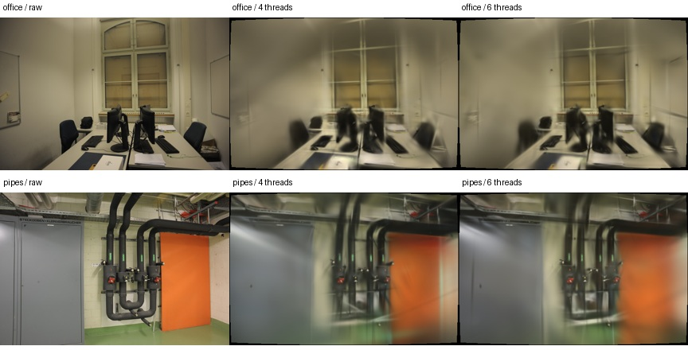

# 首轮 SIFT 特征提取的线程数与内存

Apple M5 上用相同 ETH3D 原始 JPEG，比较 PyCOLMAP 3.13.0 的 CPU SIFT 提取线程数。office 的 26 张照片产生 36,280 个特征，pipes 的 14 张产生 40,440 个特征。按照片名比较关键点和描述子，12 次单独提取所得的摘要在各自场景内完全一致。输入长边上限 1600，特征数上限 8192。每次都新建数据库，文件系统缓存已热。[COLMAP 3.13.0](https://github.com/colmap/colmap/tree/3.13.0) · [完整测量记录](benchmarks/sift-threads.json)

| 场景 | 4 线程提取（秒） | 6 线程提取（秒） | 4 / 6 线程进程峰值 RSS（MiB） |
| --- | --- | --- | --- |
| office | 6.30、6.24 | 5.06、5.04 | 1,994 / 2,956 |
| pipes | 3.71、3.76 | 3.09、3.06 | 1,990 / 2,948 |

每个场景交替测试两种线程数，两次计时后再各用一个独立进程测峰值 RSS。额外两个线程缩短提取耗时约 18%–20%，进程峰值内存增加约 960 MiB。该代价在照片和 GPU 训练共用内存的机器上需要计入预算，默认配置继续使用 4 线程。

## 实拍重建

四个独立任务从新 SfM 数据库开始。自动 SIMPLE_RADIAL 内参、穷举引导匹配、映射种子 42、匹配和建图均为 4 线程。Brush 0.3 Metal 的 1000 步训练串行运行，长边 512，高斯上限 15 万。均定位全部照片，未出现失败视角。office 留出 4 张、训练 22 张，pipes 留出 2 张、训练 12 张。两组渲染映射回相同原始照片，按共同有效像素评分。

| 场景 / 提取线程 | SfM / 训练导出 / 合计（秒） | 稀疏点 / 最终高斯 | SH3 PLY 字节 | PSNR / SSIM |
| --- | ---: | ---: | ---: | ---: |
| office / 4 | 10.96 / 7.34 / 18.30 | 2,492 / 4,042 | 955,461 | 19.352 / 0.79168 |
| office / 6 | 9.61 / 7.34 / 16.95 | 2,526 / 4,143 | 979,297 | 19.936 / 0.80077 |
| pipes / 4 | 5.96 / 7.79 / 13.75 | 1,877 / 2,911 | 688,545 | 18.194 / 0.68918 |
| pipes / 6 | 5.23 / 7.34 / 12.57 | 1,877 / 2,916 | 689,725 | 16.786 / 0.66852 |

每种配置只做一次完整重建。相同特征进入后续多线程求姿与 Metal 训练，画质变化方向因场景而异。下一步固定特征提取线程，隔离图像尺度对求姿覆盖和画质的影响。图中为两组场景第一个留出视角，ETH3D 原作者为 Thomas Schöps 等人，衍生画面沿用 CC BY-NC-SA 4.0。[数据集及署名](../THIRD_PARTY_NOTICES.md)

