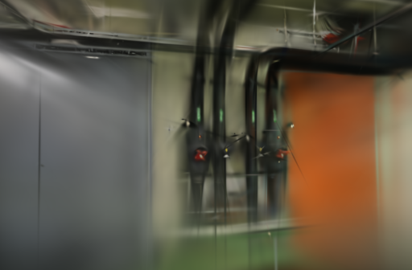
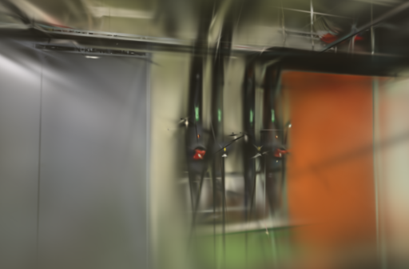
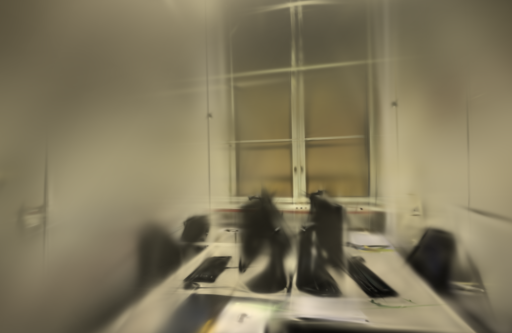
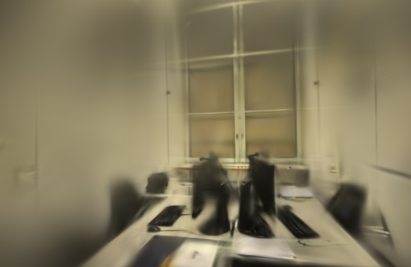

# SSIM统计量合批

2026-10-24。将SSIM的五组统计量合成两批计算后，数值与梯度检查通过，但本机组件计时中位数慢了13.1%和15.4%。这条方案未采用；保留测试与实验记录，后续若继续优化，应检查真正的内核融合，而不是仅减少高层卷积调用。

## 参考与实现范围

[fused-ssim官方实现](https://github.com/rahul-goel/fused-ssim)通过融合局部统计、利用高斯可分离性等方式减少中间内存访问，并提供Metal/MPS支持。[Faster-GS论文](https://fhahlbohm.github.io/faster-gaussian-splatting/assets/hahlbohm2026fastergs.pdf)的评测也使用融合SSIM，并在相同硬件和指标条件下比较。[Faster-GS代码](https://github.com/nerficg-project/faster-gaussian-splatting)和上述PyTorch扩展均未复制进本项目。

本轮仍使用Brush的Burn/Wgpu卷积。将依赖预测图的 `x`、`x²`、`xy` 沿批次维拼接，参考图的 `y`、`y²` 另成一批。两批分别做原有的可分离高斯模糊，再拆回原公式；前向高层卷积调用由10次变为4次。11×11窗口、sigma=1.5、零填充、常数和损失权重不变，参考图不要求梯度。

这是张量合批，没有实现fused-ssim的融合内核，也没有证明底层实际调度次数按同样比例减少。拼接、拆分与反向图仍有成本，不能凭调用次数推断提速。

## 数值验证与组件计时

用奇数尺寸13×17和偶数尺寸12×20的RGB图，分别测试非均匀纹理与相同平坦图，逐值比较SSIM图和预测图梯度；同时确认参考图没有梯度。SSIM图最大绝对差为 `1.1921e-7`，梯度最大差为 `1.8626e-9`，平坦图两项差为0。原有标量回归也通过。这些是选定用例下的浮点误差范围，不是任意图像逐位相同的保证。

最终组件基准保留原始实现的运算顺序，仅增加候选分支。早期探查曾重排基线统计量的执行顺序，已排除并单独保存；没有真实照片训练使用那份探查版本。

Apple M5 / 32 GiB、Metal，Rust / Cargo 1.99.0，锁定Brush `3edecbb2fe79d3e2c87eeab85b15e0b1dd10d486`及原Cargo.lock。每种尺寸按原始、合批、合批、原始顺序串行运行；每块预热5次、记录20次，每设置共40个计时样本。计时从输入同步后开始，到前向、反向和梯度均值读回完成结束；不含输入构造，不是GPU硬件时间戳或完整重建耗时。

| 输入尺寸（高×宽×通道） | 原始中位数 | 合批中位数 | 变化 |
| --- | ---: | ---: | ---: |
| 336×512×3 | 5.2984 ms | 5.9921 ms | +13.1% |
| 384×512×3 | 6.0129 ms | 6.9371 ms | +15.4% |

三个测试入口通过：原SSIM回归、合批数值 / 梯度检查、手动组件基准。release构建通过。没有测峰值内存，也没有将变慢具体归因于某一个内核或分配操作。

## 真实照片回归

组件已经变慢，因此取消原计划的三场景12次3000步采用评估，只做两组ETH3D各一对1000步流程回归，确认实际照片、完整模型和评测能正常完成。基线与候选使用同一个 `0.3.0-ssim-batch-study` 二进制，关闭阶段同步计时与图像张量缓存。

| 场景 | 输入 / 定位 | 训练 / 留出 | 相机模式 | 失败视角 |
| --- | ---: | ---: | --- | --- |
| pipes | 14 / 14 | 12 / 2 | 同镜头，固定几何 | 无 |
| office | 26 / 26 | 22 / 4 | 同镜头，固定几何 | 无 |

1000步、512像素长边、15万高斯预算、SH3，每100步增点、80%后停止增长、每500步导出，每8张留出一张。固定图像消费、初始点与增点索引顺序，CLI、CPU采样和GPU种子均为42；其它参数组保持原值。GPU串行运行，pipes先基线后候选，office顺序相反，训练时本任务没有打开模型预览。

相机、照片、稀疏文件、留出集合和参考摘要逐项一致。`compare_quality.py`统一到长边512后计算RGB PSNR、11×11 Gaussian-window SSIM。留出照片参与过SfM，仍是固定几何下的渲染对照。

| 场景 | SSIM | 训练、评估与导出 | 实际高斯 | PLY 字节 | PSNR / SSIM |
| --- | --- | ---: | ---: | ---: | --- |
| pipes | 原始 | 7.1465 s | 2,996 | 708,605 | 16.7332 / 0.67361 |
| pipes | 合批 | 9.1543 s | 2,936 | 694,445 | 17.6547 / 0.68020 |
| office | 原始 | 7.1240 s | 3,972 | 938,941 | 19.0644 / 0.78793 |
| office | 合批 | 8.1180 s | 4,001 | 945,785 | 18.5485 / 0.78430 |

短训练画质有升有降，不作为采用依据。每场景只测一对，进程按一秒粒度轮询，实际点数也不同，不能把耗时比例当作一般退化幅度。每次启动独立进程，系统和驱动缓存未清空；未重算SfM，未测新的API端到端时间，编译与输入复制不计入表中。

下图展示每组第一个留出视角，左右相机和画幅一致，原生PNG未修改：

| 场景 | 原始 | 合批 |
| --- | --- | --- |
| pipes |  |  |
| office |  |  |

四个模型通过完整SH3、评估输出与参考摘要校验。浏览器加载两组基线 / 候选并拖动候选漫游，无控制台错误或警告；1000步模型仍粗糙，细管、线缆和覆盖外区域有模糊、拉丝及缺失。

## 取舍与复现

不启用合批路径，正式引擎和默认训练参数不变。保留数值回归和组件基准，用于后续独立验证Wgpu可用的融合实现；真正的融合需要新的前向、反向和内存测试，不能沿用本轮结果。原照片与全部历史模型保留。

项目基线 [46703c9](https://github.com/sakorman/web-scan/commit/46703c9)。[ssim-batch.patch](benchmarks/ssim-batch.patch)是相对干净Brush `v0.3.0`的累计实验补丁，不能叠加旧补丁。按[源码构建方法](LOADER-ORDER.md#决定与复现)换用本补丁。测试与组件基准串行运行：

```bash
cargo test --manifest-path .tools/brush-order-study/Cargo.toml \
  --locked --release -p brush-train ssim -- \
  --include-ignored --nocapture --test-threads 1
```

真实照片仅切换 `WEBSCAN_BATCH_SSIM=0` / `1`。两组将 `WEBSCAN_SINGLE_LOADER`、`WEBSCAN_TRACE_LOADER`、`WEBSCAN_SEEDED_SAMPLING`、`WEBSCAN_STABLE_INIT`、`WEBSCAN_SEED_GPU`、`WEBSCAN_STABLE_REFINE` 设为1，其余此前实验开关及 `WEBSCAN_PROFILE_STAGES` 均设为0。CLI使用1000步、增长结束800步、最终评估1000步，其余沿用[固定参数](ADAM-EPSILON.md#取舍与复现)。

本机资料在 `.data/benchmarks/ssim-batch-20261024/`；[公开JSON](benchmarks/ssim-batch.json)保存最终与排除的探查、原始微基准、数值误差、四次实拍结果及文件摘要。应用源码没有变化，标准CI检查后端、前端、类型与构建。补丁保留[Brush Apache-2.0许可](../THIRD_PARTY_NOTICES.md#brush-loading-experiment)，照片和渲染保留[ETH3D署名及许可](../THIRD_PARTY_NOTICES.md#test-dataset)。

后续改为复用固定参考图统计量，三场景训练耗时有所下降，画质与默认档仍待复核。[参考统计缓存](SSIM-REFERENCE.md)
