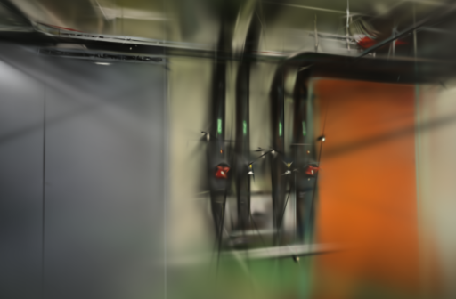
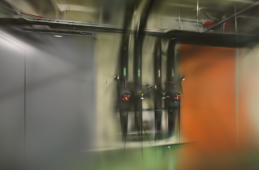
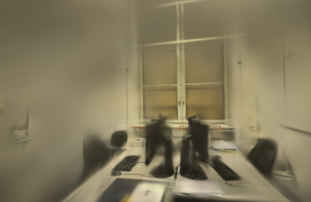
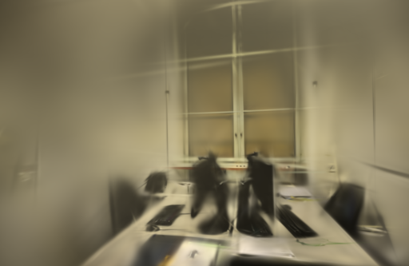

# 参考二阶矩与尺寸边界

后续：[SSIM输入尾部复制修复](SSIM-TAIL.md)定位到626宽度的向量化连续复制问题。修复后不填充的TUM组件探查一致，但默认引擎尚未替换。

2026-10-25。将实验缓存中的参考方差改为二阶矩 `E[y²]`，使用时再计算 `E[y²]−μ²`。在五组真实照片 / 尺寸组合上，新路径与不缓存的原公式得到完全相同的SSIM图和预测梯度；原方差缓存仍有约 `3.3e-5` 的最大图值差。

但TUM的626×469输入出现局部异常，原路径自身重复计算也不一致。两组ETH3D的八次短重建未取得一致画质收益，第一次更新后仍有运行差异。本轮保留实验实现和诊断，不接入默认训练，也不追加长训练。

## 改动与依据

上轮[默认质量档](SSIM-REFERENCE-DEFAULT.md)的管道房未通过画质筛查。这轮只检验一个假设：缓存方差会提前执行减法；改存二阶矩，让减法留在原有统计表达式附近，可能减少融合计算的数值差异。

[SSIM论文](https://ece.uwaterloo.ca/~z70wang/publications/ssim.pdf)给出局部统计的定义，[fused-ssim的Metal实现](https://github.com/rahul-goel/fused-ssim/blob/a7c48d6dd7ac6dc39a7958c7c4452e0b10418f38/ssim.mm)也在组合SSIM时从一、二阶矩求方差。本轮使用已有Burn卷积，没有复制融合内核，尚未证明上轮画质下降就是减法位置造成的。

新增 `WEBSCAN_CACHE_SSIM_MOMENTS=1`，只在参考统计缓存启用时生效；关闭后沿用缓存方差的实现。不缓存、容量不足、无图像标识和参考图需要梯度的回退行为不变。仍保留两张浮点统计图，预算256 MiB，没有增加逻辑缓存容量。

核对[Faster-GS项目](https://fhahlbohm.github.io/faster-gaussian-splatting/)及[论文](https://fhahlbohm.github.io/faster-gaussian-splatting/assets/hahlbohm2026fastergs.pdf)。其代码当前最新提交[c60ea269](https://github.com/nerficg-project/faster-gaussian-splatting/commit/c60ea269b7cf3ebda527d640b6fdd31462f91b41)于10月10日加入绝对梯度增点及GOF选择策略；本轮没有移植或测试该策略，继续单独排查本机Burn/Wgpu/Metal数值路径。

## 数值与梯度

两项实际GPU回归通过，分别覆盖方差缓存和二阶矩缓存：冷填充、命中后预测图变化、容量不足、尺寸变化、无标识、需梯度参考图回退。新路径在所测小尺寸合成图上与原路径完全一致，不能据此推断所有尺寸都正确。

进一步使用上一轮首次重复的第一张留出照片及对应基线渲染作为冻结输入，共三组照片，每组测试512和1024长边上限。参考图采用与训练加载器相同的Triangle缩放，不放大TUM；预测图也对齐到对应画幅。第二次调用将预测值统一改为 `0.97x+0.01`，验证命中缓存后梯度仍随预测变化。

比较缓存方差、缓存二阶矩和不缓存的重复调用，均以第一次不缓存的结果为参照。组件使用CLI相同的 `tasks_max=64` / `ExclusivePages` 设置，读取完整SSIM图后再反向计算均值损失梯度；读回会同步，不能代表训练中的完整融合调度。

| 照片 / 尺寸 | 方差缓存最大图值差 | 二阶矩最大图值差 | 二阶矩最大预测梯度差 | 原路径重复最大图值差 |
| --- | ---: | ---: | ---: | ---: |
| pipes / 512×336 | 3.219e-5 | 0 | 0 | 0 |
| pipes / 1024×673 | 3.231e-5 | 0 | 0 | 0 |
| office / 512×333 | 3.213e-5 | 0 | 0 | 0 |
| office / 1024×667 | 3.266e-5 | 0 | 0 | 0 |
| TUM / 512×384 | 3.308e-5 | 0 | 0 | 0 |
| TUM / 626×469 | 5.796e-2 | 6.450e-1 | 7.437e-4 | 7.072e-2 |

上表每格取冷填充和命中后两种预测的最大值，来自加入原路径重复调用的那次诊断。更早的探查记录也保留在JSON中，没有挑选较小误差覆盖它。诊断测试只检查完整执行及有限数值；626×469这一行没有通过数值一致性检查。

626×469的较大差异集中在图像右下部。原路径重复调用在两种预测下分别有43、60个图值分量的差异超过 `1e-4`；命中阶段的预测梯度最大差约 `1.027e-3`。这说明不能把所有异常归因于新缓存。

另做一次组件尺寸对照：只在参考图、预测图右侧各补两列零像素，变成628×469。原路径重复及二阶矩路径的图值、梯度差均为0，方差缓存仍约 `3.314e-5`。补列同时改变了边界计算，这只是尺寸相关的定位线索，尚不能认定某个向量化或卷积内核是根因。没有把补列应用到训练照片、相机内参或最终模型。

## 八次真实照片短重建

两组使用同一个 `0.3.0-ssim-moments-study` 二进制。**这里的基线为缓存方差，候选为缓存二阶矩**，不是上一轮“不缓存 / 缓存”的比较。

| 场景 | 输入 / 定位 | 训练 / 留出 | 实际尺寸 | 未定位照片 |
| --- | ---: | ---: | --- | --- |
| ETH3D pipes | 14 / 14 | 12 / 2 | 512×336 | 无 |
| ETH3D office | 26 / 26 | 22 / 4 | 512×333 | 无 |

Apple M5 / 32 GiB，Metal。复用同镜头几何，1000步、15万高斯预算、SH3、种子42；每100步增点，第800步结束增长，每500步导出，第1000步评估。每8张留出一张，留出图参与过SfM。输入、稀疏几何、相机、消费顺序、评估集合及参考摘要全部一致。

每设置各两次，pipes按基线、候选、候选、基线运行，office反向交错，GPU串行，训练期间关闭本任务模型预览。每次从空缓存启动，系统与驱动缓存未清空。计时包括训练、评估、早期参数读回及模型导出，不含编译、复制和SfM；未重测API端到端时间或峰值内存。按一秒粒度轮询，首次进程较慢，毫秒差不作为提速依据。

下表统一用 `compare_quality.py` 在512长边计算RGB PSNR及11×11 Gaussian-window SSIM，视角等权平均，不混用Brush原生指标。

| 场景 | 重复 | 缓存项 | 耗时 | 实际高斯 | PLY字节 | PSNR / SSIM |
| --- | ---: | --- | ---: | ---: | ---: | --- |
| pipes | 1 | 方差 | 8.1604 s | 3,004 | 710,493 | 17.2394 / 0.68199 |
| pipes | 1 | 二阶矩 | 7.1221 s | 2,954 | 698,693 | 17.8637 / 0.68156 |
| pipes | 2 | 方差 | 7.1686 s | 2,986 | 706,245 | 17.3022 / 0.68343 |
| pipes | 2 | 二阶矩 | 7.1591 s | 2,978 | 704,357 | 17.2137 / 0.68146 |
| office | 1 | 方差 | 7.1671 s | 3,992 | 943,661 | 18.9560 / 0.79024 |
| office | 1 | 二阶矩 | 7.1530 s | 3,973 | 939,177 | 18.6921 / 0.78257 |
| office | 2 | 方差 | 7.1672 s | 3,980 | 940,829 | 17.6359 / 0.77851 |
| office | 2 | 二阶矩 | 7.1612 s | 3,994 | 944,133 | 19.0399 / 0.78741 |

pipes平均PSNR 17.2708 → 17.5387，SSIM 0.68271 → 0.68151；office为18.2960 → 18.8660、0.78437 → 0.78499。短训练与两次重复不足以确认收敛收益。8000条消费和缓存记录全部核对；两组都缓存全部训练照片，pipes占47.25 MiB、每1000步命中988次，office占85.85 MiB、命中978次，仅统计驻留的两张浮点统计图。

## 早期状态和网页检查

保存训练前及更新1、10、100次后的完整PLY，共32份。每个场景四次初始化逐字节一致，但两种设置在第一次更新后就出现重复运行差异。旋转分量最大差：

| 场景 | 方差缓存两次重复 | 二阶矩缓存两次重复 |
| --- | ---: | ---: |
| pipes | 0.0025581 | 0.0026011 |
| office | 0.0025098 | 0.0025236 |

这些是导出归一化四元数的差异，不是旋转角，也不包含优化器内部状态。前100次快照位于首次增点之前，读回会影响调度。本轮没有证明训练完全确定，也没有证据将剩余差异都归因于SSIM。

固定展示首次重复的第一个留出视角，直接复制原生评估PNG，未修改：

| 场景 | 缓存方差 | 缓存二阶矩 |
| --- | --- | --- |
| pipes |  |  |
| office |  |  |

八个模型通过完整SH3和评估校验。浏览器加载两场景首次重复的基线 / 候选，拖动候选漫游，无控制台错误或警告。1000步模型仍很粗，管线、窗框及文字模糊，覆盖外有空洞、漂浮片段和拉丝，未确认漫游质量提升。

## 取舍与复现

保留二阶矩实验开关，正式Brush不替换，默认参数不改。暂缓6000步对照，下一步先为626×469异常做最小复现，分开检查张量布局、尺寸尾部和卷积边界；不能凭补列探查就修改采集图或相机。

基线提交[63a4fdd](https://github.com/sakorman/web-scan/commit/63a4fdd)。[ssim-moments.patch](benchmarks/ssim-moments.patch)是相对Brush `v0.3.0` 的累计实验补丁，不能叠加旧补丁。按[构建方法](LOADER-ORDER.md#决定与复现)换用该文件。两项缓存回归与release构建通过；实际引擎、源码补丁及Cargo.lock摘要见[完整JSON](benchmarks/ssim-moments.json)。

```bash
cargo test --manifest-path .tools/brush-order-study/Cargo.toml --locked --release \
  -p brush-train cached_ -- --nocapture --test-threads 1
```

照片探查需要三组 `pipes / office / tum-desk-reference.jpg` 与对应 `*-prediction.png`，具体来源和SHA-256见JSON。运行 `reference_moment_photo_probe -- --ignored --nocapture --test-threads 1`，通过 `WEBSCAN_SSIM_PROBE_DIR` 指定目录；只测试TUM补列对照时额外设 `WEBSCAN_SSIM_PROBE_ALIGNMENT=1`。这些探查不执行重建，也不写回输入。

真实训练两组均将 `WEBSCAN_CACHE_SSIM_REF=1`、`WEBSCAN_TRACE_STATE=1`，其余开关沿用[参考缓存实验](SSIM-REFERENCE.md#取舍与复现)，只切换 `WEBSCAN_CACHE_SSIM_MOMENTS=0/1`。CLI为1000步、512长边、增长结束800，其余参数保持上述设置。

本机结果在 `.data/benchmarks/ssim-moments-20261025/`。应用源码未变，标准CI检查后端、前端、类型和构建，不编译独立Brush补丁。代码保留[Brush Apache-2.0许可](../THIRD_PARTY_NOTICES.md#brush-loading-experiment)；照片、渲染保留[ETH3D及TUM署名与许可](../THIRD_PARTY_NOTICES.md)。
