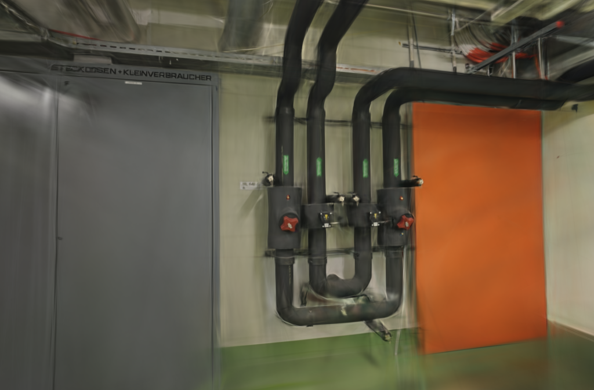
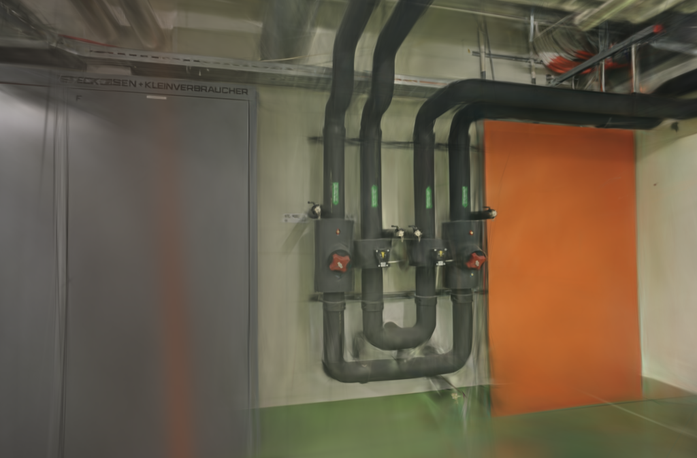
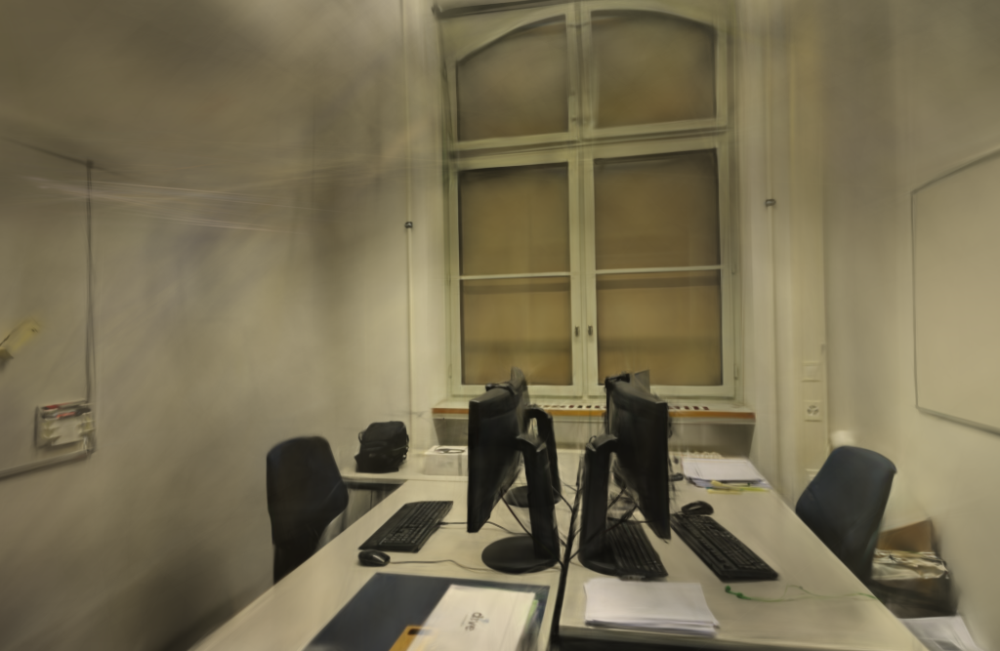
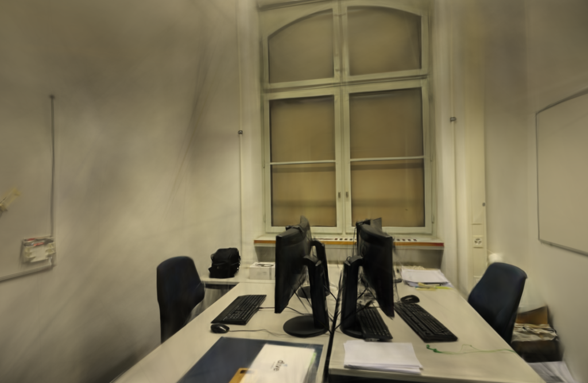
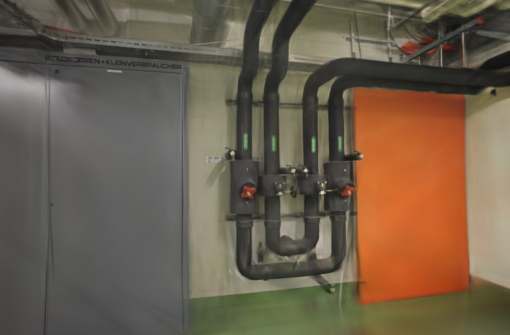
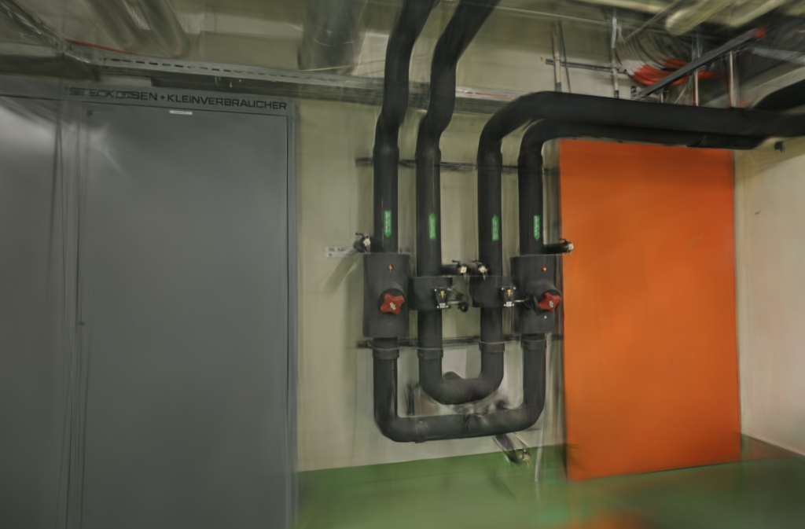

# 参考统计缓存：默认质量档复核

后续：[二阶矩与尺寸边界实验](SSIM-MOMENTS.md)在部分尺寸消除了组件差异，但发现原路径也存在尺寸相关的重复性异常，尚未启用默认缓存。

2026-10-25。沿用上一轮的SSIM参考统计缓存，完成三场景12次6000步对照。训练、评估与导出平均耗时仍下降，但pipes平均PSNR下降0.480 dB、SSIM下降0.01120，超过预先设定的筛查门槛。因此不接入默认训练路径，正式引擎保持不变。

这是[3000步实验](SSIM-REFERENCE.md)的后续验证，没有新增引擎代码。office和TUM desk通过本轮筛查，但每组只有两次重复，不足以证明一般性的质量不退化；不能把这次耗时差称为同画质提速。

## 固定条件

Apple M5 / 32 GiB，Metal。两组使用同一个已保存的 `0.3.0-ssim-reference-study` 二进制，只切换 `WEBSCAN_CACHE_SSIM_REF=0/1`，缓存上限256 MiB。引擎SHA-256为 `e2b04a343049b47fa88bea7abadc01b079d66c640aa3131e707e0d8b7e67d560`。

6000步、1024像素目标长边、15万高斯预算、SH3；每100步增点，第4800步结束增长，每500步导出，第6000步评估。种子42，图像消费、初始点及增点索引顺序固定；仍不保证GPU训练逐位确定。阶段同步计时、图像张量缓存、SSIM合批和Adam稳定项调整均关闭。

| 场景 | 输入 / 定位 | 训练 / 留出 | 去畸变输入 | 实际训练与评估尺寸 |
| --- | ---: | ---: | --- | --- |
| ETH3D pipes | 14 / 14 | 12 / 2 | 1600×1051 | 1024×673 |
| ETH3D office | 26 / 26 | 22 / 4 | 1600×1042 | 1024×667 |
| TUM desk | 96 / 96 | 84 / 12 | 626×469 | 626×469 |

三组均使用固定的同镜头几何，没有未定位照片。TUM只用RGB，不使用深度或官方轨迹，也不放大到1024。每8张留出一张，不参与训练，但参与过SfM。这轮与默认档对齐步数和分辨率上限；应用默认使用全部照片，两者不要混淆。

GPU串行，pipes / TUM按关闭、开启、开启、关闭运行，office反向交错；训练期间没有打开本任务的模型预览。每次启动新进程，从空缓存开始，包含首次填充、训练、评估和导出，排除编译、输入复制和SfM。操作系统与驱动缓存未清空，不能称为整机冷启动。复用历史几何，没有新的SfM或API端到端计时。

运行前写入的筛查条件是：输出完整、平均耗时下降，且每个场景平均PSNR下降不超过0.2 dB、SSIM下降不超过0.005。这是工程筛查，不是统计非劣效检验；没有在看到结果后调整门槛或补跑到通过为止。

## 耗时与画质

输入、稀疏几何、完整相机JSON、图像消费顺序、评估集合及参考摘要均核对一致。`compare_quality.py`将同画幅渲染和参考图统一到长边512，计算RGB PSNR与11×11 Gaussian-window SSIM，视角等权平均。下面使用重新评分结果；JSON另保留Brush原生尺寸的指标，不混算。

| 场景 | 平均耗时：关闭 → 开启 | 时间变化 | 平均PSNR：关闭 → 开启 | 平均SSIM：关闭 → 开启 | 筛查 |
| --- | --- | ---: | --- | --- | --- |
| pipes | 197.04 → 178.23 s | −9.55% | 17.1704 → 16.6904 | 0.74977 → 0.73857 | 未通过 |
| office | 191.33 → 178.22 s | −6.85% | 20.7612 → 20.8744 | 0.86727 → 0.87280 | 通过 |
| TUM desk | 136.05 → 133.57 s | −1.83% | 23.3379 → 23.4522 | 0.84611 → 0.84571 | 通过 |

| 场景 | 重复 | 缓存 | 耗时 | 实际高斯 | PLY字节 | PSNR / SSIM |
| --- | ---: | --- | ---: | ---: | ---: | --- |
| pipes | 1 | 关闭 | 198.85 s | 77,941 | 18,395,626 | 16.5425 / 0.74338 |
| pipes | 1 | 开启 | 178.21 s | 75,444 | 17,806,334 | 17.0066 / 0.74008 |
| pipes | 2 | 关闭 | 195.24 s | 78,172 | 18,450,142 | 17.7983 / 0.75615 |
| pipes | 2 | 开启 | 178.25 s | 78,163 | 18,448,018 | 16.3742 / 0.73706 |
| office | 1 | 关闭 | 192.38 s | 77,079 | 18,192,194 | 21.0109 / 0.86755 |
| office | 1 | 开启 | 178.31 s | 75,961 | 17,928,346 | 20.8057 / 0.86646 |
| office | 2 | 关闭 | 190.27 s | 75,758 | 17,880,438 | 20.5116 / 0.86700 |
| office | 2 | 开启 | 178.14 s | 75,443 | 17,806,098 | 20.9430 / 0.87914 |
| TUM desk | 1 | 关闭 | 136.07 s | 150,000 | 35,401,551 | 23.2844 / 0.84664 |
| TUM desk | 1 | 开启 | 134.05 s | 150,000 | 35,401,551 | 23.5184 / 0.84704 |
| TUM desk | 2 | 关闭 | 136.03 s | 150,000 | 35,401,551 | 23.3915 / 0.84559 |
| TUM desk | 2 | 开启 | 133.09 s | 150,000 | 35,401,551 | 23.3861 / 0.84438 |

计时带有一秒轮询粒度，实际点数也有波动。TUM两组均达到15万点，但平均时间差只有2.48秒，不能外推为其他密集场景的稳定收益。pipes两次重复的基线本身有明显波动；此次结果足以暂缓接入，尚不能认定缓存是画质下降的唯一原因。

## 缓存代价

| 场景 | 参考统计逻辑数据 | 条目 / 训练照片 | 每6000步命中 | 未缓存照片 |
| --- | ---: | ---: | ---: | ---: |
| pipes | 189.28 MiB | 12 / 12 | 5,988 | 0 |
| office | 250.13 MiB | 16 / 22 | 4,348 | 6 |
| TUM desk | 255.35 MiB | 38 / 84 | 2,675 | 46 |

72,000条消费和参考缓存记录全部核对。放不下的照片继续计算参考统计，没有丢弃训练视角。上表仅为驻留均值、方差的浮点数据，不包含模型、分配器、临时张量或CPU照片，未测进程 / GPU峰值内存。分辨率提高后可驻留照片变少，不能直接套用上一轮512像素的命中率。

## 同视角图片与浏览器检查

固定展示首次重复的第一个留出视角，原生评估PNG直接复制，未修图、重采样或替换为原照片；公开JSON记录来源、尺寸和摘要。

| 场景 | 关闭缓存 | 开启缓存 |
| --- | --- | --- |
| pipes |  |  |
| office |  |  |
| TUM desk |  |  |

另外展示pipes第二次重复的第一个留出视角，这是本轮PSNR降幅最大的视角：20.1792 → 18.1901 dB，SSIM 0.82710 → 0.80853。不是新的实验或另一套相机。

| 关闭缓存 | 开启缓存 |
| --- | --- |
|  |  |

12个模型均通过完整SH3和评估文件校验。浏览器加载三组首次重复的基线 / 候选，分别拖动候选漫游，无控制台错误或警告。薄管、线缆和小字仍不清晰，覆盖之外仍有空洞、漂浮片段和拉丝；通过格式及交互检查不代表画质达标。

## 决定与复现

本轮不采用默认缓存，保留全部实验结果。下一步可单独验证缓存二阶原始矩 `E[y²]`，再按原路径现场计算 `E[y²]−μ²`，观察是否减少运算分组变化。它只是待测假设，尚未实现，也未证明是pipes退化的原因。先做数值 / 梯度及短程轨迹检查，再决定是否值得长训练。

项目基线与补丁来自[305e826](https://github.com/sakorman/web-scan/commit/305e826)，复用[ssim-reference.patch](benchmarks/ssim-reference.patch)及[构建、开关说明](SSIM-REFERENCE.md#取舍与复现)，本轮没有重建二进制或重复未变的Rust单测。训练参数改为：

```text
--total-steps 6000 --max-resolution 1024 --max-splats 150000
--eval-split-every 8 --eval-every 6000 --eval-save-to-disk --export-every 500
--refine-every 100 --growth-stop-iter 4800 --seed 42
```

完整配置、源码及引擎摘要、逐次记录、原生指标与同尺寸评分见[公开JSON](benchmarks/ssim-reference-default.json)。本机独立记录在 `.data/benchmarks/ssim-reference-default-20261025/`，没有覆盖原照片和历史模型。应用代码未改，标准CI继续检查后端、前端、类型和构建；该CI不编译独立Brush实验补丁。

参考[SSIM原论文](https://ece.uwaterloo.ca/~z70wang/publications/ssim.pdf)、[fused-ssim](https://github.com/rahul-goel/fused-ssim)、[Faster-GS论文](https://fhahlbohm.github.io/faster-gaussian-splatting/assets/hahlbohm2026fastergs.pdf)及[官方代码](https://github.com/nerficg-project/faster-gaussian-splatting)。本轮仍使用Burn/Wgpu/Metal，未移植这些项目的融合内核，CUDA成绩不作为本机结果。Brush、ETH3D和TUM保留[原作者署名与许可](../THIRD_PARTY_NOTICES.md)；ETH3D渲染为CC BY-NC-SA 4.0，TUM渲染为CC BY 4.0。
