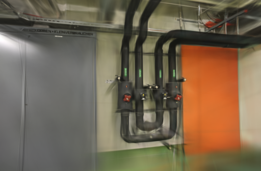
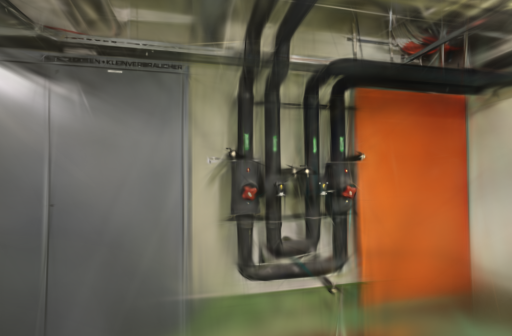
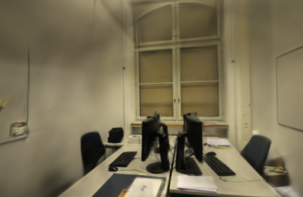
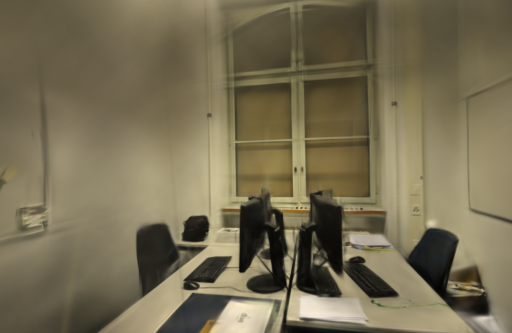

# 复用参考照片的SSIM统计量

2026-10-24。固定3000步、512像素长边，缓存参考照片的局部均值和方差后，三场景训练、评估与导出的平均耗时减少约5%～9%。缓存保留47～252 MiB逻辑数据。管道房的平均SSIM略降，只有两次重复，暂不替换正式引擎；先保留这个性能方向，再验证默认质量档。

## 为什么可以复用

[SSIM原论文](https://ece.uwaterloo.ca/~z70wang/publications/ssim.pdf)中的参考均值和参考方差只取决于参考照片。当前训练输入已冻结，因此这两项不需要每次重新卷积；预测图统计量和预测 / 参考协方差仍逐次计算。

[fused-ssim](https://github.com/rahul-goel/fused-ssim)展示了合并局部统计的实现，并支持Metal/MPS；[Faster-GS论文](https://fhahlbohm.github.io/faster-gaussian-splatting/assets/hahlbohm2026fastergs.pdf)与[代码](https://github.com/nerficg-project/faster-gaussian-splatting)强调对齐画质、预算与平台。本轮在已有Burn卷积上复用固定参考项，没有复制这些项目的融合内核，也没有把CUDA论文成绩换算成本机速度。

缓存键包含冻结图像路径和尺寸，每个训练器独立持有，上限256 MiB。命中时跳过参考均值与方差所需的四次高层卷积调用；缓存放不下、没有图像标识或参考张量需要梯度时，回到原SSIM计算。旧的加载器和训练接口仍可使用，无图像标识时不会缓存。

缓存只适用于同一训练中保持不变的参考照片。若以后加入每步裁剪、翻转或参考图颜色增强，需要新的失效规则，不能直接沿用这个键。

## 正确性与组件测试

GPU回归覆盖冷填充、重复命中且预测图变化、恰好填满预算、容量不足、同路径尺寸变化、无标识，以及需梯度参考图的回退。对照原公式，所测奇偶尺寸RGB图的最大图值差为 `1.1921e-7`，预测梯度差为 `1.8626e-9`；需要梯度时，参考梯度与原路径相同。缓存字节和条目数均符合预期。

组件计时采用与Brush CLI相同的 `tasks_max=64`、`ExclusivePages` 运行时设置。每种尺寸按关闭、开启、开启、关闭顺序串行执行，每块预热5次，再记录20次，每设置共40个样本。计时包含前向、预测梯度反向和梯度均值读回；输入构造和开始前同步不计入。缓存填充在预热期完成，这是命中后的组件成本，不是完整重建时间。

| 高×宽×通道 | 每次计算中位数 | 复用参考统计中位数 | 变化 |
| --- | ---: | ---: | ---: |
| 336×512×3 | 5.7770 ms | 4.5426 ms | −21.4% |
| 384×512×3 | 7.1097 ms | 5.6742 ms | −20.2% |

最初使用默认测试运行时的探查结果不一致，另存于JSON，没有与上表混算。随后明确对齐CLI运行时再测；这些运行不能单独证明差异完全由内存策略引起。正确性测试、组件基准和release构建均通过。

## 三场景实拍对照

Apple M5 / 32 GiB、Metal、Rust / Cargo 1.99.0。两组均使用 `0.3.0-ssim-reference-study`，源码锁定Brush `3edecbb2fe79d3e2c87eeab85b15e0b1dd10d486`及原Cargo.lock。

| 场景 | 输入 / 定位 | 训练 / 留出 | 未定位照片 | 相机 |
| --- | ---: | ---: | --- | --- |
| ETH3D pipes | 14 / 14 | 12 / 2 | 无 | 同镜头，固定几何 |
| ETH3D office | 26 / 26 | 22 / 4 | 无 | 同镜头，固定几何 |
| TUM desk | 96 / 96 | 84 / 12 | 无 | 同镜头，固定几何，只用RGB |

每场景两设置各两次，共12次。3000步、512像素长边、15万高斯预算、SH3，每100步增点、80%步数后停止增长、每500步导出，每8张留出一张。固定图像消费、初始点、增点索引顺序及种子42；阶段同步计时、统计合批、图像张量缓存和稳定项调整均关闭。

GPU串行运行，顺序交错，本任务浏览器未打开模型；系统和驱动缓存未清空。每次进程从空参考统计缓存开始，计时包含填充、训练、评估和导出，不含编译与输入复制。复用历史几何，未重算SfM、未测新的API端到端耗时。

| 场景 | 基线平均耗时 | 缓存平均耗时 | 本轮降幅 | 缓存数据 | 缓存条目 / 训练照片 | 每3000步命中 |
| --- | ---: | ---: | ---: | ---: | ---: | ---: |
| pipes | 23.2576 s | 21.2501 s | 约8.6% | 47.25 MiB | 12 / 12 | 2,988 |
| office | 23.2738 s | 21.2730 s | 约8.6% | 85.85 MiB | 22 / 22 | 2,978 |
| TUM desk | 39.4139 s | 37.4180 s | 约5.1% | 252 MiB | 56 / 84 | 1,942 |

36,000条消费和缓存记录全部核对。TUM有28张训练照片的统计量未驻留，继续按原公式计算；容量上限没有触发错误或丢弃照片。MiB只统计保留的均值 / 方差浮点数据，不包含CPU照片、模型、临时缓冲或分配器容量，未测实际峰值内存。

六次配对的候选都较快，但两次重复仍不足以得到普遍速度保证。计时按一秒粒度轮询，且实际高斯数有运行波动；下表完整保留点数与画质，不把这个降幅称为严格同点数、同画质提速。

## 画质与输出

相机、输入、稀疏文件、评估集合和参考图摘要逐项一致。`compare_quality.py`在相同画幅、长边512下计算RGB PSNR与11×11 Gaussian-window SSIM，按视角等权平均。留出照片仍参与过SfM。

| 场景 | 重复 | 参考统计 | 耗时 | 实际高斯 | PLY 字节 | PSNR / SSIM |
| --- | ---: | --- | ---: | ---: | ---: | --- |
| pipes | 1 | 重算 | 23.2651 s | 11,570 | 2,732,070 | 18.9618 / 0.74562 |
| pipes | 1 | 缓存 | 21.2538 s | 11,358 | 2,682,038 | 17.9633 / 0.73330 |
| pipes | 2 | 重算 | 23.2500 s | 12,074 | 2,851,014 | 17.8442 / 0.74539 |
| pipes | 2 | 缓存 | 21.2465 s | 11,437 | 2,700,682 | 18.5204 / 0.74535 |
| office | 1 | 重算 | 23.2736 s | 14,452 | 3,412,222 | 20.7589 / 0.85631 |
| office | 1 | 缓存 | 21.2717 s | 14,501 | 3,423,786 | 21.0244 / 0.86067 |
| office | 2 | 重算 | 23.2740 s | 14,570 | 3,440,070 | 20.8364 / 0.85869 |
| office | 2 | 缓存 | 21.2742 s | 14,450 | 3,411,750 | 20.9755 / 0.86526 |
| TUM desk | 1 | 重算 | 39.3940 s | 73,325 | 17,306,250 | 22.7078 / 0.83325 |
| TUM desk | 1 | 缓存 | 37.3933 s | 73,125 | 17,259,050 | 22.6504 / 0.83231 |
| TUM desk | 2 | 重算 | 39.4337 s | 73,578 | 17,365,958 | 22.4257 / 0.83208 |
| TUM desk | 2 | 缓存 | 37.4427 s | 73,283 | 17,296,338 | 22.5846 / 0.83308 |

pipes平均PSNR 18.4030 → 18.2418、SSIM 0.74551 → 0.73933；office为20.7977 → 20.9999、0.85750 → 0.86297；TUM为22.5667 → 22.6175、0.83266 → 0.83270。没有三场景一致的画质提升，管道房仍需复核；浮点误差很小也不保证完整训练逐位一致。

固定展示首次重复的第一个留出视角，原生PNG未修改：

| 场景 | 重算参考统计 | 缓存参考统计 |
| --- | --- | --- |
| pipes |  |  |
| office |  |  |
| TUM desk |  |  |

12个模型均通过完整SH3和评估校验。浏览器加载三组基线 / 候选并拖动候选漫游，无控制台错误或警告。薄管、线缆、小字仍模糊，离开拍摄覆盖区域仍有拉丝、漂浮片段和空洞。

## 取舍与复现

保留参考统计缓存作为后续候选，正式引擎暂不替换。下一步验证默认6000步 / 1024目标分辨率档的画质与缓存代价，并复核pipes的波动，再决定是否整合到默认路径。原照片、历史模型和现有下载功能保留。

项目基线 [088494e](https://github.com/sakorman/web-scan/commit/088494e)。[ssim-reference.patch](benchmarks/ssim-reference.patch)是相对干净Brush `v0.3.0` 的累计补丁，不能叠加旧补丁；按[构建方法](LOADER-ORDER.md#决定与复现)换用本补丁。正确性与组件计时分别运行，避免GPU测试并行竞争：

```bash
cargo test --manifest-path .tools/brush-order-study/Cargo.toml --locked --release \
  -p brush-train cached_reference_preserves_gradients_and_fallbacks -- --nocapture --test-threads 1
cargo test --manifest-path .tools/brush-order-study/Cargo.toml --locked --release \
  -p brush-train benchmark_reference_statistics -- --ignored --nocapture --test-threads 1
```

两组只切换 `WEBSCAN_CACHE_SSIM_REF=0` / `1`。均将 `WEBSCAN_SINGLE_LOADER`、`WEBSCAN_TRACE_LOADER`、`WEBSCAN_SEEDED_SAMPLING`、`WEBSCAN_STABLE_INIT`、`WEBSCAN_SEED_GPU`、`WEBSCAN_STABLE_REFINE`、`WEBSCAN_TRACE_REF_CACHE` 设为1，其余此前实验开关设为0，CLI沿用[3000步参数](ADAM-EPSILON.md#取舍与复现)。

本机记录在 `.data/benchmarks/ssim-reference-20261024/`；[公开JSON](benchmarks/ssim-reference.json)保存两种运行时的组件结果、数值检查、12次实拍、逐视角评分、缓存计数和文件摘要。应用源码未变，由提交后的标准CI检查后端、前端、类型和构建。补丁保留[Brush Apache-2.0许可](../THIRD_PARTY_NOTICES.md#brush-loading-experiment)；ETH3D与TUM照片和渲染分别保留[数据集署名及许可](../THIRD_PARTY_NOTICES.md)。
