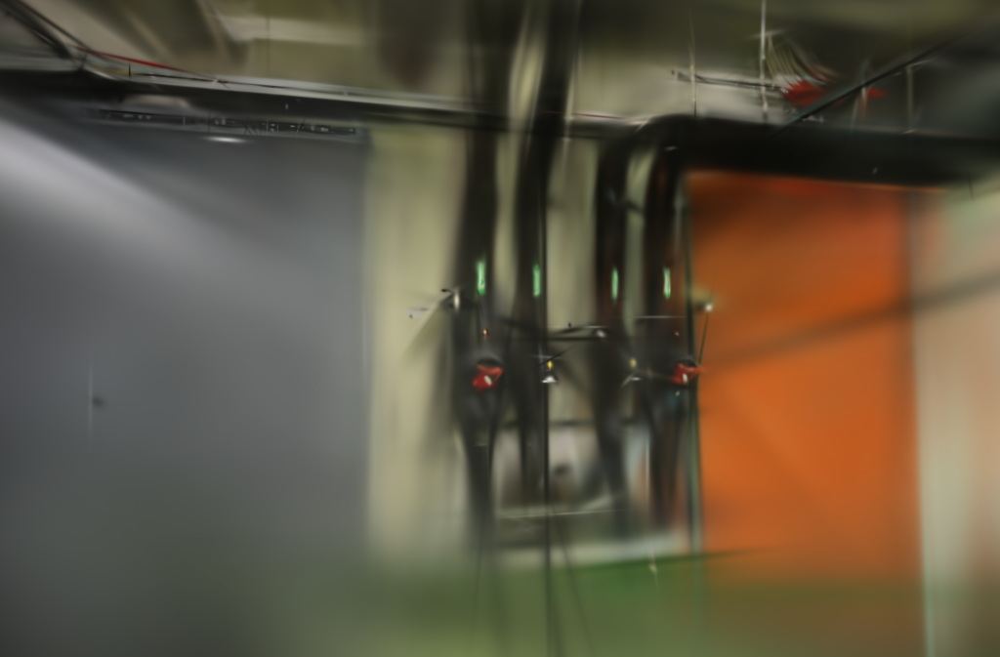
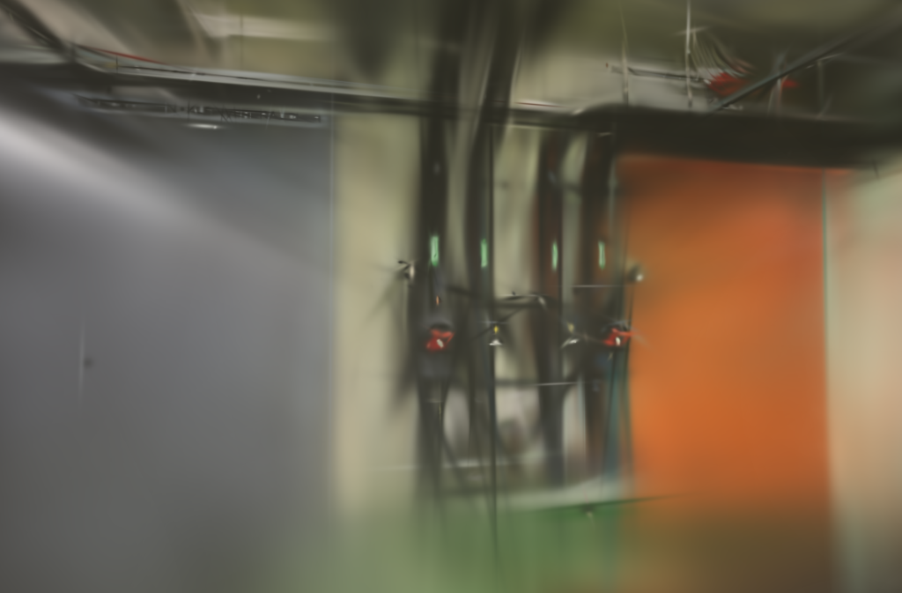
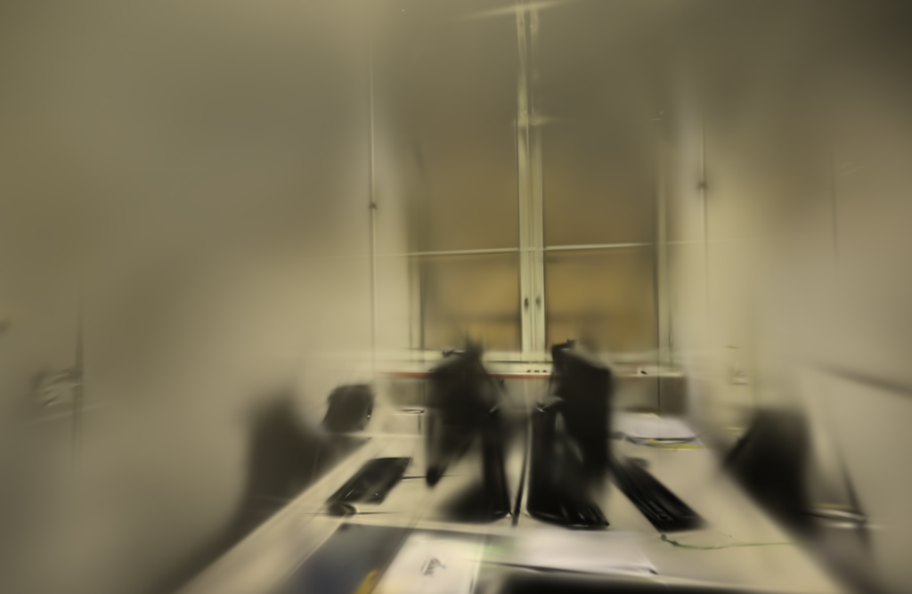
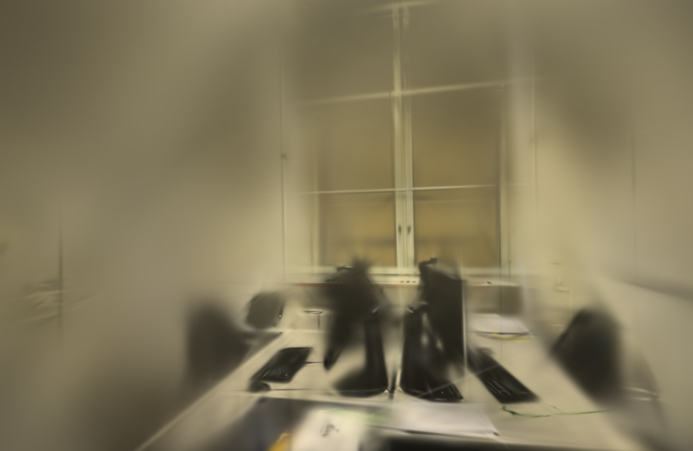
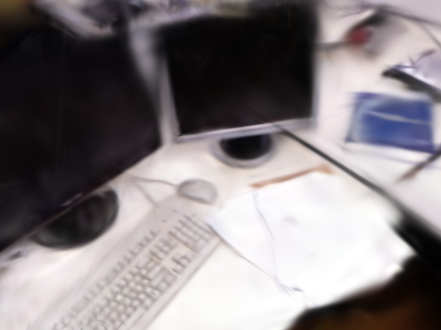

# SSIM 输入尾部修复

2026-10-25。上一轮在 TUM 的 626×469 输入中发现局部重复结果不一致。这轮把问题缩小到 Burn / CubeCL 的转置张量连续复制：上传和普通逐元素乘法都正确，HWC 转 CHW 后的最后向量在宽度625、626时出现漏写。为打包输出向量增加“总元素数必须整除向量宽度”的条件后，624～628五种相邻宽度全部通过，未经填充的 TUM 组件探查也恢复一致。

修复只存在于独立实验构建，正式 Brush 和应用默认路径没有替换。原始照片、相机尺寸和校准信息均未修改。

## 最小复现

固定 GPU 输入 `[469, width, 3]`，数值先上传，再检查 HWC 逐元素平方、转置后的 CHW 读取和平方，以及两次相同的高斯模糊。宽度625、626的旧路径在 CHW 读取和乘法各有3 / 2个错误值；上传、HWC乘法和模糊重复一致。下面是关键旧路径输出：

```text
width 625: permuted read 3 mismatches
width 626: permuted read 2 mismatches; permuted multiply 2 mismatches
```

新路径在 `624, 625, 626, 627, 628` 上全部为0个不匹配。修复使用的是CubeCL `43580a8c294f3a8140921c26f6378a12aef82881` 的连续复制实现；公开补丁只增加整除条件，没有复制外部项目的融合SSIM内核。[源码位置](https://github.com/ArthurBrussee/cubecl/blob/43580a8c294f3a8140921c26f6378a12aef82881/crates/cubecl-std/src/tensor/contiguous.rs)

两列零像素的旧探查曾暂时消除异常，但它改变了边界计算。这轮没有把补列应用到照片、模型或相机，因此不把它当作修复。

## SSIM 数值检查

修复后的6项SSIM测试全部通过，包含原始图、参考统计缓存命中、预测图变化、容量回退、尺寸变化和需梯度参考图。TUM 626×469照片探查中，二阶矩缓存与不缓存重复路径的图值和预测梯度最大差均为0；方差缓存仍保留约 `3.3e-5` 的浮点运算顺序差，这是预期的统计表达式差异。

| 检查 | 结果 |
| --- | --- |
| 修复前向量尾部回归 | 失败（width 625 / 626） |
| 修复后 624～628 宽度 | 通过，0 mismatches |
| SSIM / 梯度单测 | 6 passed, 0 failed |
| 未填充 TUM 626×469 探查 | 二阶矩与不缓存重复均为0差异 |

这证明了锁定依赖组合中的一个输入布局缺陷，但不能推广到所有设备和尺寸，也没有单凭组件差异宣称训练质量提升。

## 三场景短重建

使用同一照片、同一相机、同一适配器和禁用SSIM缓存，只比较修复前二进制与修复后二进制。三场景各两次、共12次串行重建，1000步、1024目标长边、15万高斯预算、SH3，每8张留出一张。留出照片参与过SfM，指标是固定几何下的渲染对照，不是独立端到端评测。

| 场景 | 修复前耗时 | 修复后耗时 | PSNR：前 → 后 | SSIM：前 → 后 |
| --- | ---: | ---: | --- | --- |
| pipes | 25.767 s | 26.766 s | 17.1481 → 17.0742 | 0.67006 → 0.66484 |
| office | 26.288 s | 26.323 s | 19.1806 → 19.2035 | 0.78654 → 0.78289 |
| TUM desk | 15.276 s | 15.235 s | 20.5384 → 20.5207 | 0.77812 → 0.77766 |

修复后短训练没有一致的画质或速度收益；pipes / office / TUM各只有两次重复，不能用来判断最终质量。高斯数量、PLY大小和每次原始结果保存在公开JSON中。此次修复主要解决错误数据写入，是否影响默认质量档仍需要后续6000步 / 1024对照；在尺寸异常刚消除的本轮不重复长训练。

## 输出与浏览器

12个模型均通过完整SH3、PLY和留出文件校验。浏览器加载修复前后六个模型，分别拖动三个修复后候选进入室内漫游，控制台没有错误或警告。短模型仍有模糊、拉丝、漂浮片段和覆盖外空洞；截图为首次重复第一个留出视角的原生PNG。

| 场景 | 修复前 | 修复后 |
| --- | --- | --- |
| pipes |  |  |
| office |  |  |
| TUM desk |  |  |

## 取舍与复现

保留修复后的实验补丁，正式应用继续使用官方 Brush。`docs/benchmarks/ssim-tail.patch` 是相对 Brush 实验源的累计补丁，`docs/benchmarks/cubecl-contiguous-tail.patch` 是相对 CubeCL `43580a8` 的独立两行补丁；两者均保留各自上游许可。实验二进制不提交到仓库，摘要、锁文件和逐次结果在[公开JSON](benchmarks/ssim-tail.json)。

```bash
cargo test --manifest-path .tools/brush-order-study/Cargo.toml --locked --release \
  -p brush-train ssim:: -- --nocapture --test-threads 1
```

应用照片和相机没有改变。真实照片的输入、定位数量、评估视图、实际尺寸、点数、PLY字节、训练与导出耗时均在JSON中；没有新SfM或API端到端计时，也没有测峰值内存。研究参考包括[SSIM原论文](https://ece.uwaterloo.ca/~z70wang/publications/ssim.pdf)、[fused-ssim](https://github.com/rahul-goel/fused-ssim)和[Faster-GS论文](https://fhahlbohm.github.io/faster-gaussian-splatting/assets/hahlbohm2026fastergs.pdf)。
