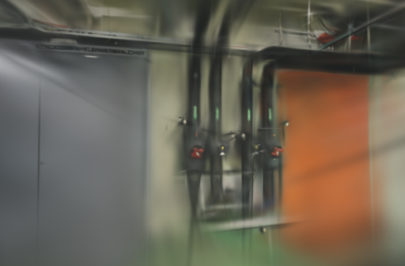
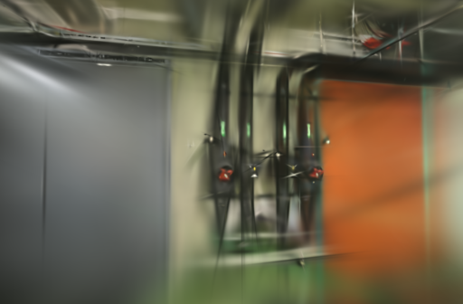
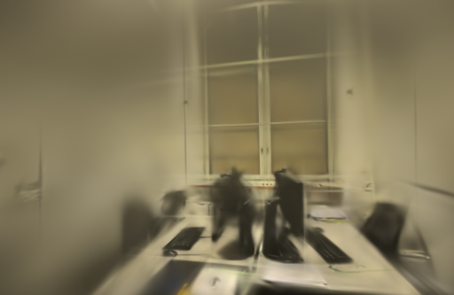
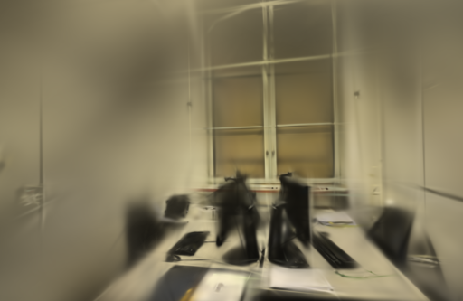

# SSIM 权重短对照

2026-10-25。参考近期感知质量研究，测试将 Brush 默认 `ssim_weight=0.2` 提高到 `0.3` 是否能改善细节。两组使用相同的 CubeCL 尾部修复二进制、同一组照片和相机，只改变 CLI 权重。pipes 的 SSIM 提高约0.00862，但 PSNR下降0.2823 dB，未通过预先设定的质量筛查；office 的两项指标都通过。默认权重保持0.2。

## 条件

Apple M5 / 32 GiB，Metal。pipes 14张、office 26张，均全部定位；每8张留出一张用于固定几何渲染评估。1000步、512像素长边、15万高斯预算、SH3，种子42；所有缓存、profile和状态读回关闭。两种权重各两次，GPU串行，未重新计算SfM。

评估照片参与过SfM；指标不是独立端到端成绩。比较脚本将输出和参考图统一到长边512，计算RGB PSNR与11×11 Gaussian-window SSIM，视角等权平均。

## 结果

| 场景 | 权重0.2耗时 | 权重0.3耗时 | PSNR：0.2 → 0.3 | SSIM：0.2 → 0.3 | 筛查 |
| --- | ---: | ---: | --- | --- | --- |
| pipes | 7.155 s | 7.118 s | 17.2438 → 16.9615 | 0.67833 → 0.68695 | 未通过 |
| office | 7.145 s | 7.635 s | 19.0049 → 18.9250 | 0.78490 → 0.79166 | 通过 |

筛查门槛是场景平均PSNR下降不超过0.2 dB、SSIM下降不超过0.005，并要求输出有效。它是工程筛查，不是统计非劣效检验。两次重复不足以证明收敛趋势；权重0.3在pipes提升结构相似度的同时降低像素误差指标，不能据此宣称画质整体提高。

## 研究依据与取舍

[Apple 的 Drop-In Perceptual Optimization](https://machinelearning.apple.com/research/drop-in)报告了大规模人类偏好研究和WD-R感知损失；[TurboGS](https://proceedings.mlr.press/v306/dong26k.html)也将稀疏误差采样、结构感知损失和密度控制放在同一优化框架中。本轮只调整现有SSIM / L1比例，没有移植WD-R、稀疏采样、混合优化器或外部CUDA代码。

下一步若继续研究感知质量，应同时加入LPIPS / DISTS等指标和人眼对照，并固定高斯预算、模型大小与训练时间。当前证据不足以更改默认权重，也不应把单一SSIM提升作为通用质量提升。

## 输出和页面检查

八个模型通过完整SH3、PLY和留出评估文件检查。浏览器加载pipes / office两种权重的四个模型，拖动两个0.3候选进入室内漫游；控制台无错误或警告。1000步模型仍有模糊、拉丝和覆盖外空洞。原生评估图如下：

| 场景 | 权重0.2 | 权重0.3 |
| --- | --- | --- |
| pipes |  |  |
| office |  |  |

图片是首次重复第一个留出视角的原生PNG，没有修图或替换参考照片。完整逐次记录、输入 / 相机摘要和摘要哈希见[公开JSON](benchmarks/ssim-weight.json)。

## 复现

同一实验二进制只切换训练参数：

```text
--total-steps 1000 --max-resolution 512 --max-splats 150000
--ssim-weight 0.2   # 基线
--ssim-weight 0.3   # 候选
--eval-split-every 8 --eval-every 1000 --eval-save-to-disk
```

本轮没有新的Rust源码或二进制构建，沿用[尾部修复实验](SSIM-TAIL.md)的引擎摘要；应用默认引擎、照片和历史模型均未改变。
