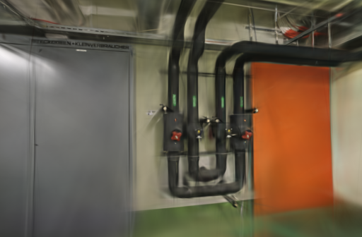
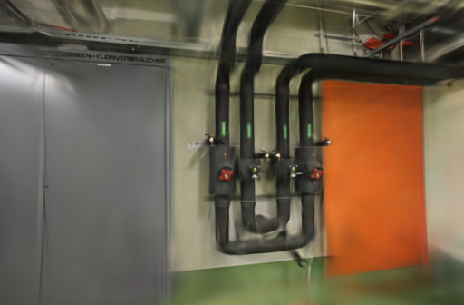
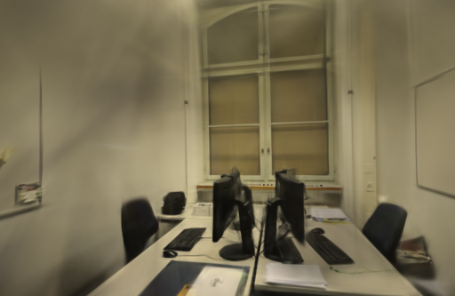
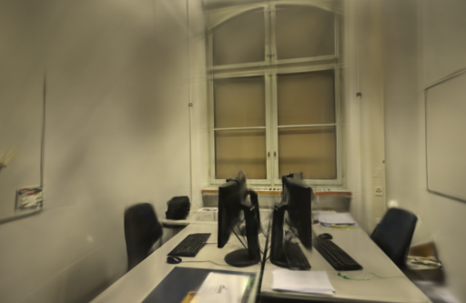

# 训练阶段耗时剖面

2026-10-24。图像张量缓存没有缩短整体训练后，本轮在同一台 Apple M5 / Metal 环境中测量 forward、loss、backward 和 update 四段。结果显示，随着高斯数量增长，backward 是四段里最大的可观测阶段；profile 本身每段都强制同步 GPU，只用于决定下一步测什么，不是生产速度结论。

## 研究依据

[Faster-GS 的论文](https://fhahlbohm.github.io/faster-gaussian-splatting/assets/hahlbohm2026fastergs.pdf)报告在统一质量、相近高斯数下，通过融合反向传播、裁剪和优化器等实现层调整获得提速，并强调不同运行的画质仍会波动。其[官方实现](https://github.com/nerficg-project/faster-gaussian-splatting)是CUDA项目，不能直接替换本地Brush的Burn/Wgpu/Metal路径。

[fused-ssim](https://github.com/rahul-goel/fused-ssim)公开了支持Apple MPS的融合SSIM实现，说明SSIM的多个统计量可以合并计算、减少中间全局内存访问。接入当前Brush的Burn/Wgpu路径仍需适配张量与自动求导接口；本轮只记录为下一步候选，没有安装、复制代码或改变损失。

## 测量方式

在独立 Brush 构建中增加 `WEBSCAN_PROFILE_STAGES=1`。只在第210–219、1210–1219、2610–2619步采样，每步分别在 forward、loss、backward、update 后调用 Burn `Backend::sync`，记录主机墙钟时间。首两个样本留在原始数据中，窗口摘要使用后八个样本，避免同步后的融合图刚建立时影响稳定读数。

同步范围包括当前阶段的主机工作、融合队列排空和GPU完成时间，也可能包含同设备上的预取上传，不能当作GPU硬件时间戳。update还包括统计收集、优化器和位置噪声；输入等待、增点、评估、导出和日志不在四段内。同步会改变调度并增加开销；两组使用同一二进制，训练期间本任务浏览器未打开模型。

参数固定为3000步、512像素长边、15万高斯预算、SH3、每100步增点、80%步数后停止增长、每500步导出、每8张留出一张。pipes / office / TUM desk 各两种设置各两次，共12次；相机、输入、留出集合和参考图摘要在每个场景内一致。没有重算SfM、没有测新的API端到端时间。

| 场景 | 输入 / 定位 | 训练 / 评估 | 相机模式 | 未定位照片 |
| --- | ---: | ---: | --- | --- |
| ETH3D pipes | 14 / 14 | 12 / 2 | 同镜头，固定几何 | 无 |
| ETH3D office | 26 / 26 | 22 / 4 | 同镜头，固定几何 | 无 |
| TUM desk | 96 / 96 | 84 / 12 | 同镜头，固定几何，只用RGB | 无 |

GPU串行运行，顺序交错，系统和驱动缓存未清空。计时包含训练、评估、导出及profile开销，不含输入复制和编译；未测峰值内存。逐次实际高斯数、PLY字节和指标见公开JSON。

## 实测阶段

以下是每个窗口两次重复各保留八次、共16个样本的中位数，单位为毫秒。图像缓存、稳定项调整和状态快照关闭；GPU种子、图像消费、初始点和增点索引顺序固定为当前实验基线。

| 场景 | 高斯数（窗口前最近一次） | forward | loss | backward | update |
| --- | ---: | ---: | ---: | ---: | ---: |
| pipes · 210 | 2,174 | 2.293 | 3.656 | 5.070 | 1.944 |
| pipes · 1210 | 4,501 / 4,462 | 2.289 | 3.667 | 5.058 | 1.946 |
| pipes · 2610 | 11,499 / 11,362 | 2.274 | 3.664 | 5.074 | 1.938 |
| office · 210 | 2,846 | 2.275 | 3.658 | 5.047 | 1.934 |
| office · 1210 | 5,919 / 5,875 | 2.277 | 3.647 | 5.033 | 1.940 |
| office · 2610 | 14,577 / 14,404 | 2.244 | 3.654 | 5.051 | 1.940 |
| TUM desk · 210 | 18,529 / 18,533 | 2.288 | 3.595 | 6.541 | 1.930 |
| TUM desk · 1210 | 36,284 / 36,426 | 3.816 | 3.621 | 8.050 | 1.953 |
| TUM desk · 2610 | 73,389 / 73,786 | 4.029 | 3.705 | 9.656 | 1.965 |

在这条路径中，backward随高斯数量增长最明显，TUM桌面从6.541 ms增到9.656 ms；update在约1.93–1.97 ms之间相对平稳。pipes和office的profile阶段较稳定，TUM的密集模型暴露出可继续调查的反向计算成本。这个结论针对三组公开照片和当前Wgpu实现，不推广到CUDA或更大场景。

## 同相机结果与代价

`compare_quality.py` 将所有评估图和参考照片统一到长边512，计算RGB PSNR和11×11 Gaussian-window SSIM。评估照片参与过SfM，仍属于固定几何下的渲染留出评测。

| 场景 | profile关闭耗时 | profile开启耗时 | PSNR：关闭 → 开启 | SSIM：关闭 → 开启 |
| --- | ---: | ---: | ---: | ---: |
| pipes | 23.2355 s | 23.2561 s | 17.4848 → 18.2532 | 0.72996 → 0.74292 |
| office | 23.2791 s | 23.2330 s | 21.1989 → 20.5797 | 0.85935 → 0.85655 |
| TUM desk | 38.8926 s | 39.8821 s | 22.7090 → 22.5958 | 0.83334 → 0.83229 |

这些是两次重复下的探索性结果，profile造成的同步会改变调度，不能把约1秒TUM差异称为正常训练退化或提速。高斯数和最终模型也有常规波动。未采用任何profile开关作为生产默认。

12个模型均通过完整SH3、相机、评估集合和参考摘要校验。浏览器加载三场景基线 / 候选，拖动候选漫游，控制台没有错误或警告；细管、线缆、小字和覆盖外区域仍有模糊、拉丝与缺失。

| 场景 | profile关闭 | profile开启 |
| --- | --- | --- |
| pipes |  |  |
| office |  |  |
| TUM desk |  |  |

## 决定与下一步

保留可复现的profile开关和原始阶段记录，正式引擎与默认训练器不变。当前最值得继续检查的是高斯数增大后反向图的内存访问与融合边界；可以先做不改变数学结果的SSIM统计批处理微基准，再考虑Metal/Wgpu适用的实现。Faster-GS的CUDA融合内核和fused-ssim的PyTorch扩展不能直接当作本机优化结果。

项目基线 [7807baa](https://github.com/sakorman/web-scan/commit/7807baa)。[stage-profile.patch](benchmarks/stage-profile.patch)是相对干净Brush `v0.3.0` 的累计实验补丁，不能叠加此前补丁。实际回归测试：

```bash
cargo test --manifest-path .tools/brush-order-study/Cargo.toml \
  --locked --release -p brush-train sample_windows_avoid_startup_exports_and_refinement
```

本机资料在 `.data/benchmarks/stage-profile-20261024/`，公开[JSON记录](benchmarks/stage-profile.json)含原始阶段样本、窗口摘要、12次训练、输入 / 相机 / 评估摘要和同视角图。照片与模型仍只保存在本机；TUM和ETH3D的许可见[第三方说明](../THIRD_PARTY_NOTICES.md)。

两组都将 `WEBSCAN_SINGLE_LOADER`、`WEBSCAN_TRACE_LOADER`、`WEBSCAN_SEEDED_SAMPLING`、`WEBSCAN_STABLE_INIT`、`WEBSCAN_SEED_GPU`、`WEBSCAN_STABLE_REFINE` 设为 `1`，把 `WEBSCAN_STABLE_ADAM`、`WEBSCAN_ROTATION_ADAM`、`WEBSCAN_TRACE_GRADIENT`、`WEBSCAN_TRACE_SAMPLING`、`WEBSCAN_TRACE_STATE`、`WEBSCAN_CACHE_TENSORS` 设为 `0`。只切换 `WEBSCAN_PROFILE_STAGES=0` / `1`；CLI沿用[3000步固定参数](ADAM-EPSILON.md#取舍与复现)。
