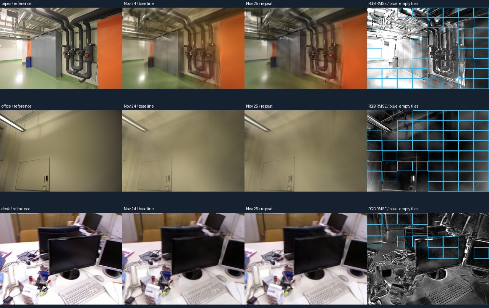
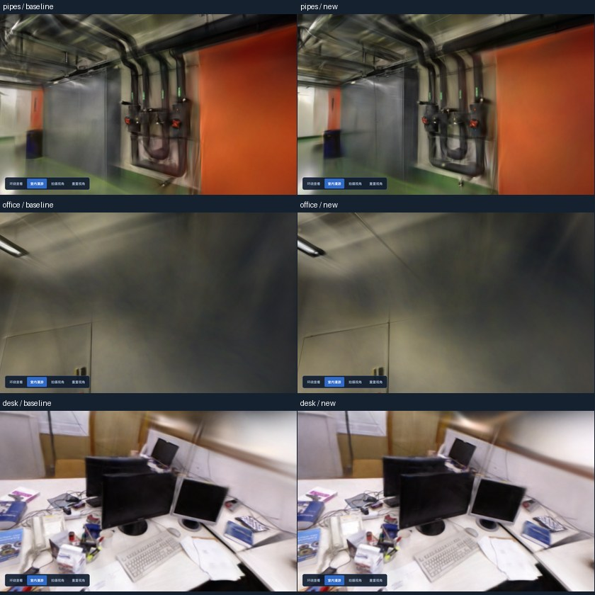

# 稀疏轨迹空白区域是否更容易渲染出错？

2026-11-25。在 ETH3D pipes、office 和 TUM desk 的 18 个留出视角中，只有 6 个视角的无轨迹格持续出现更高的平均 RGB 平方误差，另外 12 个持续更低。每个视角比较了三份相同位姿的模型。office 的四个视角全部属于后者。本轮保留误差诊断，放弃单凭轨迹空白决定增密位置。[逐视角数值、像素分母、模型摘要与耗时](benchmarks/support-error.json)

| 场景 | 留出视角 | 三份模型中空格误差均较高 | 三份模型中空格误差均较低 |
| --- | ---: | ---: | ---: |
| ETH3D pipes | 2 | 1 | 1 |
| ETH3D office | 4 | 0 | 4 |
| TUM desk | 12 | 5 | 7 |

例如，office 第 9 张照片的 64 个分区中，48 格没有合格轨迹，16 格有轨迹。本轮模型两组的平均 MSE 分别为 0.003179 和 0.006493。墙面大片区域即使颜色相近，仍可能出现错误几何。这里测量的是同视角颜色误差。

## 分组和核验

沿用上轮全部留出视角及 8×8 网格。空格指没有任何三维轨迹同时满足焦点视角投影核验及至少两张独立训练照片的观测条件。先在上轮提交上保存六份模型的整图 PSNR、SSIM 及逐格 MSE，再将轨迹位置和评分网格对齐。逐格 MSE 按实际像素数合并，避免短边无法整除 8 时把不同面积的格子等权平均。所有 MSE 均基于编码 RGB / 255。按照片内灰度梯度的上下四分位另外统计高低纹理组。某组只有空格或只有有轨迹格时，缺少的一侧记录为 null。[轨迹与纹理基线](TEXTURE-SUPPORT.md) · [评分基线提交](https://github.com/sakorman/web-scan/commit/d9666ee)

两份模型的相机、注册照片和稀疏模型摘要均须匹配。工具按文件名关联真实留出渲染并核验训练日志、照片和评分尺寸。首次验证在 office 的 1600×1067 输入上发现，把 512×341 再当缩略图边框会得到 511×341。修正为直接使用评分器已经选定的像素尺寸，并加入该尺寸的回归测试。最终逐像素重算全部分组的数量与误差，MSE 差值均小于 1e−12，旧 PSNR / SSIM 完全复现。

低纹理组只有 14/18 个视角同时含两类格子，其中 5 个视角在三份模型中空格误差均较高，5 个均较低，4 个随模型变化。高纹理组有 9/18 个视角可比较，其中 6 个持续较高，2 个持续较低，1 个随模型变化。分组数量少，且同一场景中的照片和格子相关，这些次数只作描述。下一步可检查多次重建中反复出现高残差的具体格子，再用训练照片核验其边缘是否错位。留出照片只用于事后评估。

## 实拍控制与画面

每个场景复用两份已有模型，再串行各训练一次。pipes 的新任务相对昨日基线下降 1.96 dB，因此只对 pipes 额外复测。固定 Brush 0.3.0，Apple M5 / Metal、3,000 步、长边 512、上限 150,000 高斯、SH3，本轮种子 42。pipes、office、desk 分别定位 14/14、26/26、96/96 张，均无定位失败。训练 / 留出分别为 12/2、22/4、84/12。ETH3D 使用 1600×1067 输入与共享 RADIAL，相机焦距分别 906.09、906.44 px。desk 使用 640×480 输入与共享 SIMPLE_RADIAL，焦距 549.46 px。均通过纯 RGB 求姿，留出照片参加过上游 SfM。没有使用已知位姿、深度或雷达。ETH3D 共同评分画幅为 512×341，desk 为 512×384。[相机与照片来源](TEXTURE-SUPPORT.md) · [固定公开采集清单](benchmarks/tum-desk-inputs.json)

| 场景 / 日期 | 实际高斯数 | PLY 字节 | PSNR dB / SSIM | 位姿恢复或复制 s | 训练评估导出 s | 总计 s |
| --- | ---: | ---: | --- | ---: | ---: | ---: |
| pipes 11-24 | 11,599 | 2,738,914 | 19.559 / 0.7695 | 0.035 | 22.975 | 23.06 |
| pipes 11-25 | 11,614 | 2,742,454 | 17.595 / 0.7517 | 0.028 | 22.811 | 22.88 |
| pipes 额外复测 | 11,498 | 2,715,078 | 18.541 / 0.7507 | 0.036 | 22.592 | 22.67 |
| office 11-24 | 14,746 | 3,481,606 | 21.266 / 0.8742 | 0.044 | 23.670 | 23.77 |
| office 11-25 | 14,462 | 3,414,582 | 21.868 / 0.8811 | 0.044 | 23.313 | 23.41 |
| desk 11-24 | 72,195 | 17,039,570 | 22.472 / 0.8305 | 0.074 | 38.541 | 38.62 |
| desk 11-25 | 71,838 | 16,955,318 | 22.558 / 0.8316 | 0.078 | 38.371 | 38.45 |

ETH3D 经服务 API 恢复已验证缓存。desk 在独立目录复制同一套历史 SfM 输入后重新训练，表中总计从复制开始计时。本轮均未重新求姿，系统缓存未清空，测速期间无浏览器渲染。历史 desk 冷启动耗时 80.89 秒，其中求姿 40.46 秒，该历史报告未保存种子和引擎摘要。三场景成对离线评分和分组共用约 0.7、1.3、3.8 秒，不含已有轨迹审计。pipes 四份模型的两个视角均保留各自的分组误差方向，但复测 PSNR 仍低于昨日，SSIM 也未恢复。离线分析没有进入训练过程，训练波动原因尚未定位。

下图由左到右为已定位序列第 9 张照片（第 2 个留出视角）、昨日模型、本轮控制和本轮误差。最右列按逐像素 RGB RMSE 显示，0 为黑，0.30 及以上为白，蓝框标出空格。pipes 左侧墙地交界误差较亮，有轨迹的管道旁同样可见强误差。office 右墙大片空格仍呈暗色。



浏览器从同一拍摄相机拖动漫游。pipes 顶部细管有重影，office 墙面仍有模糊暗区和条纹，desk 显示器边缘及线缆有叠影。本次短路径没有确认新增的独立漂浮物或几何空洞，遮挡背面仍待验证。七份模型通过浏览器加载与拖动检查，包括 pipes 复测。全部十份参与评分的模型均读回完整 SH3 点数。ETH3D 图像保留 Thomas Schöps 等的 CC BY-NC-SA 4.0，TUM 图像保留 Jürgen Sturm 等的 CC BY 4.0。[署名与许可](../THIRD_PARTY_NOTICES.md)



## 复现与参考

以下命令复现本轮 pipes 的两个留出视角。在仓库根目录运行。比较其他场景时，提供每个留出视角的轨迹审计一次，输入文件均保存在本地。

```sh
base=1136e72db1f043a283f04f43fc08fb8c
repeat=d394f921cede42e4a6b85e36e1080eea
out=.data/benchmarks/support-error-recheck
for i in 0 8; do
  .venv/bin/python scripts/benchmark_track_color.py --job "$base" --focus-index "$i" --output "$out/audit-$i.json"
done
.venv/bin/python -m scripts.benchmark_support_error --quick "$base" --detail "$repeat" \
  --audits "$out/audit-0.json" "$out/audit-8.json" --output "$out/scores.json"
```

- Shaocheng Shen 等的 GaussFlaw 在渲染图内定位并分类局部缺陷。这里借鉴局部核验思路，用像素误差和轨迹覆盖做对照，未使用其数据、深度线索或模型。[GaussFlaw，2026-11-02，v1](https://arxiv.org/abs/2611.02767v1)
- Shiwei Ren、Tianci Wen、Yongchun Fang、Biao Lu 的 FastGS 在多个训练视角累积与高误差像素有关的高斯分数。作者实现使用 CUDA。其原创部分采用 MIT，继承部分保留各自许可。本轮评估在训练结束后运行，没有移植增密方法或外推 CUDA 速度。[CVPR 2026 论文](https://openaccess.thecvf.com/content/CVPR2026/papers/Ren_FastGS_Training_3D_Gaussian_Splatting_in_100_Seconds_CVPR_2026_paper.pdf) · [FastGS 44e02a5](https://github.com/fastgs/FastGS/blob/44e02a5c1d5e9ed64d2ecd4af1cbba14ac92150f/utils/fast_utils.py) · [Brush v0.3.0，Apache-2.0](https://github.com/ArthurBrussee/brush/tree/v0.3.0)
