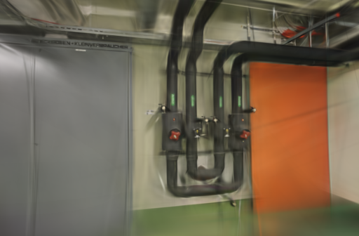
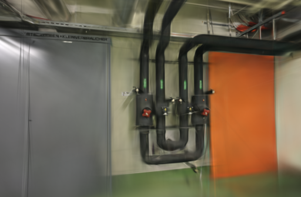
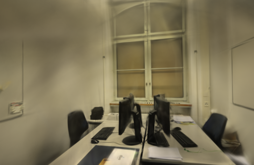
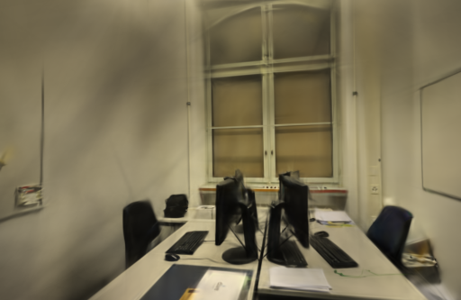

# 训练图像张量缓存

2026-10-23。三场景共12次真实重建确认：复用训练图像张量能省掉97.2%～99.6%的重复转换，但本机训练耗时基本不变，缓存还保留23.6～189 MiB图像数据。因此保留实验实现，不默认启用。下一步先测GPU各阶段耗时，再选择改动。

## 最近研究与本轮选择

本轮查阅了以下公开资料，链接和检索时的仓库提交也保存在[测量记录](benchmarks/tensor-cache.json)中。

| 资料 | 与本项目相关的内容 | 本轮处理 |
| --- | --- | --- |
| [Faster-GS，CVPR 2026论文](https://fhahlbohm.github.io/faster-gaussian-splatting/assets/hahlbohm2026fastergs.pdf) · [官方代码](https://github.com/nerficg-project/faster-gaussian-splatting) | 区分实现层提速与改变高斯数、画质的算法调整；仓库另有反向传播与优化器融合分支 | 借鉴其评测原则，先检查本机重复的数据转换。未移植CUDA内核 |
| [FastGS，CVPR 2026论文](https://arxiv.org/abs/2511.04283) · [官方代码](https://github.com/fastgs/FastGS) | 多视角密度控制和优化的CUDA实现；官方要求CUDA设备 | 记录方法与平台要求，论文时间不用于推断本机Metal速度 |
| [EffGS，2026-09-30预印本](https://arxiv.org/abs/2609.39553) | 频率引导、局部密度控制和高斯尺度调节 | 作为后续待验证方向，本轮未实现这些算法 |

Faster-GS本次检查的main提交为 `c60ea269`（2026-10-10），FastGS为 `44e02a5c`（2026-03-03）。GitHub发布接口仍将 [Brush v0.3.0](https://github.com/ArthurBrussee/brush/releases/tag/v0.3.0) 与 [gsplat v1.5.3](https://github.com/nerfstudio-project/gsplat/releases/tag/v1.5.3)列为各自最新发布版本；不把main的新功能当作本机已安装能力。

## 具体实现

现有加载器缓存解码后的照片，但每次训练取图仍会重新生成浮点数组和GPU张量。本轮增加只读张量缓存，按加载器内的冻结图像路径复用。缓存按实际元素数和浮点类型大小计账，上限256 MiB；放不下的图像继续走原转换路径。每个任务独立建立缓存，任务之间不复用。

GPU回归测试检查了原始像素与缓存像素逐值一致、调用方运算不修改缓存、恰好达到容量边界、超预算回退，以及关闭缓存时不保留张量。1项测试通过，release构建通过。照片、相机、训练 / 评估划分、步数、分辨率和高斯预算都没有调整。

## 三场景固定基线

Apple M5 / 32 GiB、Metal，独立构建 `0.3.0-tensor-cache-study`；Brush源码锁定 `3edecbb2fe79d3e2c87eeab85b15e0b1dd10d486`，沿用原Cargo.lock、Rust / Cargo 1.99.0。

| 场景 | 输入 / 定位 | 训练 / 评估 | 未定位照片 | 几何来源 |
| --- | ---: | ---: | --- | --- |
| ETH3D pipes | 14 / 14 | 12 / 2 | 无 | 10月12日同镜头任务 |
| ETH3D office | 26 / 26 | 22 / 4 | 无 | 10月12日同镜头任务 |
| TUM desk | 96 / 96 | 84 / 12 | 无 | 10月19日同镜头任务，只用RGB |

每场景两设置各两次，共12次。固定3000步、512像素长边、15万高斯预算、SH3，每100步增点、80%步数后停止增长、每500步导出，每8张留出一张。固定读图顺序、初始点顺序、加权采样种子、GPU种子和增点索引顺序，种子均为42，所有参数组epsilon为 `1e-15`。

每场景相机、输入、稀疏文件、评估集合及参考图摘要相同。顺序交错，GPU串行运行，训练期间没有浏览器模型渲染；操作系统与驱动缓存未清空。每次缓存从空开始，计时包含首次填充。没有重算SfM、没有测新的API端到端时间。

## 省掉转换不等于训练提速

以下每行是一次3000步候选训练的实际消费记录，两次重复相同；基线始终转换3000次。预取但未消费的条目不计入命中数。

| 场景 | 实际转换次数 | 复用次数 | 命中率 | 缓存保留的逻辑图像数据 | 平均训练与导出：基线 → 缓存 |
| --- | ---: | ---: | ---: | ---: | --- |
| pipes | 12 | 2,988 | 99.6% | 23.625 MiB | 23.2584 → 23.2757 s |
| office | 22 | 2,978 | 99.27% | 42.926 MiB | 23.2890 → 23.2898 s |
| TUM desk | 84 | 2,916 | 97.2% | 189 MiB | 39.4552 → 39.4936 s |

36,000条消费与缓存记录全部核对。减少转换没有带来可测的整体收益；这不足以证明具体某个GPU阶段就是瓶颈，但不支持继续用内存换取这项缓存。计时包含训练、评估、日志与导出，进程按一秒粒度轮询；表中的毫秒差不作为提速或退化结论。

这里的MiB只统计缓存中保留的浮点图像数据。CPU照片、队列、模型、分配器保留容量另算，未测进程或GPU峰值内存差。

## 同相机画质

使用 `compare_quality.py` 将渲染与同一参考照片统一到长边512，计算RGB PSNR和11×11 Gaussian-window SSIM，按视角等权平均。留出照片仍参与过SfM，属于固定几何下的渲染评测。

| 场景 | 重复 | 图像处理 | 耗时 | 实际高斯 | PLY 字节 | PSNR / SSIM |
| --- | ---: | --- | ---: | ---: | ---: | --- |
| pipes | 1 | 每次转换 | 23.2646 s | 11,939 | 2,819,154 | 19.2864 / 0.75407 |
| pipes | 1 | 缓存 | 23.2697 s | 11,836 | 2,794,846 | 18.8696 / 0.74596 |
| pipes | 2 | 每次转换 | 23.2522 s | 11,513 | 2,718,618 | 17.5678 / 0.73561 |
| pipes | 2 | 缓存 | 23.2816 s | 11,621 | 2,744,106 | 18.1927 / 0.73243 |
| office | 1 | 每次转换 | 23.2533 s | 14,342 | 3,386,262 | 20.9276 / 0.85930 |
| office | 1 | 缓存 | 23.2992 s | 14,531 | 3,430,866 | 21.4475 / 0.86275 |
| office | 2 | 每次转换 | 23.3246 s | 14,554 | 3,436,294 | 21.2647 / 0.85490 |
| office | 2 | 缓存 | 23.2804 s | 14,351 | 3,388,386 | 20.9756 / 0.85423 |
| TUM desk | 1 | 每次转换 | 39.4508 s | 73,081 | 17,248,666 | 22.7539 / 0.83371 |
| TUM desk | 1 | 缓存 | 39.4821 s | 73,430 | 17,331,030 | 22.6132 / 0.83230 |
| TUM desk | 2 | 每次转换 | 39.4595 s | 73,408 | 17,325,838 | 22.5874 / 0.83245 |
| TUM desk | 2 | 缓存 | 39.5050 s | 73,241 | 17,286,426 | 22.5763 / 0.83239 |

分数没有一致改善，最终模型仍有运行波动。只做了两次重复，不能把这些差值全归因于缓存，更不能把不同场景、不同实际点数的耗时直接当作算法速度比较。TUM这一组补充了96帧密集实拍下的同相机基线，没有引入深度、雷达或真值位姿。

下面固定展示首次重复的第一个留出视角，原生PNG未修改：

| 场景 | 每次转换 | 缓存 |
| --- | --- | --- |
| pipes |  |  |
| office |  |  |
| TUM desk |  |  |

12个模型均通过完整SH3、相机、评估集合和参考摘要校验。浏览器加载三组基线 / 候选并拖动候选漫游，无控制台错误或警告。细管、线缆、小字仍模糊，覆盖外仍有拉丝、漂浮片段和缺失。

## 取舍与复现

默认不启用张量缓存，正式引擎、照片和历史模型保留。后续先分段测量光栅化、损失与优化器的GPU耗时，再评估Faster-GS等工作中的内核优化；EffGS的局部密度策略另做质量实验，不把多个改变混在一次对照里。

项目基线 [4670af9](https://github.com/sakorman/web-scan/commit/4670af9)。[tensor-cache.patch](benchmarks/tensor-cache.patch)是相对干净Brush `v0.3.0` 的累计实验补丁，不能叠加此前补丁。按[源码构建方法](LOADER-ORDER.md#决定与复现)换用本补丁。GPU回归：

```bash
cargo test --manifest-path .tools/brush-order-study/Cargo.toml \
  --locked --release -p brush-dataset cached_pixels_survive_operations_and_full_budget_falls_back
```

两组均将 `WEBSCAN_SINGLE_LOADER`、`WEBSCAN_TRACE_LOADER`、`WEBSCAN_SEEDED_SAMPLING`、`WEBSCAN_STABLE_INIT`、`WEBSCAN_SEED_GPU`、`WEBSCAN_STABLE_REFINE` 设为 `1`；将 `WEBSCAN_STABLE_ADAM`、`WEBSCAN_ROTATION_ADAM`、`WEBSCAN_TRACE_GRADIENT`、`WEBSCAN_TRACE_SAMPLING`、`WEBSCAN_TRACE_STATE` 设为 `0`。仅切换 `WEBSCAN_CACHE_TENSORS=0` / `1`，使用[3000步固定CLI参数](ADAM-EPSILON.md#取舍与复现)。

本机资料在 `.data/benchmarks/tensor-cache-20261023/`，保留源码补丁、实际二进制、GPU测试、模型、适配器和分析脚本；[公开JSON](benchmarks/tensor-cache.json)保留逐次与逐视角数据、缓存计数、参考与构建摘要。应用源码未变，由提交后的标准CI执行后端、前端、类型和构建检查。

补丁保留 [Brush Apache-2.0许可](../THIRD_PARTY_NOTICES.md#brush-loading-experiment)。ETH3D照片和衍生渲染保留 [CC BY-NC-SA 4.0署名](../THIRD_PARTY_NOTICES.md#test-dataset)，TUM照片和渲染保留 [CC BY 4.0署名](../THIRD_PARTY_NOTICES.md#tum-rgb-d-desk-sample)。

图像复用未带来可测提速；后续同步剖面中，反向阶段随高斯数量增长更明显。[训练阶段耗时剖面](STAGE-PROFILE.md)
