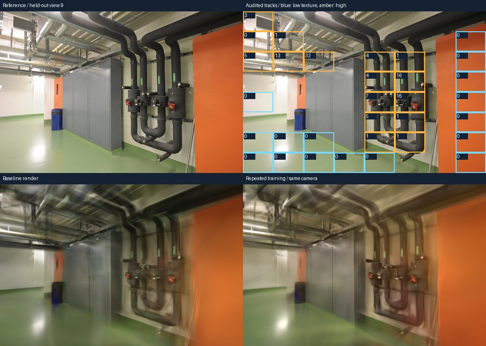
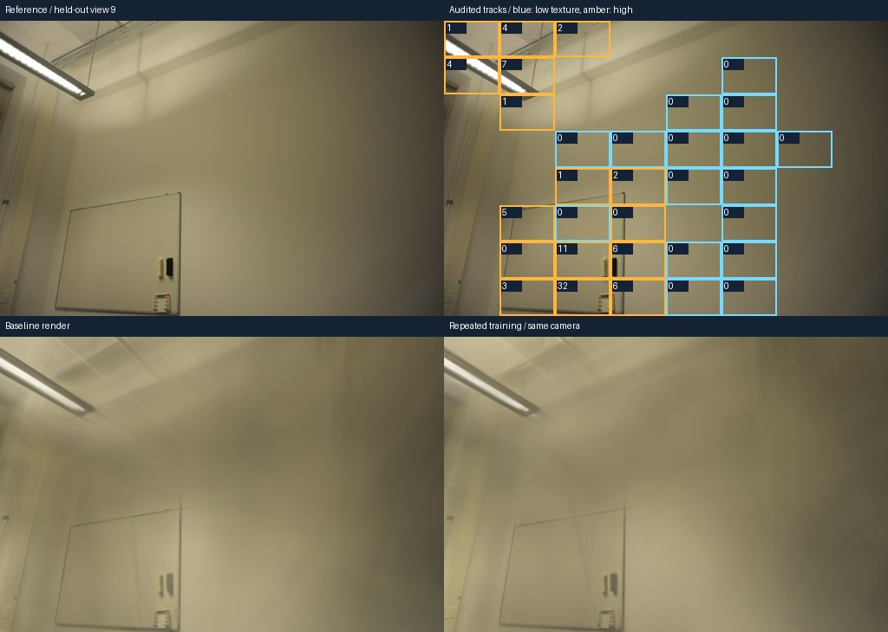
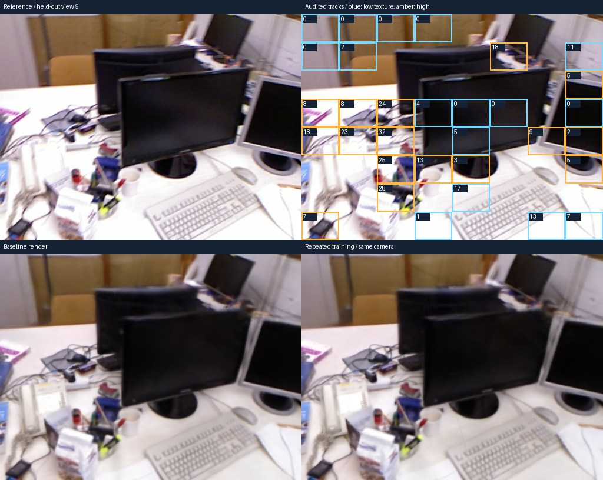
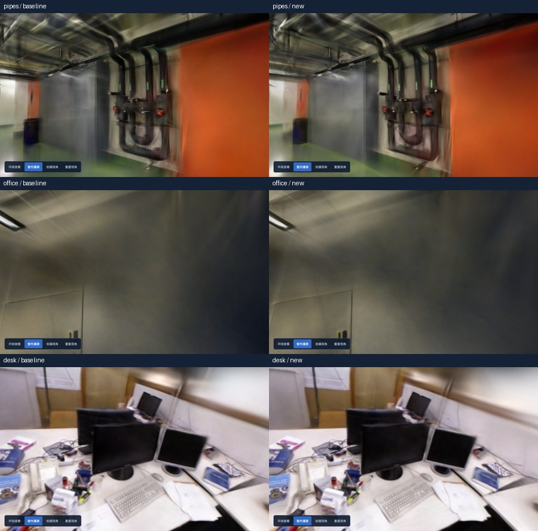

# 留出视角中的纹理与跨照片轨迹覆盖

2026-11-24。在 ETH3D pipes、office 和 TUM freiburg1_desk 的全部 18 个留出视角中，每张照片纹理最低的四分之一分区，有合格轨迹的格子都少于纹理最高的四分之一。即使使用 96 张实拍 RGB 的 desk 序列，低纹理组仍有 93/192 格没有样本。采用离线覆盖诊断，暂缓从附近轨迹推断整面墙的颜色。[逐视角数据、相机与评分](benchmarks/texture-support.json)

| 场景 | 留出视角 | 低纹理有轨迹格 / 总格 | 高纹理有轨迹格 / 总格 | 低 / 高纹理轨迹出现次数 |
| --- | ---: | ---: | ---: | ---: |
| pipes | 2 | 1/32 | 31/32 | 1 / 432 |
| office | 4 | 3/64 | 52/64 | 6 / 832 |
| desk | 12 | 99/192 | 183/192 | 716 / 3,548 |

每个视角分别计数，同一三维点可以出现在多张照片中。格内有一个样本即可计入覆盖，格内其余像素的颜色和几何仍需独立证据。三组数据的材质、轨迹和焦距不同，无法从场景间差异推断增加照片的收益。

## 方法与复现

先在基线版本冻结 18 份逐视角轨迹审计。沿用误差小于 4 px 的三维点，要求至少两张训练照片具有独立可采样观测、单次重投影误差不超过 2 px，并在留出相机内核验焦点特征。基线只报告轨迹位置与照片对颜色统计。[基线提交](https://github.com/sakorman/web-scan/commit/08e50537f9799948c1f746bb0a44d0f42a15ede0) · [观测规则](TRACK-OBSERVATIONS.md)

新步骤只读取基线导出的坐标和对应的去畸变留出照片。校验照片 SHA-256 与画幅后，灰度图按比例缩至最长 512 px，在 8×8 格内计算水平与垂直中央差分平方和的均值。分位数在每张图内计算，包含阈值上的并列格。上下四分位阈值重合时不作分组。参考图灰度只用于事后分组，训练观测数量与 RGB 统计来自原审计。模糊、暗角、去畸变边缘和光照都会影响梯度，低梯度格也可能包含真实细节。

例子复现 office 的第 9 张照片（第 2 个留出视角）的诊断。其余留出相机的索引为 0、8、16……，任务标识及图片摘要见逐视角数据。TUM 历史任务的资料根目录为 `.data/benchmarks/tum-desk-20261019`。

```bash
job=cca441de3f4643d6a2e0773a27990f34
out=.data/benchmarks/texture-support-recheck
.venv/bin/python scripts/benchmark_track_color.py --job "$job" --focus-index 8 --output "$out/audit.json"
photo=$(.venv/bin/python -c 'import json,sys; print(json.load(open(sys.argv[1]))["focus_image"])' "$out/audit.json")
.venv/bin/python scripts/benchmark_texture_support.py --audit "$out/audit.json" \
  --reference ".data/jobs/$job/sfm/undistorted/images/$photo" --output "$out/tiles.json"
```

18 张参考图新增分区计算合计约 0.11 秒，不含原有轨迹审计或训练。新任务读回后逐视角重算，照片摘要、稀疏模型摘要、轨迹坐标、颜色审计统计以及每格梯度和计数均与对应基线一致。本轮没有测量内存收益。

## 实拍重建控制

纯 RGB 求姿。pipes、office、desk 分别定位 14/14、26/26、96/96 张，失败视角均为 0，训练 / 留出分别为 12/2、22/4、84/12。留出照片参与上游 SfM。ETH3D 输入 1600×1067，使用共享 RADIAL，焦距分别 906.09、906.44 px。desk 从 613 张视频帧均匀选择 96 张 640×480 RGB，使用共享 SIMPLE_RADIAL，参数为 549.4642、320、240、0.038006。训练均读去畸变 PINHOLE 图像，没有使用深度、雷达或数据集提供的位姿。[TUM 选帧与来源](TUM-DESK.md)

本轮三个独立任务串行使用 Apple M5 / Metal 的 Brush 0.3.0，种子 42，3,000 步，训练长边 512，预算 150,000 高斯，完整 SH3。新引擎 SHA-256 为 `8380ed40cce870025393e1ea0257e0752351c67a409d827b76dc75ec3a999a71`。两个 ETH3D 基线有相同引擎摘要，10 月 desk 基线未记录该摘要和种子。逐场景严格核对相机、画幅和留出参考后用共同网格计算评分，ETH3D 为 512×341，desk 为 512×384。浏览器漫游在训练完成后进行。[评分实现](../scripts/compare_quality.py) · [逐次训练波动](REPEATABILITY.md)

| 场景 / 任务 | 实际高斯数 | PLY 字节 | PSNR dB / SSIM | SfM 或恢复 s | 训练评估导出 s | 总计 s |
| --- | ---: | ---: | --- | ---: | ---: | ---: |
| pipes 基线 | 11,494 | 2,714,134 | 18.315 / 0.7582 | 0.034 | 22.695 | 22.78 |
| pipes 新任务 | 11,599 | 2,738,914 | 19.559 / 0.7695 | 0.035 | 22.975 | 23.06 |
| office 基线 | 14,318 | 3,380,598 | 21.698 / 0.8739 | 0.047 | 23.622 | 23.73 |
| office 新任务 | 14,746 | 3,481,606 | 21.266 / 0.8742 | 0.044 | 23.670 | 23.77 |
| desk 历史冷启动 | 72,150 | 17,028,950 | 22.643 / 0.8331 | 40.462 | 40.268 | 80.89 |
| desk 冻结位姿重训 | 72,195 | 17,039,570 | 22.472 / 0.8305 | 复制 0.074 | 38.541 | 38.62 |

两个 ETH3D 新任务经正常 API 复用各自缓存，desk 在独立目录复制历史相机、照片和稀疏点后调用同一 Brush 适配器。desk 重训总计从准备输入到模型导出，不含采集导入和重新估姿。离线分区代码没有进入训练入口，表中分数和时间差异不作画质或速度收益。

下图均取已定位照片中按名称排序的第 9 张。左上为留出原图，右上蓝框为低纹理组、橙框为高纹理组，框内数字为合格轨迹数。下方并列基线与新模型同视角渲染。office 的低纹理 16 格均无样本，desk 的低纹理 16 格中有 8 格合计 60 个样本。







六个 PLY 均读回 SH3 点数并在浏览器加载、切换拍摄相机及拖动漫游。pipes 的阀门保留轮廓，细管边缘仍有拖影。office 的低纹理墙面仍有深色模糊区域。desk 的显示器边缘和线缆仍有模糊及叠影。本次短距离漫游没有确认新出现的独立漂浮物或空洞，遮挡背面未覆盖。



## 研究依据与限制

- Anhong Zheng、Zhuoyuan Yu 的室内 3DGS 研究按纹理复杂度安排平面初始化。Mohannad Adnan Al-Jaafari 等的 DART-3DGS 在稀疏外围复制种子。这里仅核验固定视角中可用观测的分布，两篇论文的增密或画质结果均需另设本机训练对照。论文采用 CC BY 4.0。[纹理分区论文，2026-03-09](https://doi.org/10.3390/electronics15051137) · [DART-3DGS，2026-10-04](https://doi.org/10.3390/jimaging12100483)
- Johannes L. Schönberger 等维护的 COLMAP SIFT 实现设有峰值和边缘阈值。查阅的近期提交同时涉及 ROCm/HIP，本机使用已安装的 pycolmap 3.13.0，未移植 GPU 特征代码。Arthur Brussee 的 Brush 用作本机 Metal 训练引擎，CUDA 本轮未测。[COLMAP 60c5ce0，BSD-3-Clause](https://github.com/colmap/colmap/blob/60c5ce07c14bff99e49885bcee503aa2a6a4c65c/src/colmap/feature/sift.cc) · [Brush v0.3.0，Apache-2.0](https://github.com/ArthurBrussee/brush/tree/v0.3.0)
- ETH3D 图片与衍生图保留 Thomas Schöps 等的 CC BY-NC-SA 4.0，desk 图片与衍生图保留 Jürgen Sturm 等的 CC BY 4.0。并排图各行沿用对应场景许可。[ETH3D 数据集](https://www.eth3d.net/datasets) · [TUM RGB-D](https://cvg.cit.tum.de/data/datasets/rgbd-dataset) · [完整署名](../THIRD_PARTY_NOTICES.md)

下一步可用已保存渲染，对齐同一分区检查空格是否稳定对应较大残差，再决定是否值得试验局部初始化。梯度和稀疏支撑本身不足以诊断曝光偏差或断定表面几何错误。

## 服务与回归

轮前健康检查返回 503，历史列表读取失败，服务日志显示 SQLite 无法打开数据库。独立 Python 连接核对 77 条任务，均处于终态。平滑重启后任务 ID 和状态全部一致，健康与历史接口恢复 200，两个真实 API 任务完成。访问失效的根因仍待确认。357 项后端测试、18 项前端测试、TypeScript 类型检查和生产构建通过，浏览器检查无控制台或 HTTP 错误。
