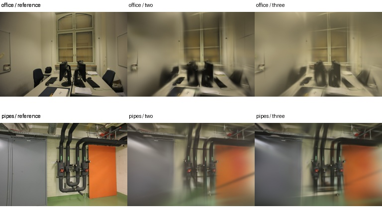

# 固定相机后，用第三张训练照片校验三角点

用相同的两张训练照片三角化作为基线。在另一张训练照片中用前后向光流跟踪同一位置，通过几何检查后，用三个观测重新三角化。未通过的点沿用原坐标。三组实拍都逐项核对了原照片字节、内外参、初始点 ID 与颜色。office 和 pipes 的留出 PSNR 均下降，因此这项改动只保留为离线实验。[COLMAP 的双视图轨迹说明](https://colmap.github.io/faq.html#increase-number-of-matches-sparse-3d-points) · [Lindenberger 等，多视图特征对齐](https://arxiv.org/abs/2108.08291) · [实验实现](benchmarks/third-view-refine.py)

## 六次本机重建

ETH3D 的相机与初始匹配来自已完成的纯照片 SfM，包括对留出照片的相机定位。ARKitScenes 使用设备提供的相机与此前的训练照片匹配。各组按照片名排序，从第 0 张起每八张留出一张。两组点的位置和颜色都只取自训练照片。两种方法均有全部相机，失败视角为零。计时从复用已有相机和匹配开始，上游求姿及设备采集另计。[ETH3D 相机来源](RETRY-FEATURES.md) · [ARKitScenes 初始化基线](ARKITSCENES.md#固定位姿去掉输入深度)

| 场景（训练 / 留出） | 方法 | 初始点 / 最终高斯 | SH3 PLY 字节 | 训练与导出 / 导入至完成（秒） | 同视角 PSNR / SSIM |
| --- | --- | ---: | ---: | ---: | ---: |
| office（22 / 4） | 两视图 | 1,630 / 2,708 | 640,637 | 7.29 / 8.02 | 19.140 / 0.77899 |
| office | 加第三视图 | 1,630 / 2,699 | 638,513 | 7.18 / 7.94 | 18.324 / 0.77207 |
| pipes（12 / 2） | 两视图 | 1,481 / 2,378 | 562,757 | 7.04 / 7.38 | 17.643 / 0.67651 |
| pipes | 加第三视图 | 1,481 / 2,401 | 568,185 | 7.08 / 7.90 | 16.889 / 0.67965 |
| ARKitScenes 47333462（84 / 12） | 两视图 | 2,913 / 5,601 | 1,323,385 | 2.94 / 3.57 | 15.937 / 0.63863 |
| ARKitScenes | 加第三视图 | 2,913 / 5,599 | 1,322,913 | 2.90 / 3.31 | 15.983 / 0.63382 |

两视图准备在 office、pipes、ARKitScenes 分别耗时 0.234、0.141、0.113 秒，第三视图另用 0.051、0.038、0.087 秒，分别更新 79、116、1,125 个点。计时涵盖几何计算，导入至完成还包括导入、排队、工作进程和轮询。采用缓存已热的本机 Brush 0.3 Metal，种子 42，每组 1000 步，高斯上限 15 万，长边上限 512。六次训练串行执行，每种配置仅一次。按实际留出渲染画幅缩放同一张参考照片，逐像素评分，再按视角等权平均。ARKitScenes 原生为 256×192，每帧实际评分尺寸、点数、计时和未注册视角见数据文件。[逐视角与深度数据](benchmarks/third-view.json)

## 留出深度与画面细节

仅在训练结束后评分时读取 ARKitScenes 的 12 张留出深度图。每个相机将初始点投影到像素，保留最近的点。限于 0.25–5 米，中心和 3×3 邻域的所有传感器深度均有效，与中心深度相差最多 5 厘米。两组都有投影的 1,697 个像素观测上，绝对轴向深度误差中位数从 3.007 厘米变为 2.978 厘米，第 90 百分位从 13.30 厘米变为 13.40 厘米。两组投影到的有效像素分别为 1,993、1,957 个。稀疏点投在传感器表面后方也可能由遮挡导致。单段采集的尾部误差和渲染指标均无一致改善。[ARKitScenes 数据说明与许可](https://github.com/apple/ARKitScenes/blob/main/DATA.md) · [Baruch 等，ARKitScenes](https://arxiv.org/abs/2111.08897)



office 桌面显示器轮廓仍有重影，pipes 的 U 形管底部与墙面混在一起。ARKit 的海报文字在两种结果中均难辨。这里检查的是固定拍摄视角，自由漫游中的遮挡仍待单独验证。图中 ETH3D 衍生画面按 CC BY-NC-SA 4.0 使用，原作者为 Thomas Schöps 等。[数据源及署名](../THIRD_PARTY_NOTICES.md)

## 复现实验

将一组现有针孔相机、照片和特征轨迹整理为 COLMAP 的 images 与 sparse 目录。给实验脚本传入源数据目录与一个尚不存在的输出目录。实验环境采用 PyCOLMAP 3.13 和 OpenCV。脚本输出 two、three 两份已定位采集及几何耗时。分别用已有位姿导入入口训练，按上表配置评估。[导入及训练](POSED-IMPORT.md)

```sh
.venv/bin/python docs/benchmarks/third-view-refine.py path/to/undistorted .data/benchmarks/third-view-reproduction
```

每条既有轨迹取最早两个画幅内训练观测，要求正深度、夹角至少 1.5°、重投影误差最多 1.5 个原图像素。第三张在源照片前后三个位置内按时序距离选择，已使用和留出视角除外。先用固定几何预测落点，再用长边至多 768 像素的图像做 15×15 光流，前后向误差上限 0.5 像素，偏离预测最多 4 像素，平均灰度残差低于 16，最后检查三帧重投影。早期实现遇到去畸变后的画幅外观测，另有不同画幅导致无法配对。最终按各帧原画幅剔除无效观测，再为光流补边。下一步在固定源像素和点数下，用实测深度单独替换点的位置，估计位置误差对画质的贡献。
