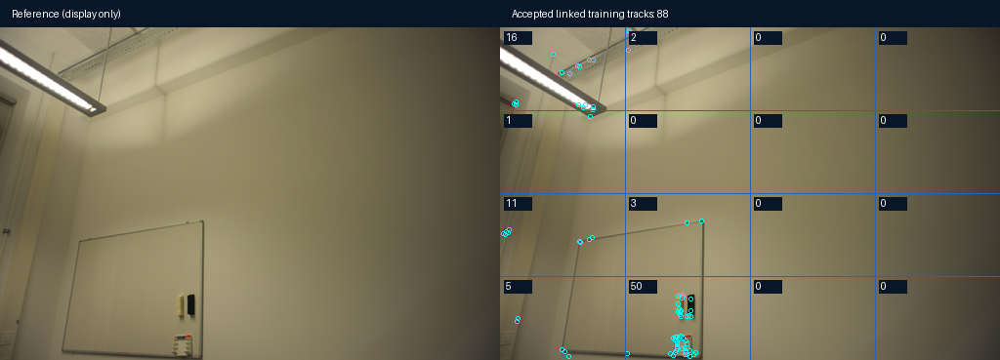
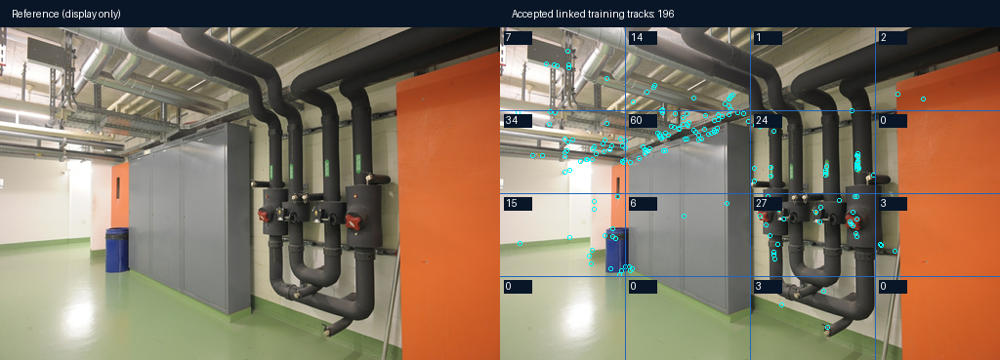
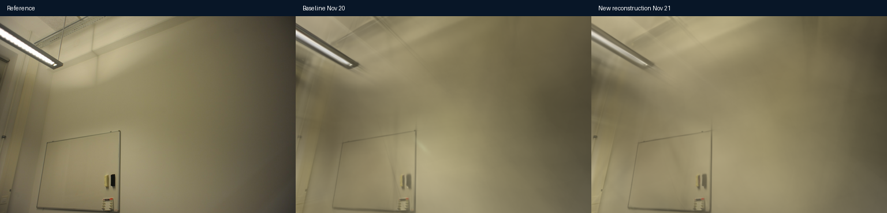
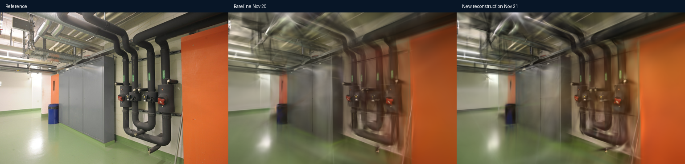
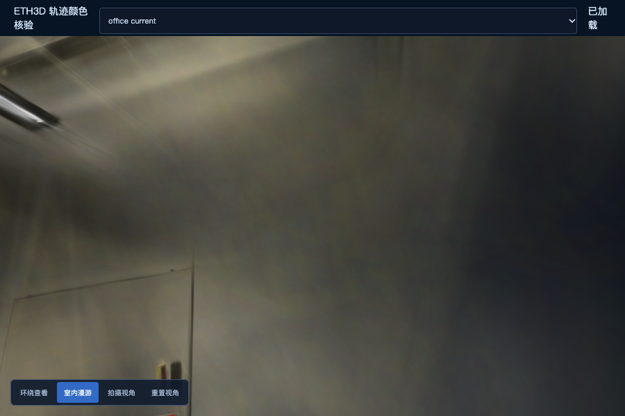
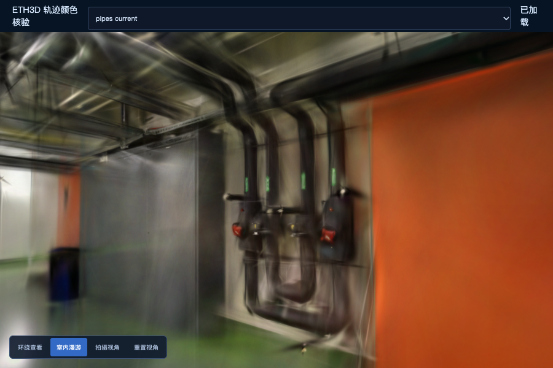

# 训练照片对应点的颜色核验

2026-11-21。新增离线 `scripts/benchmark_track_color.py`，在 COLMAP 稀疏对应位置测量训练照片的颜色差异。核验照片摘要、相机、训练划分、反向关联与重投影误差，排除同一轨迹中的重复照片，不读取留出照片的颜色参与统计。

office 第 9 张只有 88 条合格关联轨迹，全部位于左半画面，**右半墙面为 0 条**。因此，现有稀疏颜色差异不能解释上轮墙面的区域色偏，也不足以支持全图曝光补偿。保留诊断工具，暂不采用统一校色；本轮没有改训练器或获得画质提升。新 office 控制重建平均 PSNR 比前次低 1.4665 dB，已知训练波动仍未解决。

## 依据与假设

- Yifei Wang 等人的 [MCSplat，2026-10-18 v1](https://arxiv.org/abs/2610.25345v1)研究驾驶场景中跨相机外观差异与几何学习的耦合，用深度引导的对应建立规范外观空间，再恢复各相机外观。本轮只提取“先检查对应表面的颜色，再讨论补偿”的假设，没有复现其前馈网络。论文使用 arXiv 非独占传播许可；本轮未取得和移植其代码，不推断代码许可，也未验证其 CUDA 或 Metal 适用性。
- 核对 Johannes L. Schönberger 等 COLMAP 作者及贡献者的[近期实现 c1b5a96](https://github.com/colmap/colmap/blob/c1b5a967736c5d4790a1d5fa5e948b33e1523de4/src/colmap/scene/reconstruction.cc)（主分支提交日期 2026-11-18）及本机 [3.13.0 颜色提取约定](https://github.com/colmap/colmap/blob/3.13.0/src/colmap/scene/reconstruction.cc)：采样前将左上像素中心 `(0.5,0.5)` 转成数组坐标，再做双线性插值。COLMAP 本体按 [BSD-3-Clause](https://github.com/colmap/colmap/blob/c1b5a967736c5d4790a1d5fa5e948b33e1523de4/LICENSE)发布，依赖许可另计；本轮自行实现统计，没有升级 COLMAP。

本机流程是纯照片 → COLMAP 估计位姿 → Brush / Metal，未输入真值位姿、深度或雷达。已知位姿、同步多相机或雷达深度流程中的对应可靠性不能直接套用到这里；本工具只在 CPU 分析已经生成的稀疏模型。

## 测量定义与失败修正

按照片名排序，每 8 张留出一张。要求报告明确验证过留出模式，训练 / 留出数量及留出参考文件摘要一致；去畸变 PINHOLE 相机、画幅、内参和归一化位姿须与场景一致。

对每个三维点，若轨迹中有重复照片 ID，整条排除；其余要求点平均重投影误差小于 4 px，训练观测的单点误差不超过 2 px、正深度、坐标有限且可完整双线性采样。检查二维 / 三维反向关联。每条轨迹在每对不同训练照片中只投一票。编码 RGB 除以 255，不线性化，也不解释为物理曝光量。

每对照片输出第二张减第一张的 RGB 差值中位数，以及每条轨迹三通道绝对差均值的中位数和 90 分位数。汇总只取至少 20 条轨迹的照片对，每对等权，再取各对中位数的中位数；不是所有像素或所有轨迹的平均误差。阈值在测量前固定，稀疏点会偏向纹理、边缘和反光结构，仍可能混合反射、图像处理和采样误差。

另统计与预选第 9 张（索引 8）关联的轨迹，其焦点观测也须通过 2 px、正深度及画幅检查；只用留出图的几何关联限定范围，**不解码其颜色**。覆盖示意图单独显示留出照片，仅供观察位置，未参与颜色统计。此筛选不能证明对应点属于漫反射表面，也不是完全独立于留出几何的验证。

首次实拍审计遇到同一轨迹有重复照片而中止。修正为整条排除后，pipes / office 分别拒绝 21/1881、88/2482 条轨迹，未随意选一个重复特征，也未修改 SfM 或训练输入。随后增加焦点几何及留出摘要核验；规则修订记录在计划中，早期结果保留在本地，报告只使用修订后的结果。不能据此断言重复关联就是画质波动的根因。

| 场景 | 合格训练轨迹 | 合格训练观测 | 全场景合格照片对 | 全场景颜色差异 | 第 9 张关联轨迹 | 关联照片对 | 关联区域颜色差异 |
| --- | ---: | ---: | ---: | ---: | ---: | ---: | ---: |
| pipes | 1546 | 4656 | 35 | 0.14491 | 196 | 13 | 0.02623 |
| office | 1962 | 6629 | 98 | 0.06607 | 88 | 16 | 0.06960 |

这里的“颜色差异”采用上述两级中位数。pipes 全场景和焦点附近差异很大，不能用一个全局数代表反光地面；其底部四个分区只有 `0、0、3、0` 条合格轨迹。office 的对应集中于灯具、门框和白板附件，右半墙面无样本，不代表那里颜色一致。新旧任务的输入、稀疏模型、相机及全部颜色统计完全一致，因为它们复用同一份 SfM；这验证了工具复现性，不是两次独立采集证据。[逐照片对结果与摘要](benchmarks/track-color.json)





## 真实重建对照

基线为 [520b723](https://github.com/sakorman/web-scan/commit/520b723d9f4350adba11ef79fdfa79dad1a1f555) 与上轮两份模型。先用上轮模型建立输入颜色基线，再各新建一次串行 Brush 任务；训练期间未运行浏览器。配置与输入经 `compare_repeats.py` 核对；基线逐视角 PSNR / SSIM 重算与上轮已发布数据完全相同。

- Brush 0.3.0 / Apple M5 Metal，程序 SHA-256 `8380ed40cce870025393e1ea0257e0752351c67a409d827b76dc75ec3a999a71`，seed 42；3000 步、512 长边、150000 高斯预算、SH3、细化间隔 100、增点截止 2400、导出间隔 500。未改训练配置。
- pipes 输入 / 定位 14/14，失败 0，训练 / 留出 12/2（索引 0、8）；office 26/26，失败 0，22/4（0、8、16、24）。原图 1600×1067，去畸变参考分别为 1600×1066 / 1600×1067，统一评分 512×341。
- 同镜头 RADIAL `[f,cx,cy,k1,k2]`：pipes `[906.091435630405,800,533.5,-0.10091385666317157,0.06728544184812109]`；office `[906.4381085295956,800,533.5,-0.10327691090226823,0.06959028672322837]`。
- 留出照片参与上游 SfM 与过往方案选择，指标不是独立端到端泛化测试。各任务使用新 Brush 进程、复用 SfM，未清空 Metal / 系统缓存，不属于冷启动。

| 任务 | 实际高斯 | PLY 字节 | 平均 PSNR dB | SSIM | SfM 缓存恢复 s | 训练评估导出 s | 任务总计 s |
| --- | ---: | ---: | ---: | ---: | ---: | ---: | ---: |
| pipes 基线 `6f22dd07` | 11896 | 2809006 | 19.1353 | 0.76218 | 0.0266 | 22.9235 | 23.00 |
| pipes 新 `5e45df7c` | 11633 | 2746938 | 18.8665 | 0.76346 | 0.0231 | 22.9193 | 22.99 |
| office 基线 `94b49136` | 14293 | 3374698 | 22.0851 | 0.88152 | 0.0509 | 23.4621 | 23.56 |
| office 新 `4533f0aa` | 14712 | 3473582 | 20.6186 | 0.87226 | 0.0467 | 23.4182 | 23.53 |

新任务从 API 请求到观察到完成为 23.3293 / 24.3705 秒，包含轮询等待。耗时与点数仅作记录，未设独立速度实验，不宣称提速。office 四张留出图 PSNR 均低于基线；第 9 张从 23.7252 降至 23.2808 dB，第 17 张从 18.5431 降至 16.6061 dB。pipes 第 9 张从 15.0211 降至 14.9001 dB。诊断脚本不参与训练，这些差异不能归因于新增统计，也不能据一次重建认定训练已稳定；本轮未重复训练筛选较好的结果。

下图依次为参考、基线、新模型，同相机、同画幅，图片内容均为 512×341，标题不评分，未校色。office 灯线及墙面条纹仍模糊，pipes 细管、阀门与反光地面仍有拖影。





两模型完整 SH3 读回、浏览器拍摄视角切换及相同拖动漫游通过，无页面或 HTTP 错误。离开拍摄位置后仍有半透明、拉伸和漂浮状细线，局部墙面缺乏结构；小范围漫游不能排除其他位置的空洞，未证实几何改善。





## 验证、代价与复现

新增 11 项测试，覆盖半像素采样、边界与非有限坐标、留出排除、重复计权、支持数门槛、正负误差抵消，以及完整模拟场景中的留出解码拦截、摘要篡改、重复关联、负深度和大重投影误差。339 项后端、18 项前端、类型检查及构建通过，保留已有 TestClient 弃用与 Vite 大包警告。两任务期间 49 次健康 / 历史检查均正常，本地服务保持运行。

四次离线输入审计中，pipes 为 0.161–0.162 秒，office 为 0.241–0.252 秒，不含 pycolmap 导入及 JSON 写出；不是隔离的冷启动测速。工具保留全部训练照片的 uint8 RGB 数组，约 59 / 107 MiB，另有解码、稀疏模型和照片对差值，峰值内存未测。只适合当前小场景；大数据集应先测内存，再决定是否分批读取。

```bash
PYTHONPATH=. .venv/bin/python scripts/benchmark_track_color.py \
  --job 4533f0aa28a448bd9afb5983e6472de2 --focus-index 8 \
  --output .data/benchmarks/track-color-recheck/office.json
```

完整报告由[脚本](benchmarks/track-color.py)生成，先在独立进程运行 pycolmap，再用 Torch 评分，避免 macOS OpenMP 运行时冲突。本地计划、两任务记录、初次失败修订及浏览器结果保留在 `.data/benchmarks/track-color-20261121`；需要已有模型产物：

```bash
PYTHONPATH=. .venv/bin/python docs/benchmarks/track-color.py \
  --plan .data/benchmarks/track-color-20261121/plan.json \
  --runs .data/benchmarks/track-color-20261121/runs.json \
  --work-dir .data/benchmarks/track-color-recheck/audits \
  --output .data/benchmarks/track-color-recheck/report.json
```

工作目录必须尚不存在，避免覆盖已有审计。新训练复用[串行 API 脚本](benchmarks/repeatability-run.py)，本轮顺序固定 pipes、office，源任务为上述两份基线；全部照片及历史模型保留。

下一步先核验重复照片关联在去畸变前后的来源，确认筛选规则的适用范围。若继续解释右半墙面，需要有可见性验证的稠密对应，不能拿左半画面的 88 条稀疏轨迹拟合全图补偿，也不依据本轮留出分数调整采样阈值。

照片及衍生截图：Thomas Schöps 等，[ETH3D / CVPR 2017](https://www.eth3d.net/datasets)，[CC BY-NC-SA 4.0](https://creativecommons.org/licenses/by-nc-sa/4.0/)。原始照片和模型不发布到仓库。
