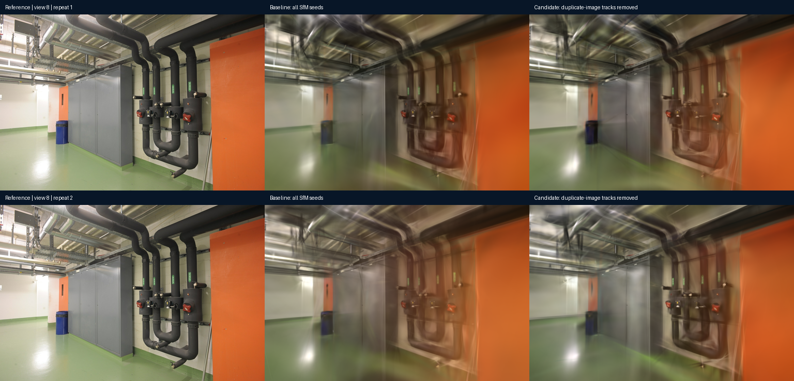
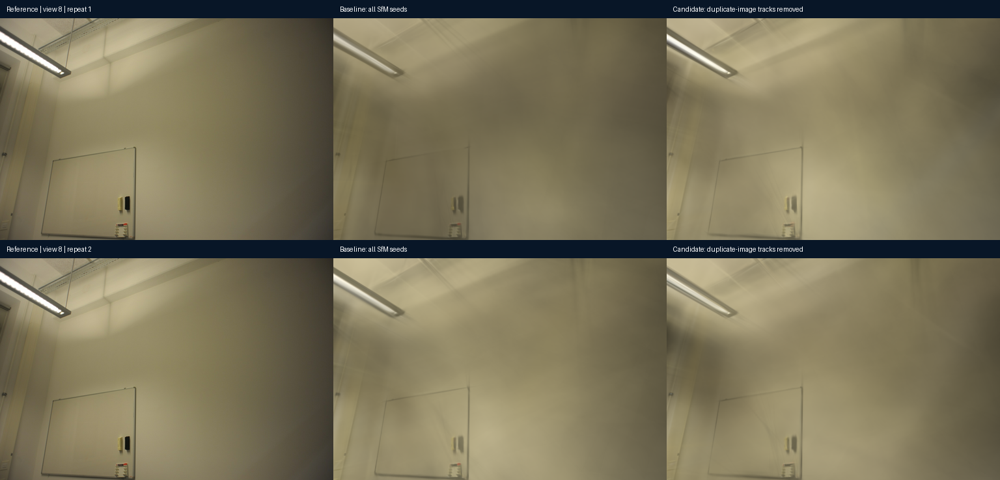
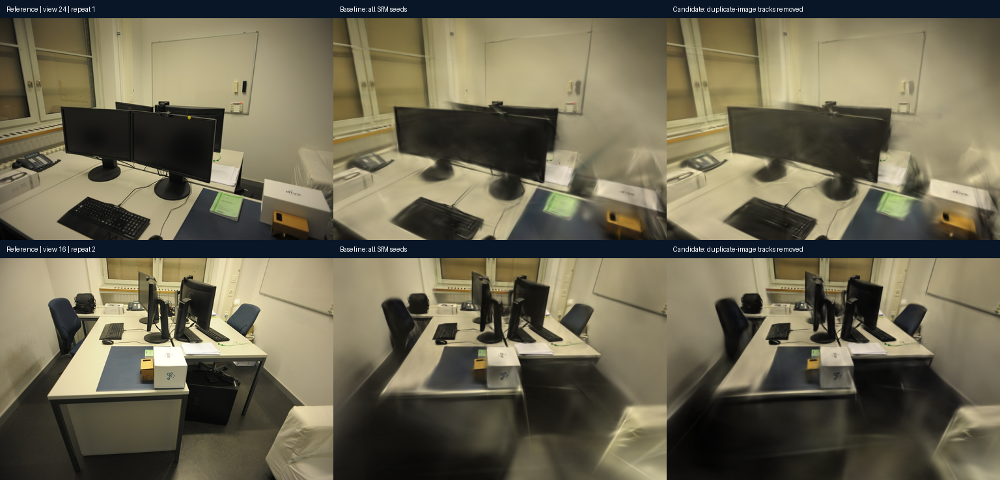
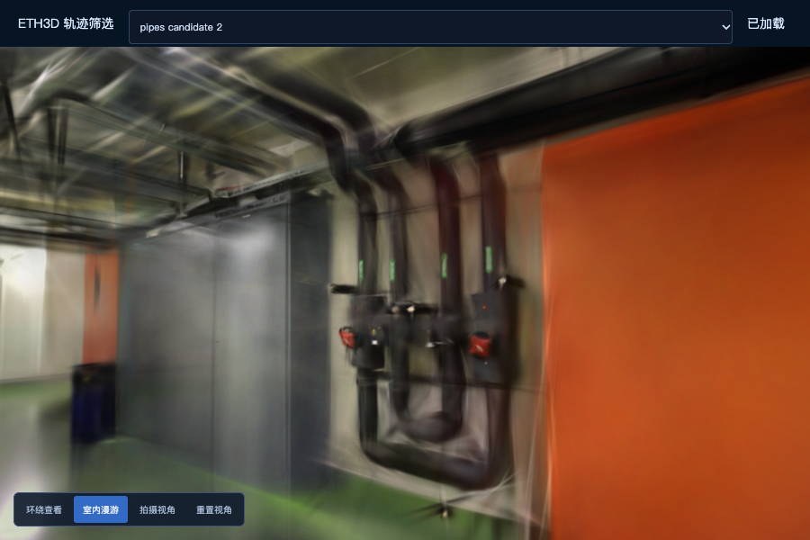
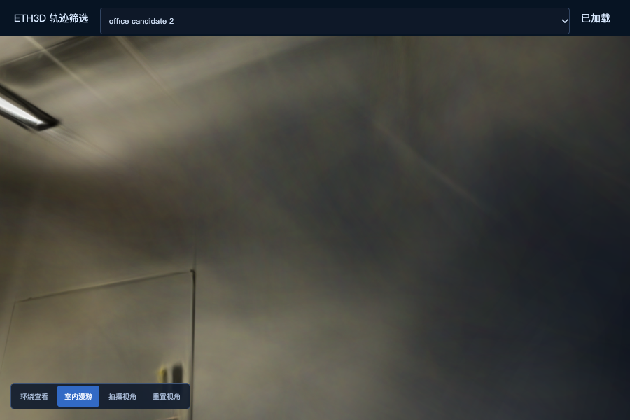

# 重复照片关联的来源与初始化筛选

2026-11-22。重复关联在原始 SfM 模型中已经存在；去畸变和缓存复用没有新增关联。删除这些点作为 Brush 初始化的候选方案未通过双场景重复筛查，**不接入默认重建**。保留离线筛选、来源核验和复现工具，以便后续在具体轨迹上验证更精细的规则。

基线代码：[e31a7c9](https://github.com/sakorman/web-scan/commit/e31a7c9)。承接[训练照片颜色核验](TRACK-COLOR.md)，本轮只试验“一个三维点在同一照片中关联多个二维特征时，整点排除”这一规则，不修改相机、照片、训练参数或增点策略。

## 来源核验

使用 pycolmap 3.13.0，依次读回保存的 `sparse/0 → chosen → undistorted/sparse → 缓存任务`。四阶段的点 ID、坐标及完整 `(image_id, point2D_idx)` 关联均一致；去畸变输出与缓存任务的所有稀疏二进制文件摘要相同。

| 场景 | 原始点数 | 有重复照片的轨迹 | 重复照片组数 | 原图组内最大特征间距：中位数 / 最大值 | 去畸变后对应值 |
| --- | ---: | ---: | ---: | ---: | ---: |
| pipes | 1,881 | 21 | 25 | 1.198 / 5.291 px | 1.190 / 5.389 px |
| office | 2,482 | 88 | 123 | 2.055 / 6.087 px | 2.076 / 6.124 px |

间距取同组所有二维特征两两距离的最大值，包含完全重合与相邻特征。此结果仅把来源定位到已有 mapper 输出，没有追踪产生各条关联的具体操作，不能将所有这些点判为错误点。核验耗时 0.104 秒，不含模块导入和最终写出。[逐条关联及文件摘要](benchmarks/track-origin.json) · [核验脚本](benchmarks/track-origin.py)

公开参考与适用范围：

- Johannes L. Schönberger 等维护的 [COLMAP 3.13.0 合并实现](https://github.com/colmap/colmap/blob/3.13.0/src/colmap/sfm/incremental_triangulator.cc)依据重投影误差判断合并；该路径没有按照片唯一性拒绝合并。因此“重复照片”本身不足以证明坏点。COLMAP 为 BSD-3-Clause，本轮只读取源码和本地模型。
- Arthur Brussee 的 [Brush v0.3.0 COLMAP 载入器](https://github.com/ArthurBrussee/brush/blob/v0.3.0/crates/brush-dataset/src/formats/colmap.rs)从点坐标、颜色建立初始化，没有这条轨迹筛选。Brush 为 Apache-2.0，本轮使用现有发布二进制的 Metal 后端。
- Ivan Desiatov、Torsten Sattler 的 [The Role of Initialization in 3D Gaussian Splatting，v4，2026-10-07](https://arxiv.org/abs/2603.20714v4)研究初始化与后续增点的关系，不能由初始点数直接推断最终质量。[作者实现固定版本](https://github.com/deivse/ivd_splat/tree/94ebb03d090c6d80dfd8b78a853a61d2f28782d3)要求 CUDA 12.6；其根许可证限制为非商业学术/个人用途，子模块另有许可。本轮没有复制或运行该代码。
- Xinpeng Wang、Qinghai Jiang、Jia Chen、Zhiyu Song 的 [Geometry-Aware Initialization with Footprint-Calibrated Opacity for 3D Gaussian Splatting，2026-11-18](https://doi.org/10.3390/ai7110490)将几何支撑与不透明度校准结合，实验使用 RTX 4060 Laptop、CUDA 11.8、gsplat 1.5.3。它与本轮整点删除不同，不能将论文收益套用到 Metal；本轮未实现其算法。

这些资料支持把初始化可靠性作为待验证问题，不支持直接采用删除规则。实验从纯照片 SfM 的缓存接续训练，未使用官方已知位姿、深度或雷达。

## 可比条件与预设门槛

训练前保存计划，两个场景、两个方案、各重复两次，共八次独立 Brush 进程。顺序为 baseline-1 pipes/office、candidate-1 pipes/office、candidate-2 office/pipes、baseline-2 office/pipes。所有 GPU 训练串行，浏览器验证在训练结束后运行。

预设筛查要求：**每个场景**两次平均 ΔPSNR ≥ +0.2 dB、平均 ΔSSIM ≥ 0；同时每次配对均须 ΔPSNR ≥ −0.2 dB、ΔSSIM ≥ −0.005。它只用于决定候选是否值得继续验证，不构成统计保证或默认配置的采用依据。未通过后不追加训练寻找有利结果。

| 配置 | pipes | office |
| --- | --- | --- |
| 输入 / 定位 / 失败照片 | 14 / 14 / 0，无失败视角 | 26 / 26 / 0，无失败视角 |
| 训练 / 留出照片 | 12 / 2 | 22 / 4 |
| 留出序号（文件名排序，从 0 开始） | 0、8 | 0、8、16、24 |
| 原图 / 去畸变尺寸 | 1600×1067 / 1600×1066 | 1600×1067 / 1600×1067 |
| 训练最长边 / 实际评分画幅 | 512 / 512×341 | 512 / 512×341 |
| 初始化点 baseline → candidate | 1,881 → 1,860 | 2,482 → 2,394 |
| 清除的二维点关联 | 135 | 672 |

共同设置：Apple M5 / Metal，Brush 0.3.0，seed 42，3000 步，上限 150,000 个高斯，SH3，每 100 步细化，2400 步停止增点，每 500 步导出。发布二进制 SHA256：`8380ed40cce870025393e1ea0257e0752351c67a409d827b76dc75ec3a999a71`。

原始 SfM 使用共享 RADIAL 相机，参数顺序为 `[f,cx,cy,k1,k2]`：pipes `[906.091435630405,800,533.5,-0.10091385666317157,0.06728544184812109]`；office `[906.4381085295956,800,533.5,-0.10327691090226823,0.06959028672322837]`。训练使用相同的去畸变相机，完整内外参与输入摘要保存在本地任务和[结果数据](benchmarks/track-filter.json)。

候选工具只写新的稀疏模型目录，保留剩余三维点的二进制记录及相对顺序，将被删除点在 `images.bin` 中的关联置为 −1。pycolmap 独立读回确认相机姿态、二维特征坐标、保留点坐标及 RGB 完全一致，反向关联有效；重复训练的稀疏文件摘要相同，Brush 日志记录的初始点数也一致。[读回结果](benchmarks/track-filter-verified.json)

**文件顺序一致不代表内部初始化顺序固定。** 发布版 Brush 从 HashMap 遍历点，删除点也可能影响内部遍历；Metal 运算和增点存在非确定性。本轮未使用本地修改过的 Brush，不能把每次差值全部归因于被删点的几何作用。两次重复不足以估计稳定收益或置信区间。

留出照片未用于 3DGS 梯度训练，但参与上游 SfM 和此前的方法选择；本轮筛选也使用完整 SfM 轨迹。这是固定场景的训练留出对照，不是严格隔离的端到端未知场景评估。

## 全部结果

使用 `compare_quality.py` 对齐相机、画幅、留出照片与 512×341 参考图后重算 PSNR / SSIM。下表使用同一评分实现，不混用 Brush 日志中的另一套平均值。

| 独立任务 | PSNR dB | SSIM | 实际高斯 | 完整 SH3 PLY 字节 | 准备 s | 训练评估导出 s | 缓存流程总计 s |
| --- | ---: | ---: | ---: | ---: | ---: | ---: | ---: |
| pipes-baseline-1 | 18.4115 | 0.75097 | 11,447 | 2,703,042 | 0.0241 | 23.7859 | 23.8752 |
| office-baseline-1 | 20.5646 | 0.86870 | 14,348 | 3,387,678 | 0.0379 | 23.4269 | 23.4761 |
| pipes-candidate-1 | 18.8194 | 0.76039 | 11,645 | 2,749,770 | 0.0274 | 22.7878 | 22.8227 |
| office-candidate-1 | 20.3001 | 0.86889 | 13,942 | 3,291,862 | 0.0427 | 23.6368 | 23.6891 |
| office-candidate-2 | 21.0764 | 0.85669 | 14,058 | 3,319,238 | 0.0402 | 23.6061 | 23.6563 |
| pipes-candidate-2 | 19.5324 | 0.76746 | 11,689 | 2,760,154 | 0.0264 | 22.7292 | 22.7632 |
| office-baseline-2 | 21.1805 | 0.87720 | 14,669 | 3,463,434 | 0.0359 | 23.4390 | 23.4850 |
| pipes-baseline-2 | 19.8403 | 0.76748 | 11,617 | 2,743,162 | 0.0216 | 22.6985 | 22.7274 |

本轮复用 SfM，未执行新的定位；记录中的 `sfm_seconds=0` 表示跳过，不代表定位成本为零。准备时间包含复制照片和模型，候选还包含筛选；总计包含本地准备、训练、评估、导出和读回，不包含最初 SfM、浏览器及离线比较。每次训练进程新启动，但系统和 Metal 缓存未清空，不能当作冷启动，也不据此宣称提速。未测峰值内存；筛选脚本会载入二进制文件并建立副本，额外空间随稀疏模型大小增长。

| 场景 | 第一次 ΔPSNR / ΔSSIM | 第二次 ΔPSNR / ΔSSIM | 两次平均 ΔPSNR / ΔSSIM | 筛查 |
| --- | --- | --- | --- | --- |
| pipes | +0.4079 / +0.00941 | −0.3079 / −0.00002 | +0.0500 / +0.00470 | 不通过 |
| office | −0.2645 / +0.00019 | −0.1041 / −0.02051 | −0.1843 / −0.01016 | 不通过 |

初始化点减少并没有带来稳定收益，也没有保证最终高斯更少。office 第一次第 25 张 PSNR −2.6997 dB、SSIM −0.02886；第二次第 17 张 −2.0242 dB、−0.06216。pipes 第二次第 1 张 PSNR −1.3727 dB。所有逐视角和 4×4 分区数据均保留，没有以局部改善替换整场景结论。

同视角图每行依次为参考、基线、候选，上下为两次重复；图像区域均为 512×341，标题不参与评分：





下面列出事后定位到的 office 退化视角：第一行是第一次第 25 张，第二行是第二次第 17 张。显示器边缘、桌下与墙面有模糊、半透明残影及亮度差异；指标不能独立区分其几何或光度成因。



## 浏览器与回归

训练后，用实际网页查看器逐一加载八份完整 PLY，对准拍摄视角 8，再切换室内漫游并拖动。八份均加载成功，无页面或 HTTP 错误。pipes 管道边缘仍重影、细支架模糊，前景有半透明条带；office 墙面仍有大片暗斑和细长残影，右侧部分区域接近背景暗色。目测未确认这些区域是实际几何空洞，亦未证明漂浮物减少；没有深度真值或几何评分。





新增 9 项二进制筛选测试，验证记录保留、关联清理、源文件不变、重复运行及损坏输入拒绝。全量 **348 项后端、18 项前端、TypeScript 类型检查和生产构建通过**；保留已有 TestClient 弃用提示与构建大包警告。八份完整 SH3 点数读回通过，两个场景的候选另经 pycolmap 逐点及逐观察读回。原服务与历史目录保留，实验未创建线上历史任务。

## 复现与后续

本轮数据保存在 `.data/benchmarks/track-origin-20261122/training`；计划、冻结的适配器、八份独立任务、所有模型、日志和浏览器截图均留在本地。两份缓存来源分别为 pipes `5e45df7c1bfa4af6ba342326ca2fe407`、office `4533f0aa28a448bd9afb5983e6472de2`。来源追踪还需要原始任务 pipes `6ea72a6d027348f6ae89252a7d088cae`、office `48915f24aab048bc8c91dbf80d721811`。

在仓库根目录执行；训练命令要求新的输出目录，已有结果直接评分即可。pycolmap 核验与 Torch 评分分进程运行。

```sh
.venv/bin/python docs/benchmarks/track-origin.py --output .data/track-origin.json
PYTHONPATH=. .venv/bin/python docs/benchmarks/track-filter.py --root .data/benchmarks/track-filter-reproduction
PYTHONPATH=. .venv/bin/python docs/benchmarks/track-filter-score.py --root .data/benchmarks/track-filter-reproduction --output .data/track-filter-scores.json
.venv/bin/python docs/benchmarks/track-filter-verify.py --root .data/benchmarks/track-filter-reproduction --output .data/track-filter-verified.json
.venv/bin/python docs/benchmarks/track-filter-figures.py --root .data/benchmarks/track-filter-reproduction --output .data/track-filter-figures
```

单独试验可用 `scripts/benchmark_track_filter.py --source 稀疏模型目录 --destination 新目录`，该工具不接入服务，不能将结果当作推荐预处理。复现需上述本地输入及发布版 Brush；运行前应确认 GPU 空闲。

下一步先按特征重合程度、重投影残差和跨视角分布检查这些具体轨迹，区分可能冗余的关联与有效几何支撑，再决定是否值得设计更窄的筛选规则。当前证据不支持整条删除。

图像来源：Thomas Schöps 等的 [ETH3D](https://www.eth3d.net/datasets)，CC BY-NC-SA 4.0；本报告截图包含其缩放参考图及重建衍生图，按同一许可署名保留。没有发布原始照片、模型或内部资料。
