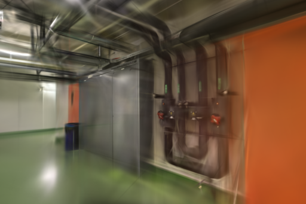
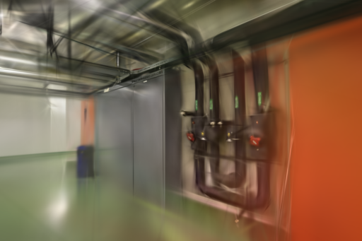
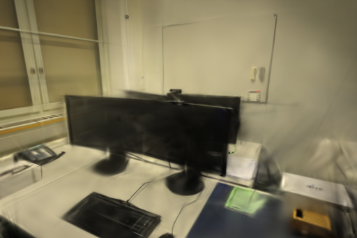
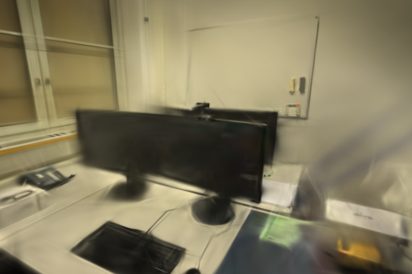
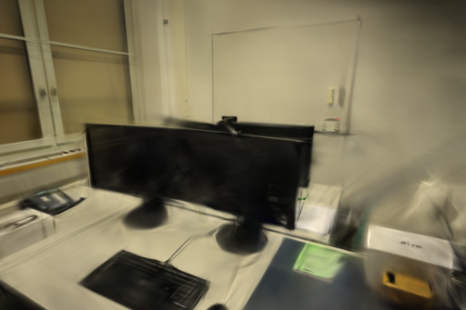
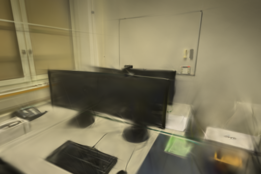

# 初始点最短轨迹对照

2026-10-31，macOS / Apple Silicon，Brush 0.3.0 Metal。将初始化稀疏点的最少观测数从 2 提到 3，模型变小，但 office 两次重复的 SSIM 都下降，因此不采用为默认规则。生产训练代码没有改动。

## 假设与范围

Feng Zhou 等的 [Initialize to Generalize](https://arxiv.org/abs/2510.17479) 研究了稀疏视角下初始化与训练约束的作用，提出补充缺失覆盖并约束几何一致性的流程。[官方实现](https://github.com/zss171999645/ItG-GS) 使用已知相机位姿和 LLFF / Mip-NeRF360 的稀疏训练划分。本轮仅检验一个独立假设：删除只被两张照片观测的初始点，能否减少不可靠几何。没有移植或复现该论文的增广、自初始化与融合流程，也不能用本轮结果评价整篇方法。

本实验使用纯 RGB 照片经 COLMAP 求得的位姿，不用数据集真值位姿、深度或雷达。结论限于当前 Metal 引擎，没有 CUDA 对照。观测次数按完整 SfM 轨迹计算，包含后续训练时留出的照片；它不等于训练视图支撑数，也不是几何正确性的充分条件。

## 配置与输入

基线来自提交 [16d5a15](https://github.com/sakorman/web-scan/commit/16d5a15b046399dcc7e1efab5c9fa72f394064b0)。每个变体、场景重复两次，共 8 次串行训练。pipes 按基线/候选、候选/基线执行，office 顺序相反。训练时没有打开实验查看器，也没有另一项 Brush 训练。

| 配置 | pipes | office |
| --- | ---: | ---: |
| 输入 / 已定位照片 | 14 / 14 | 26 / 26 |
| 未定位照片 | 无 | 无 |
| 训练 / 留出视图 | 12 / 2 | 22 / 4 |
| 原始照片尺寸 | 1600×1067 | 1600×1067 |
| 初始稀疏点：基线 → 候选 | 1,881 → 1,271 | 2,482 → 1,838 |
| 删除的两视图点 | 610（32.43%） | 644（25.95%） |

固定同镜头 RADIAL 求解结果、去畸变 PINHOLE 相机、照片顺序、位姿和归一化。固定 3,000 步、512 像素长边、150,000 高斯上限、SH3、种子 42、每 100 步增密、2,400 步结束增密、每 500 步导出、每 8 张留出 1 张。固定种子不保证 Metal 逐位确定性。所有原生渲染与共同评分尺寸均为 512×341。

候选只修改独立任务副本的 `points3D.bin` 和 `images.bin`：删除短轨迹点，并将对应图像观测的点 ID 解除关联。保留点的原始记录及顺序不变，图像坐标、相机、位姿和照片不变。依据 [COLMAP 输出格式](https://colmap.github.io/format.html)，用 PyCOLMAP 读回 8 份模型，逐项验证保留点、图像观测、位姿和内参；原始任务文件摘要保持不变。

## 实测结果

以下分数由 `compare_quality.py` 在共同网格重算，按视图等权平均。它与 Brush 原生日志的缩放和 SSIM 实现有差异；两套数据均保留在 [逐次数据](benchmarks/track-initialization.json)，不混用。

| 场景 / 重复 | 变体 | 实际高斯 | 完整 PLY 字节 | 训练、评测及导出 | PSNR | SSIM |
| --- | --- | ---: | ---: | ---: | ---: | ---: |
| pipes / 1 | 基线 | 11,139 | 2,630,354 | 23.2604 s | 18.297881 | 0.752683 |
| pipes / 1 | 三次观测 | 8,303 | 1,961,057 | 23.2371 s | 19.401435 | 0.762856 |
| pipes / 2 | 基线 | 11,564 | 2,730,654 | 23.2604 s | 18.119985 | 0.753170 |
| pipes / 2 | 三次观测 | 8,295 | 1,959,169 | 22.2585 s | 18.486415 | 0.744065 |
| office / 1 | 基线 | 14,562 | 3,438,182 | 24.2976 s | 20.890799 | 0.876137 |
| office / 1 | 三次观测 | 11,762 | 2,777,382 | 23.2770 s | 21.075446 | 0.870047 |
| office / 2 | 基线 | 14,488 | 3,420,718 | 24.2717 s | 22.044057 | 0.880979 |
| office / 2 | 三次观测 | 11,632 | 2,746,702 | 23.2663 s | 22.051481 | 0.875061 |

两次重复取均值，pipes 少 26.89% 高斯，PSNR +0.734992 dB、SSIM +0.000534，但第二次 SSIM 回落；office 少 19.47% 高斯，PSNR +0.096035 dB、SSIM **-0.006004**。office 的 `0024` 视角两次都退化：PSNR -1.323301 / -2.623630 dB，SSIM -0.016926 / -0.025585。平均 PSNR 的轻微提升不能掩盖这些视角损失。

每次从新的 Brush 进程启动，复用已准备的 SfM 文件，不是训练检查点续跑。表内包含候选过滤、训练、留出评测和导出，排除输入复制与 SfM；本轮 SfM 和端到端耗时未测，记录为 null。未清空文件系统或 Metal 缓存，因此不称为冷启动。进程计时有一秒轮询粒度；均值时间差为 -0.5126 / -1.0130 秒，且模型点数同时变化，不能据此宣称等质量训练提速。未测训练峰值内存。

## 图像与漫游

逐张查看首次运行的 6 个留出视角，另复查第二次 office 的 `0024`。pipes 首次 `0008` 的轮廓稍清楚，但橙墙渗色、细管线模糊仍存在；office `0024` 的显示器与桌面更模糊，`0016` 的前景黑区也没有解决。以下均为训练器保存的同视角 PNG，未修图。

| 场景 / 留出视角 | 基线 | 三次观测 |
| --- | --- | --- |
| pipes / 第一次 / `0008` |  |  |
| office / 第一次 / `0024` |  |  |
| office / 第二次 / `0024` |  |  |

训练全部结束后，在浏览器用现有 Spark 完整 SH3 查看器加载首次运行的四个模型，从 pipes 照片 1、office 照片 25 进入室内漫游，并对两变体作相同方向拖动。模型都能正常加载，候选仍有穿过管道和桌边的细线漂浮、边缘拖影与模糊遮挡区域，没有观察到稳定的覆盖改善。该人工复查不是全场景几何误差测量。

## 验证与复现

8 份 PLY 均通过完整 SH3 数值与字段检查；各组相机、留出照片摘要和画幅一致。183 项后端、18 项前端、类型检查和构建通过。保留已有 TestClient 弃用提示和查看器包体警告。8787 服务持续可用；本轮不修改生产页面或训练规则。

实验补丁仅用于冻结适配器副本，勿对历史任务或共享 SfM 缓存直接运行。复现目录必须是新目录：

```bash
mkdir -p .data/benchmarks/track-init-repro
git show 16d5a15:webscan/brush.py > .data/benchmarks/track-init-repro/baseline.py
cp .data/benchmarks/track-init-repro/baseline.py .data/benchmarks/track-init-repro/candidate.py
patch .data/benchmarks/track-init-repro/candidate.py < docs/benchmarks/track-initialization.patch
.venv/bin/python scripts/benchmark_exports.py --repo . \
  --baseline .data/benchmarks/track-init-repro/baseline.py \
  --candidate .data/benchmarks/track-init-repro/candidate.py \
  --output .data/benchmarks/track-init-repro/runs \
  --jobs 44537f26e3b34c5bb417deacb103ce47 c6a40f0953a54a9092430d295e2055a9 \
  --steps 3000 --resolution 512 --repeats 2
```

上述 ID 是本机已完成的 pipes / office 任务；其他机器需换成相同数据、配置且保留去畸变稀疏模型的任务。可在新的评分目录建立 `jobs/0-0-baseline`、`jobs/0-0-candidate` 等指向运行目录的符号链接，然后用 `compare_quality.py --data <评分目录> --quick 0-0-baseline --detail 0-0-candidate --size 512 --output <结果.json>`；其余三对同理。补丁、输入摘要、适配器摘要和逐视角结果一同归档。

当前不采用全局最短轨迹过滤。两次重复不足以推断一般性能，且留出照片参与上游 SfM，这不是独立端到端评估。下一步如继续研究初始化，应先检验三角化角度与低覆盖区域的关系，避免仅凭观测次数删除支撑点；没有新的假设或输入时不重复本实验。

照片及以上衍生截图来自 Schöps 等的 [ETH3D / CVPR 2017](https://www.eth3d.net/datasets)，遵循 [CC BY-NC-SA 4.0](../THIRD_PARTY_NOTICES.md#test-dataset)。Brush 为 Arthur Brussee 等的 Apache-2.0 项目。原始照片、模型和完整日志保留在本机 `.samples` / `.data`，公开仓库只保存配置补丁、测量摘要和上述截图。
