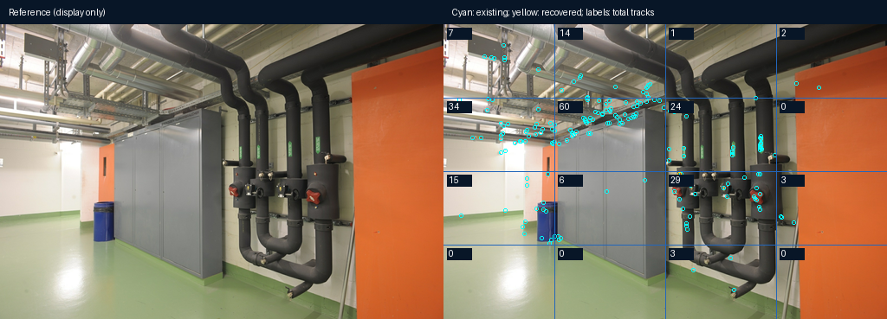
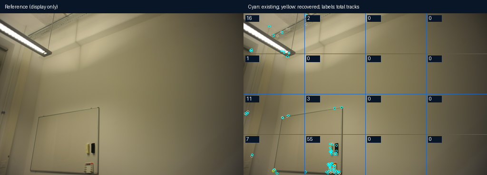
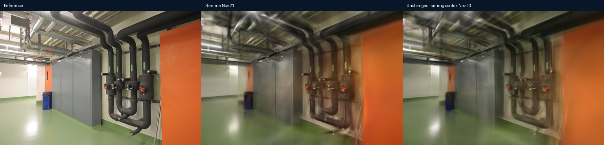
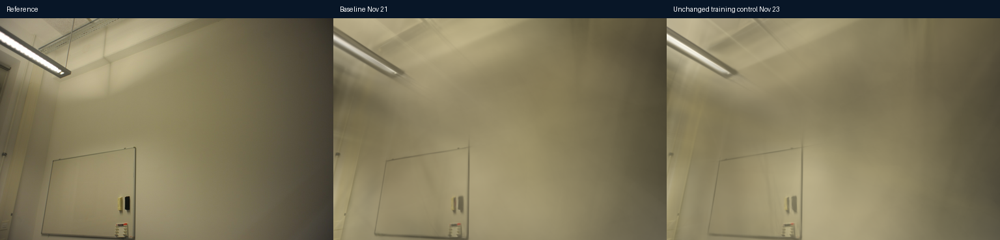
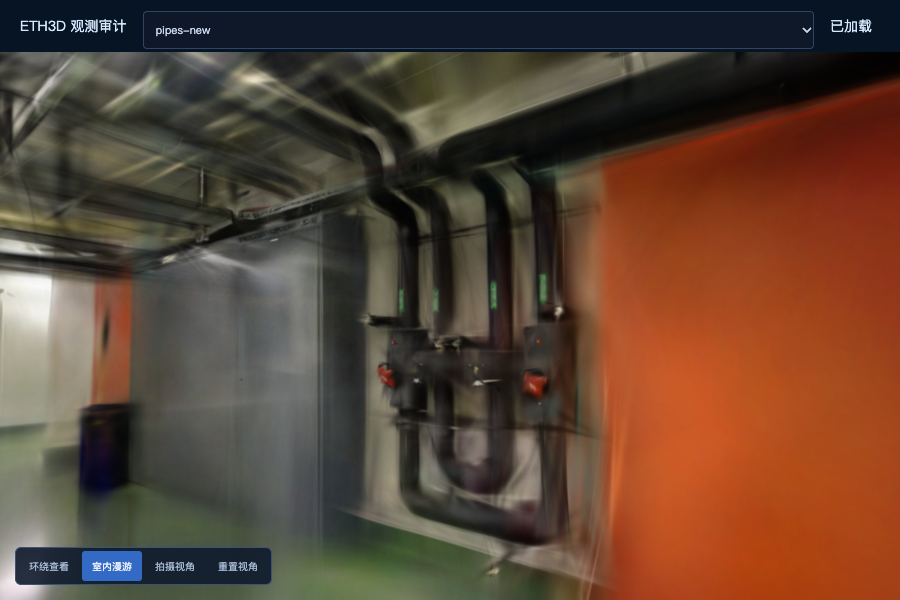
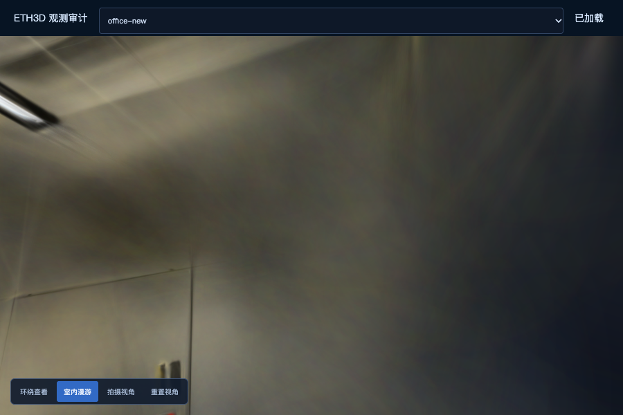

# 保留重复轨迹中的无歧义颜色观测

2026-11-23。颜色审计原先遇到一张照片关联多个特征，就排除整条三维轨迹。现在仅排除该照片组，继续检查其余照片的唯一观测。ETH3D pipes / office 分别恢复 19 / 76 条可用于颜色诊断的轨迹，仍然不采样留出颜色，不修改 SfM、Brush 初始化或训练。

基线代码：[8786fd3](https://github.com/sakorman/web-scan/commit/8786fd3)。此前[整条初始化删点实验](TRACK-FILTER.md)没有改善双场景画质，本轮只改离线审计粒度。采用新审计规则，不采用曝光补偿或初始化筛选。

## 依据与方法

[COLMAP 的近期观测管理实现](https://github.com/colmap/colmap/blob/137f21680c79d3f2fffbb1d11deb367162aa6f83/src/colmap/sfm/observation_manager.cc)在筛选重投影误差时区分删除某条观测与删除整个三维点。该文件最近提交为 2026-11-10，采用 BSD-3-Clause，由 Johannes L. Schönberger 等维护。本轮借鉴这种粒度区分，不调用其删除操作，也不将重复照片视为错误几何的证明。

Xinpeng Wang、Qinghai Jiang、Jia Chen、Zhiyu Song 的 [Geometry-Aware Initialization with Footprint-Calibrated Opacity for 3D Gaussian Splatting，2026-11-18](https://doi.org/10.3390/ai7110490)强调局部几何支撑与增密过程的作用。该论文使用 CUDA / gsplat，不能把其结果直接当作本机 Metal 的收益；本轮没有移植其初始化或不透明度方法。Arthur Brussee 的 [Brush v0.3.0](https://github.com/ArthurBrussee/brush/blob/v0.3.0/crates/brush-dataset/src/formats/colmap.rs)为 Apache-2.0，实际训练继续使用原发布二进制。

待验证假设是：同一轨迹在部分照片中存在重复关联，并不要求丢掉其余照片的全部颜色观测。先冻结旧脚本并记录基线，再运行以下规则，所有阈值保持原值：

1. 按照片 ID 分组；有两条或更多关联的组全部排除，不挑第一条、平均颜色或选择最小残差代表。
2. 剩余训练观测必须满足反向关联一致、位于相机前方、重投影残差不超过 2 px、可进行双线性采样；三维点平均误差须小于 4 px。
3. 至少两张不同训练照片通过后才纳入统计，每条轨迹对每对训练照片只贡献一次。
4. 留出照片只核对身份与几何位置，不解码其颜色用于统计。焦点留出照片若对同一点有多个特征，不计入该视角的覆盖图。
5. 保留 `--duplicate-policy reject-track` 复现旧规则，新默认 `exclude-image` 记录被排除的照片组和恢复轨迹的具体来源及残差。

残差与颜色均来自当前估计的 SfM，不是几何或曝光真值。较宽的三角化角也不保证正确对应；本轮角度只作说明，未新增角度阈值。照片仍参加过上游 SfM，属于纯 RGB 求姿后的训练留出诊断，没有使用数据集真值位姿、深度或雷达。

## 基线与新审计

旧规则在冻结脚本与新版显式 `reject-track` 下的已有字段、颜色统计及覆盖点完全一致。两组新重建复用相同 SfM 后，全部新旧策略的输入摘要、审计计数、逐对颜色、覆盖点及独立几何核验也与各自基线一致。

| 项目 | pipes | office |
| --- | ---: | ---: |
| 有重复照片关联的原始轨迹 | 21 | 88 |
| 排除的训练照片组 / 二维观测 | 23 / 46 | 104 / 211 |
| 恢复且至少有两个合格训练观测的轨迹 | 19 | 76 |
| 合格颜色轨迹：旧 → 新 | 1,546 → 1,565 | 1,962 → 2,038 |
| 已采样训练观测：旧 → 新 | 4,656 → 4,721 | 6,629 → 6,920 |
| 达到 20 条轨迹的照片对：旧 → 新 | 35 → 37 | 98 → 98 |
| 第 9 张焦点覆盖轨迹：旧 → 新 | 196 → 198 | 88 → 95 |
| 焦点照片中存在多特征关联的点 | 0 | 5 |
| 恢复轨迹最大三角化角的最小 / 中位 / 最大值 | 6.513° / 25.736° / 51.624° | 1.112° / 13.808° / 36.299° |

已采样观测计数包含最终未凑足两个来源的轨迹；它不能直接等同于参与照片对统计的样本总数。三角化角使用 pycolmap 3.13.0 的 `calculate_triangulation_angle`，仅在各恢复轨迹的合格训练照片之间计算，取每条轨迹的最大值，再汇总。独立读回用 COLMAP 的相机投影核验全部恢复观测，其最大残差为 pipes 1.93494 px、office 1.99987 px。

合格照片对的“绝对 RGB 差中位数再取中位数”从 pipes 0.14491 → 0.14926、office 0.06607 → 0.06580；统计照片对及样本组成发生变化，不能将差值解读成颜色改善。RGB 为编码值 / 255，不是线性辐射强度。

焦点覆盖图中青色为原有轨迹、黄色为恢复轨迹，数字是该区域总数；参考照片仅用于展示。office 新增样本仍集中在左侧，右半墙面继续为零，不能将左侧对应颜色外推为整墙曝光。





## 真实重建回归

训练与筛选规则无连接，本轮通过正常 API 队列分别新增一次 pipes、office 控制重建。GPU 串行运行，训练时没有浏览器渲染或另一项训练；之后再做测试、评分与浏览器检查。新任务分别为 `5d626cd8463d461596b69c7c07fdd4b8`、`cca441de3f4643d6a2e0773a27990f34`。基线分别为 `5e45df7c1bfa4af6ba342326ca2fe407`、`4533f0aa28a448bd9afb5983e6472de2`。

| 配置 | pipes | office |
| --- | --- | --- |
| 输入 / 已定位 / 未定位 | 14 / 14 / 0，无失败视角 | 26 / 26 / 0，无失败视角 |
| 训练 / 留出 | 12 / 2 | 22 / 4 |
| 留出序号，文件名排序从 0 开始 | 0、8 | 0、8、16、24 |
| 原图 / 去畸变尺寸 | 1600×1067 / 1600×1066 | 1600×1067 / 1600×1067 |
| 稀疏初始化点数 | 1,881 | 2,482 |
| 训练最长边 / 评分画幅 | 512 / 512×341 | 512 / 512×341 |

共同设置为 Apple M5、Metal、Brush 0.3.0、seed 42、3000 步、150000 高斯上限、SH3、每 100 步细化、2400 步结束增点、每 500 步导出。引擎 SHA256 为 `8380ed40cce870025393e1ea0257e0752351c67a409d827b76dc75ec3a999a71`。原始共享 RADIAL 相机 `[f,cx,cy,k1,k2]` 为 pipes `[906.091435630405,800,533.5,-0.10091385666317157,0.06728544184812109]`、office `[906.4381085295956,800,533.5,-0.10327691090226823,0.06959028672322837]`，训练使用对应去畸变 PINHOLE 相机；新旧内外参与照片摘要一致。

下表使用现有 `compare_quality.py` 的同相机、同参考照片评分，不混用 Brush 日志中的指标。

| 场景 / 任务 | PSNR dB | SSIM | 实际高斯 | 完整 PLY 字节 | SfM 缓存读取 s | 训练评估导出 s | 任务总计 s |
| --- | ---: | ---: | ---: | ---: | ---: | ---: | ---: |
| pipes 基线 11-21 | 18.8665 | 0.76346 | 11,633 | 2,746,938 | 0.0231 | 22.9193 | 22.99 |
| pipes 新控制 11-23 | 18.3149 | 0.75823 | 11,494 | 2,714,134 | 0.0335 | 22.6945 | 22.78 |
| office 基线 11-21 | 20.6186 | 0.87226 | 14,712 | 3,473,582 | 0.0467 | 23.4182 | 23.53 |
| office 新控制 11-23 | 21.6976 | 0.87385 | 14,318 | 3,380,598 | 0.0468 | 23.6221 | 23.73 |

新任务从 API 请求到观测完成分别为 23.376 / 24.355 秒，含队列与轮询等待；任务总计不含最初求姿或照片上传。SfM 列是缓存读取及准备时间，没有重做定位。各 Brush 进程新启动，系统与 Metal 缓存未清空，不作冷启动或提速对照。

pipes 新模型平均 PSNR −0.5516 dB、SSIM −0.00523；office 平均 +1.0790 dB、+0.00159，但 office 第 9 张仍为 −0.8641 dB、第 17 张 SSIM −0.01282。训练流程及输入没有改变，不能把增降归因于这个只读审计修正；同种子波动尚未解决，也不能据此宣称画质改善。留出照片参与过上游 SfM 和此前方法选择，这不是完全独立的端到端测试。

同视角图依次为参考、旧模型、新控制重建，各图像区域 512×341，标题不参与评分：





四份模型均在真实网页查看器中切到第 9 张拍摄视角并拖动漫游，无页面或 HTTP 错误。新 pipes 仍有管道重影、细支架模糊和漂浮的半透明条带；新 office 墙面仍有暗斑及细长残影。没有证明空洞或漂浮物减少，也没有使用几何真值评分。





## 验证、成本与复现

扩展集成回归，覆盖重复训练照片、重复留出特征、颜色符号、每对单次计数、轨迹顺序不变性与禁止解码留出颜色，另新增完全相同重复关联的测试。**349 项后端、18 项前端、类型检查、构建通过**；保留现有 TestClient 弃用提示与构建大包警告。四份完整 SH3 读回通过，49 次运行中健康及历史检查正常。

新审计对基线/新任务的耗时为 pipes 0.1643 / 0.1644 秒、office 0.2563 / 0.2549 秒，不含模块导入和最终 JSON 写出。旧策略约 0.170 / 0.261 秒，差距不作加速结论。额外保存恢复轨迹明细，并继续载入全部训练照片 RGB 数组，约 59 / 107 MiB；峰值内存未测，模型训练成本没有改变。

[冻结计划](benchmarks/track-observations-plan.json) · [完整结果、逐观测残差及逐视角评分](benchmarks/track-observations.json) · [独立几何核验](benchmarks/track-observations-geometry.py)。本地日志、旧脚本、审计中间结果与浏览器截图保存在 `.data/benchmarks/track-observations-20261123`，原始照片和历史模型均保留。

仓库根目录执行以下命令。首条仅审计已有任务；第二条会串行创建两次控制重建，输出文件须不存在；核验目录也须为新目录。无需重训即可分析已有 `runs.json`。

```sh
PYTHONPATH=. .venv/bin/python scripts/benchmark_track_color.py --job 5d626cd8463d461596b69c7c07fdd4b8 --duplicate-policy exclude-image --output .data/color-observations.json
PYTHONPATH=. .venv/bin/python docs/benchmarks/track-observations-run.py --output .data/track-observations-runs.json
PYTHONPATH=. .venv/bin/python docs/benchmarks/track-observations.py --runs .data/track-observations-runs.json --work-dir .data/track-observations-verify --output .data/track-observations.json
```

复现 11-21 的严格整轨迹排除，使用 `--duplicate-policy reject-track`；旧报告的复现脚本已显式固定此策略。两种策略的统计不能省略策略标签直接比较为收益。

下一步在更密集的实拍场景上核验弱纹理墙面的对应覆盖，再决定颜色不一致是否足以支持校正；本轮不把恢复样本数当作几何或曝光可靠度。

图像及衍生截图来自 Thomas Schöps 等的 [ETH3D](https://www.eth3d.net/datasets)，按 CC BY-NC-SA 4.0 保留署名；公开资料只用于方法参考，没有复制内部资料或第三方实现代码。
