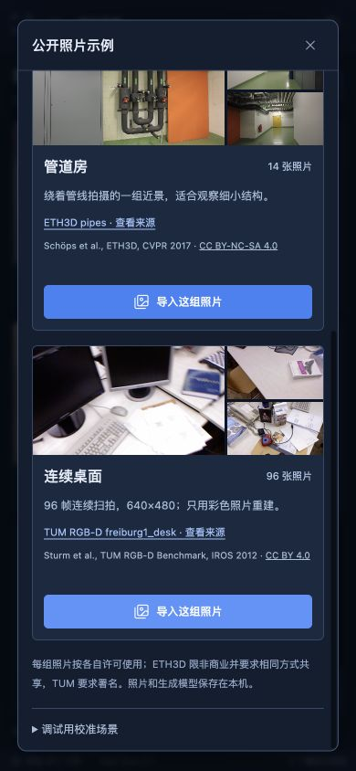
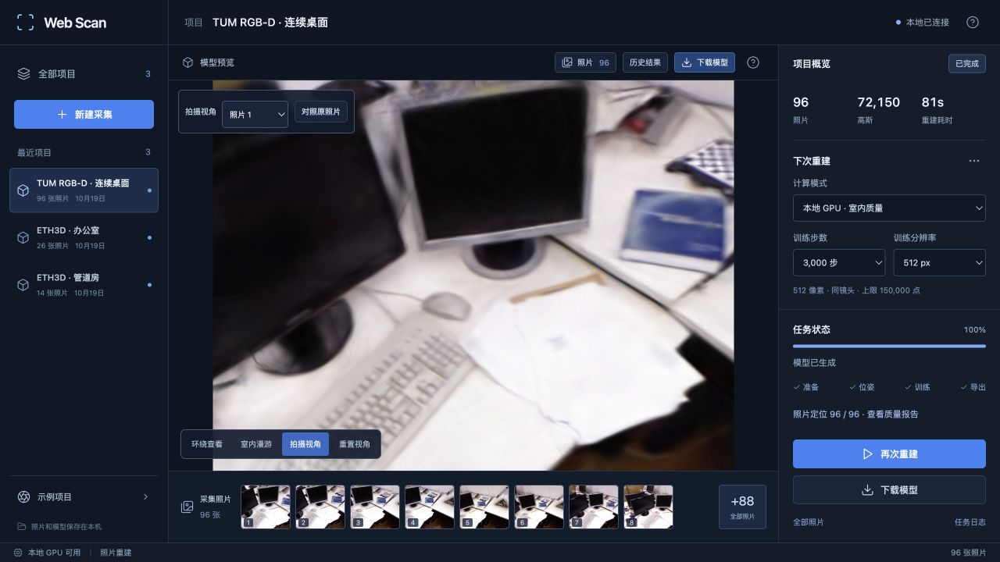

# 连续桌面照片示例

2026-10-19。新增 TUM RGB-D `freiburg1_desk` 的 96 帧彩色照片，用于检查连续扫拍下的定位和重建。它提供更密集的视角，但原始分辨率只有 640×480，不能靠增加帧数恢复不存在的纹理细节。

## 数据来源与处理

数据来自 [TUM RGB-D 官方下载页](https://cvg.cit.tum.de/data/datasets/rgbd-dataset/download#freiburg1_desk)，作者为 Jürgen Sturm、Nikolas Engelhard、Felix Endres、Wolfram Burgard 和 Daniel Cremers，IROS 2012。[官方许可说明](https://cvg.cit.tum.de/data/datasets/rgbd-dataset#license)为 CC BY 4.0。该许可与 ETH3D 的非商业、相同方式共享要求分别保留。

准备脚本按 RGB 文件名里的时间戳排序，在整个序列的帧索引上等间隔选取 96 帧，包含首尾。只读取彩色 PNG，不使用深度、原始标定、加速度计或真值位姿；重建由 COLMAP 重新求相机。图片保持原始尺寸，转换为 JPEG quality 95；导入接口沿用现有 JPEG quality 94 归一化。

官方归档含 613 张 RGB 照片，本次固定选取 96 张。本机准备耗时 1.69 秒，不含约 328 MiB 的网络下载。归档 SHA-256 为 `e983d6830916e66dc4a46a71368046b149b283de87769690e7aa4e0b9483530c`。

采样清单记录原始帧数、每张文件名及 SHA-256。脚本拒绝重复时间戳、异常路径、链接、图片尺寸不符和不完整输入，全部准备成功后才发布清单。示例导入前再次校验字节，失败时不把半成品当作可用数据。

## 使用

```bash
curl -L --fail --continue-at - \
  https://cvg.cit.tum.de/rgbd/dataset/freiburg1/rgbd_dataset_freiburg1_desk.tgz \
  -o /tmp/rgbd_dataset_freiburg1_desk.tgz
.venv/bin/python scripts/prepare_tum.py /tmp/rgbd_dataset_freiburg1_desk.tgz
```

归档约 328 MiB，包含深度等本工具不使用的文件。准备后重新打开“示例项目”，选择“连续桌面”。这组照片来自同一镜头，测试时在更多设置中选择“同镜头”；普通未知来源照片仍需根据采集情况选择。

ETH3D office / pipes 继续作为固定回归基准，TUM 用于扩展连续采集场景。三组数据的照片数、拍摄方式、纹理和分辨率不同，不能直接比较 PSNR 或耗时来宣称算法优化收益。

## 真实重建记录

Apple M5 / 32 GiB，Brush 0.3.0 / Metal，GPU 串行执行，训练时浏览器停留在项目列表。三组各新建独立采集、完整计算 SfM，没有复用相机缓存。表中时间来自实际 Worker，不含网络下载与归档准备。

| 场景 | 相机模式 | 输入 / 定位 | 训练 / 留出 | 步数 / 分辨率 / 高斯预算 | SfM | 训练与导出 | 总计 | 实际高斯 | PLY 字节 | PSNR / SSIM |
| --- | --- | --- | --- | --- | ---: | ---: | ---: | ---: | ---: | --- |
| ETH3D pipes | 自动 | 14 / 11 | 9 / 2 | 1000 / 512 / 50,000 | 6.30 s | 8.09 s | 14.45 s | 2,596 | 614,205 | 16.108 / 0.6585 |
| ETH3D office | 自动 | 26 / 26 | 22 / 4 | 1000 / 512 / 50,000 | 9.09 s | 8.09 s | 17.25 s | 4,006 | 946,965 | 19.098 / 0.7993 |
| TUM desk | 同镜头 | 96 / 96 | 84 / 12 | 3000 / 512 / 150,000 | 40.46 s | 40.27 s | 80.89 s | 72,150 | 17,028,950 | 22.873 / 0.8468 |

从导入到下载校验结束分别为 14.62、17.49 和 81.18 秒。TUM 与 office 没有未定位视角；pipes 本次第 4、13、14 张未定位，具体文件名在报告中。三次训练都通过完整 SH3、留出图片与下载字节校验。[完整任务报告](benchmarks/tum-desk-runs.json) · [归档及采样清单](benchmarks/tum-desk-inputs.json)

表中 PSNR / SSIM 来自 Brush 的 512 像素留出评测，评估照片参与过上游 SfM。只测了一次，三个场景也没有相同训练预算，不能把分数差异解释为新增示例提高了算法画质。

### pipes 定位波动

本轮 pipes 自动模式只定位 11/14，低于之前的 14/14。逐张核对后，归一化照片字节与此前完整定位的任务完全相同，SfM 代码也未改变。对同一个新任务的输入在独立目录重算一次 SfM，又得到 14/14，用时 7.41 秒。

这说明自动模式存在定位波动，本轮没有解决它，也没有用重试结果覆盖首次成绩。两次位姿不同，因此不拿各自的短训练分数做固定相机比较。[相同输入摘要与复算记录](benchmarks/tum-pipes-registration.json)。下一步可沿用这些输入检查初始化与相机约束稳定性。

## 页面与模型检查

示例面板逐组展示作者与许可，桌面使用三列。在 1280×720 下，面板内容与可视高度均为 576 px，主页面没有溢出。390×844 下使用单列，在面板内部滚动可到达第三组，主页面仍为 390×844。实际点击“导入这组照片”，得到 96 张就绪的采集，来源名称正确。




模型加载、拍摄视角、同画幅原照片切换、拖动漫游与下载面板均已在浏览器检查，控制台无错误。显示器、键盘和桌面可辨认，但小字和线缆仍模糊，移出拍摄轨迹可见拉丝和空洞，不能当作高精度完整空间扫描。



105 项后端、18 项前端测试、类型检查和生产构建通过。新增测试覆盖 RGB 选择、时间戳顺序、逐文件校验、导入后来源与许可，以及异常输入时保留旧示例。新的准备脚本只使用标准库和已有 Pillow，无新增依赖。

本次增加连续实拍基准和示例入口，训练参数保持原样。没有把深度或真值位姿流程混入纯照片成绩。实验数据保存在 `.data/benchmarks/tum-desk-20261019/`，原始归档与准备照片保存在 `.samples/`，不提交到 Git。

截图中 ETH3D 内容保留 CC BY-NC-SA 4.0，TUM 内容保留 CC BY 4.0；具体署名见 [第三方说明](../THIRD_PARTY_NOTICES.md)。
