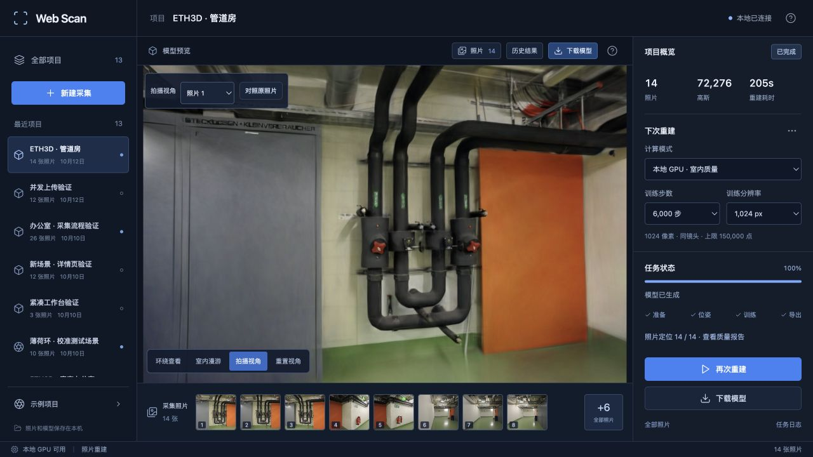

# 查看器按需绘制

2026-10-13，Apple M5 / 32 GiB / macOS，Spark 2.3.1、Three.js 0.180.0。

模型静止时，原查看器仍使用连续动画循环提交相同画面；切换到原照片对照后，照片后面的 WebGL 模型也继续绘制。新版本仅在相机、视口或模型数据变化时请求绘制。原照片覆盖画布、页面进入后台时暂停请求，恢复后重新绘制。

采用 [Spark 官方的按需绘制接口](https://sparkjs.dev/docs/on-demand-rendering/)：`onDirty` 通知异步排序和加载完成，应用把同一帧的多次通知合并。拖动和环绕阻尼继续更新到停止；显示层的排序回调不会反过来推动已经静止的相机。退出项目后取消待执行帧，迟到的回调不会恢复旧画布。

## 浏览器实测

同一 ETH3D pipes 模型，72,276 个高斯、相同拍摄视角与 1280×720 视口。临时开发页在渲染后记录 Three.js 的帧计数，正式代码不包含这项统计。以下统计的是绘制计数，不是 GPU 利用率或功耗。

| 状态 | 观察时长 | 绘制计数增长 |
| --- | ---: | ---: |
| 原版，模型静止 | 108.00 秒 | 10,319 |
| 原版，原照片覆盖模型 | 57.90 秒 | 5,683 |
| 新版，模型静止 | 75.10 秒 | 0 |
| 新版，原照片覆盖模型 | 105.44 秒 | 0 |
| 新版，环绕阻尼结束 | 48.64 秒 | 0 |

模型加载和排序收敛后才开始静止采样，因此 0 表示观察窗口内没有重复提交，不表示加载时不需要绘制。拖动后计数继续增长，停止后回到等待状态。不同窗口时长不能直接比较总帧数；原版两种状态的增长速率约为 95.6、98.2 次/秒。

固定视角的前后截图在相同模型区域逐像素比较，RGB 平均与最大绝对误差均为 0。该检查仅覆盖这份模型及当前视角，不证明任意模型在不同设备上完全一致。

## 重建回归

本次不修改重建器、训练参数或模型文件。为检查完整模型输出，串行重新训练两组公开照片，复用冻结的相机位姿，1000 步、512 像素、50,000 高斯预算、每 8 张留出一张评估：

| 场景 | 输入 / 定位 | 训练 / 评估 | 高斯数 | 训练与导出 | PSNR / SSIM |
| --- | --- | --- | ---: | ---: | --- |
| pipes | 14 / 14 | 12 / 2 | 3025 | 9.05 秒 | 18.267 / 0.7187 |
| office | 26 / 26 | 22 / 4 | 3961 | 8.03 秒 | 18.775 / 0.8069 |

这是小规模回归结果，不是查看器优化带来的训练提速或画质提升。计时不含 SfM 和输入复制；评估照片参与过上游 SfM。旧模型和全部照片保留。原始配置、文件校验值与报告见 [重建记录](benchmarks/viewer-training.json)。

## 验证范围

前端测试覆盖帧请求合并、排序回调、持续运动、暂停/恢复、退出后的迟到回调，以及浏览器原生动画 API 的调用约定。浏览器检查包括首帧加载、原照片切换、拍摄视角选择、拖动、环绕阻尼、重置和项目切换。真实手机功耗、系统休眠与 WebGL 上下文丢失后的恢复仍需实机覆盖。

原始记录：[绘制计数](benchmarks/viewer-rendering.json)、[截图区域比较](benchmarks/viewer-pixels.json)。数据和截图中的 ETH3D 内容遵循 [数据集许可](../THIRD_PARTY_NOTICES.md#test-dataset)。

复测绘制计数可在临时开发页的 `renderer.render(scene, camera)` 之后记录 `renderer.info.render.frame`，完成加载后按固定时间窗口采样。保持模型、相机、窗口尺寸及显示刷新率一致；统计代码仅用于观察，不包含在正式查看器中。
