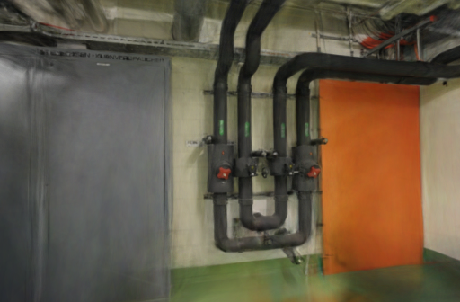
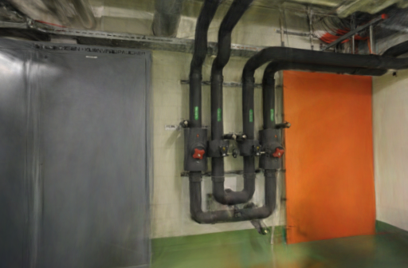
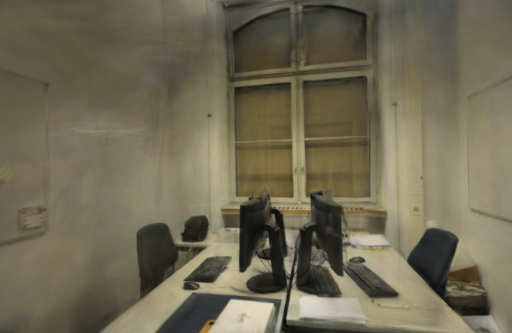
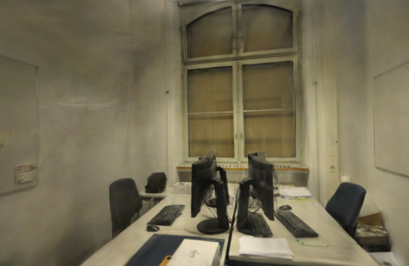

# 网页预览精度

2026-10-16。在固定模型与相机的六个留出视角中，提高中间缓冲精度后，网页渲染的 PSNR 和 SSIM 均有小幅改善。两组场景的平均 PSNR 分别提高约 0.45 dB 和 0.33 dB。已有模型刷新页面即可使用，下载文件与训练参数不变。

## 原因与改动

页面已经用扩展格式加载 PLY，但 Spark 的中间累加缓冲仍使用默认压缩格式。现在同时启用 `accumExtSplats`，减少渲染过程中再次量化位置、形状和颜色造成的误差。只改这一项，保留现有滤波、排序、SH3 和按需绘制行为。

[SparkRenderer 官方说明](https://sparkjs.dev/docs/spark-renderer/)将模型输入与中间累加缓冲分成独立配置；本轮核对并测试的是项目锁定的 Spark 2.3.1。扩展格式仍有量化，不能称为完全无损，也不会补出原照片未覆盖的几何。

## 固定模型对照

使用两份已有留出训练模型，文件 SHA-256、相机矩阵、画幅和评估照片均固定。pipes 为 300,000 个高斯，office 为 231,428 个高斯；两份均来自 10000 步 / 1024 像素、同镜头模式任务。训练/评估视图分别为 12/2 和 22/4，没有增加点数或重新训练来获得本表收益。

浏览器按真实相机投影渲染到 512 像素长边、设备像素比 1，背景与正式页面一致。PNG 直接从 WebGL 画布导出，不含界面覆盖，也没有截图 JPEG 压缩。参考图缩放到同一尺寸，按 RGB PSNR 和 11×11 Gaussian-window SSIM 评分，各视角等权平均。

| 场景 | 留出视角 | PSNR：原版 → 扩展缓冲 | SSIM：原版 → 扩展缓冲 |
| --- | ---: | ---: | ---: |
| pipes | 2 | 16.235 → 16.683 | 0.7150 → 0.7191 |
| office | 4 | 19.742 → 20.071 | 0.8372 → 0.8414 |

六个视角的两项指标均提高，幅度有限。评估照片参与过上游 SfM；这是同一模型的网页预览对照，不是训练算法成绩，也不能与 Brush 原生评测分数直接混用。[每视角分数、模型/相机/图片摘要](benchmarks/viewer-precision.json)

以下是相同相机、相同尺寸的原始画布输出。两列仅改变中间缓冲精度。

| 原版 | 扩展缓冲 |
| --- | --- |
|  |  |
|  |  |

## 未采用的滤波调整

同时检查了 Brush 的协方差滤波与 Spark 默认的透明度补偿，比较原版、仅调整滤波、仅提高缓冲精度、同时修改四种配置。此组探索统一使用黑色背景，与上面的正式背景评分分别保存。

仅将滤波改为 `preBlurAmount=0.3 / blurAmount=0` 时，pipes 平均 PSNR 16.018 → 15.950，office 19.335 → 19.294，SSIM 虽略有提高，像素误差没有改善。同时修改两项也未在所有指标上优于仅提高精度，因此最终保留原滤波。[四种配置的结果](benchmarks/viewer-filter-study.json)

假设依据来自 [Brush 0.3.0 的投影协方差](https://github.com/ArthurBrussee/brush/blob/v0.3.0/crates/brush-render/src/shaders/helpers.wgsl)与 [Spark 滤波选项](https://sparkjs.dev/docs/spark-renderer/)。渲染器在裁剪、量化、透明度和排序上仍有差异，参数名字对应不等于最终画面相同。

## 内存与适用范围

按当前实际分配的中间纹理尺寸和格式计算，静止拍摄视角下：

| 模型 | 原版容量 | 扩展容量 | 增加 |
| --- | ---: | ---: | ---: |
| pipes 300,000 点 | 6,021,120 B | 10,838,016 B | 4.59 MiB |
| office 231,428 点 | 4,669,440 B | 8,404,992 B | 3.56 MiB |

这只是该次静止相机下已创建的中间纹理容量估算，包含纹理填充，不是整机或驱动的 GPU 内存测量；移动时可能创建更多缓冲。未测得渲染帧率收益，也未验证真实手机的内存与帧率上限。改动的收益是预览精度，代价是额外中间存储。

## 重建与页面回归

另用两组公开照片建立独立采集，串行执行冷 SfM、1000 步 / 512 像素 / 5 万高斯预算的 Metal 训练，自动相机模式、每 8 张留出一张。训练期间关闭对照页，正式页面返回项目列表。

| 场景 | 输入 / 定位 | 训练 / 留出 | SfM | 训练与导出 | Worker 总计 | 高斯 | PLY | Brush PSNR / SSIM |
| --- | --- | --- | ---: | ---: | ---: | ---: | ---: | --- |
| pipes | 14 / 14 | 12 / 2 | 5.94 s | 7.06 s | 13.06 s | 2,940 | 695,389 B | 17.917 / 0.7099 |
| office | 26 / 26 | 22 / 4 | 8.68 s | 8.11 s | 16.86 s | 4,126 | 975,285 B | 19.995 / 0.8216 |

没有失败定位视角；从导入到转换与下载校验结束分别为 13.22 / 17.08 秒。PLY 和 splat 转换及下载内容字节一致，完整 SH3 校验通过。这两次是流程回归，不是提速对照，也未用于上面的预览评分。[完整配置与报告](benchmarks/viewer-precision-reconstruction.json)

99 项后端、18 项前端测试、TypeScript 与生产构建通过。正式页面重新加载后检查历史模型、拍摄视角和拖动漫游，未记录控制台错误；管道边缘仍有局部拉丝，离开采集轨迹仍可能暴露空洞。下一步继续核对更密集采集的覆盖，以及不同屏幕分辨率下的预览代价。

## 复现

后端保持 8787 端口运行，启动 `npm run dev`。将 [对照页面](benchmarks/viewer-comparison.html)复制到 `.qa/viewer-check.html`，访问 `http://127.0.0.1:5173/.qa/viewer-check.html`。页面使用本次记录的历史任务 ID；换用自己的留出任务时，同时修改 HTML 与评分脚本中的两个任务 ID。

对 pipes 的视角 0、8，office 的 0、8、16、24，分别选择 baseline / extended 并点击 Render，等 PNG 链接出现后保存。文件按 `pipes-0-baseline-app.png` 的格式命名；两组、六个视角共 12 张 PNG。正式背景为 `0x0b111c`，黑底探索需单独设为 `0x000000`，不要混合评分。

从仓库根目录运行：

```bash
.venv/bin/python docs/benchmarks/viewer-score.py /path/to/renders
```

脚本复用现有评分实现，核对尺寸并记录来源图、相机和模型摘要。全部原始对照图保存在本机 `.data/benchmarks/viewer-precision-20261016/renders`。

模型渲染和照片衍生结果遵循 [ETH3D 许可与署名](../THIRD_PARTY_NOTICES.md#test-dataset)。
